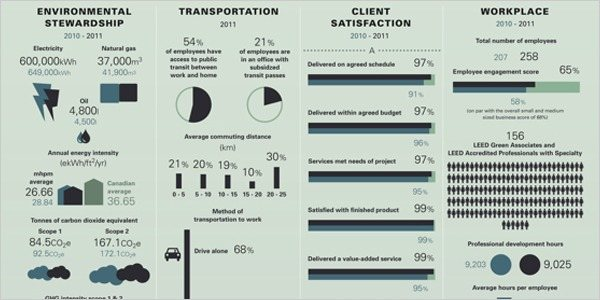
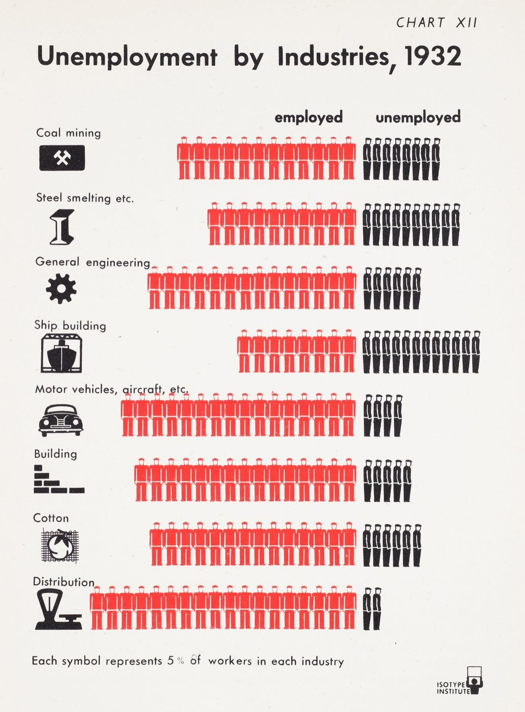

# 混合型信息图形 Mixed Charts

混合型把不同的统计图形、符号和文字组织成一次阅读。分组、标题与注释让读者知道正在比较什么，图形和符号说明怎样读出数量或识别对象。可先看整体想回答的问题，再判断每个模块承担的是比较、构成、定位还是解释。

## MX-01 环境、交通、客户满意度与工作场所

课件第 22 页「混合型信息图形」。课件片段保留了图中四个英文栏目标题和局部图例。

| 模块 | 原图可见的统计与编码 | 在叙事中的作用 |
| --- | --- | --- |
| 环境管理 | 电力、天然气和燃油分项列出数值，配闪电、方块与油滴等标记。 | 先辨认资源类别，再读相应单位下的指标或对照值。 |
| 交通方式 | 两张饼图分别标 54% 与 21%，配有各自的文字说明。通勤距离分段用柱高和百分比标注。 | 先区分问题与适用人群，再查看距离分布。两个饼图各自呈现一个比例。 |
| 客户满意度 | 「按约定进度交付」等项目用横条和百分比对照，同一行可看到两个值。 | 逐项比较同一指标的两条记录，再浏览其他项目。 |
| 工作场所 | 文本列出员工总数。横条显示参与度，人形阵列旁标注资格人数，圆形旁标出专业发展小时。 | 把人数、参与度和培训指标放在同一主题下，分别保留各自的单位。 |

**数据与叙事**　栏目按主题编组，组内再按问题选图。数字和短标签提供读数，图标帮助找对象。四栏可以独立阅读，组件的重复样式使页面保持连续。若按原图重建，先记录 `主题、指标、统计期、数值、单位、比较组、分母、符号含义`。图例未说明单个小人代表多少人的情况下，阵列旁的标注数字可用来读取人数。

## MX-02 1932 年各行业就业与失业图像统计

课件第 59 页。题名 *Unemployment by Industries, 1932*，图署名 ISOTYPE Institute。课件第 58–61 页说明 ISOTYPE 图像符号体系。

- 行业图标和行名标出类别。每行有就业与失业两组，人形以颜色区分，并以中间的分界作为共同参照。
- 图例明确标明**每个符号代表本行业工人的 5%**。同一行的总量是本行业工人，读者可横向读构成，也可纵向比较各行业的比例。
- 人形保持等大，由重复次数传达数量。若将百分比换算成新图中的图标数，按「百分比 ÷ 每枚符号代表的百分点」计算，并交代半枚或舍入的规则。总就业人数需要各行业的基数才可求出。

## 从案例提炼的制作原则

1. 确定全图的主题，并为每个栏目写出一个具体问题。为构成、数量对照与顺序变化分别选合适的图。
2. 同一指标的对比用共同标尺。不同问题先给出各自的单位和分母，再布置在统一版面内。
3. 同单位的 ISOTYPE 符号用相同尺寸重复，普通识别图标与计数图标各自说明用途。插图与强调色应帮助读者定位或理解数据。
4. 复核标题、图例、读数与注释的一致性。版面的层次参考课件第 43、54–55、69–71 页。

[编目型数据逻辑](../01-信息图形数据逻辑/03-编目型信息图形概念定义.md) · [案例目录](README.md)
