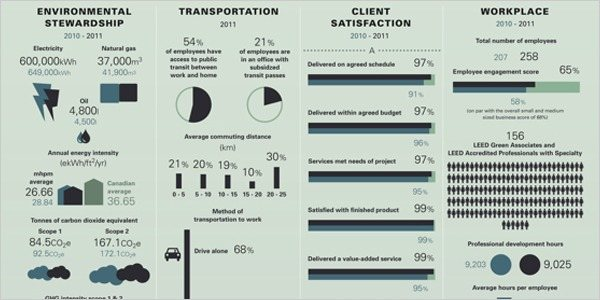

# MX-01 环境、交通、客户满意度与工作场所

课件第 22 页「混合型信息图形」。课件片段保留了图中四个英文栏目标题和局部图例。

| 模块 | 原图可见的统计与编码 | 在叙事中的作用 |
| --- | --- | --- |
| 环境管理 | 电力、天然气和燃油分项列出数值，配闪电、方块与油滴等标记。 | 先辨认资源类别，再读相应单位下的指标或对照值。 |
| 交通方式 | 两张饼图分别标 54% 与 21%，配有各自的文字说明。通勤距离分段用柱高和百分比标注。 | 先区分问题与适用人群，再查看距离分布。两个饼图各自呈现一个比例。 |
| 客户满意度 | 「按约定进度交付」等项目用横条和百分比对照，同一行可看到两个值。 | 逐项比较同一指标的两条记录，再浏览其他项目。 |
| 工作场所 | 文本列出员工总数。横条显示参与度，人形阵列旁标注资格人数，圆形旁标出专业发展小时。 | 把人数、参与度和培训指标放在同一主题下，分别保留各自的单位。 |

**数据与叙事**　栏目按主题编组，组内再按问题选图。数字和短标签提供读数，图标帮助找对象。四栏可以独立阅读，组件的重复样式使页面保持连续。若按原图重建，先记录 `主题、指标、统计期、数值、单位、比较组、分母、符号含义`。图例未说明单个小人代表多少人的情况下，阵列旁的标注数字可用来读取人数。

[返回本组案例](README.md)
