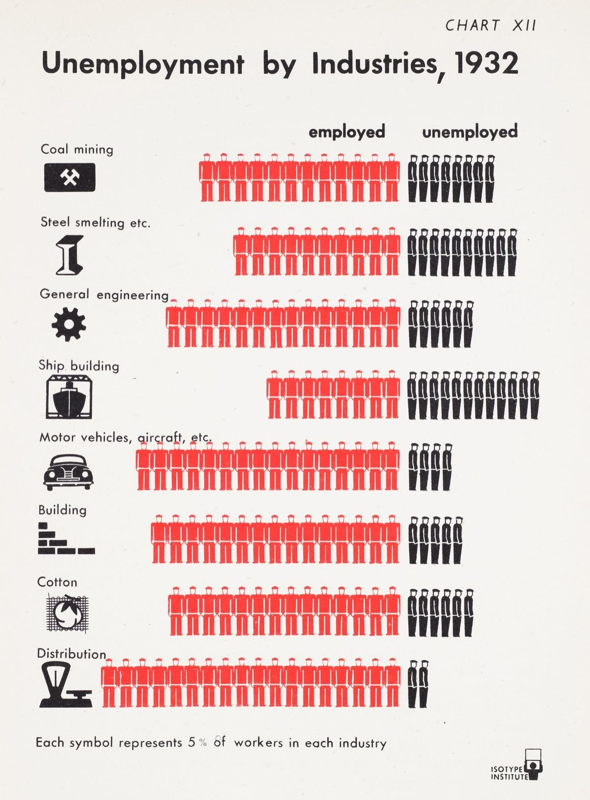

# MX-02 1932 年各行业就业与失业图像统计

课件第 59 页。题名 *Unemployment by Industries, 1932*，图署名 ISOTYPE Institute。课件第 58–61 页说明 ISOTYPE 图像符号体系。

- 行业图标和行名标出类别。每行有就业与失业两组，人形以颜色区分，并以中间的分界作为共同参照。
- 图例明确标明**每个符号代表本行业工人的 5%**。同一行的总量是本行业工人，读者可横向读构成，也可纵向比较各行业的比例。
- 人形保持等大，由重复次数传达数量。若将百分比换算成新图中的图标数，按「百分比 ÷ 每枚符号代表的百分点」计算，并交代半枚或舍入的规则。总就业人数需要各行业的基数才可求出。

[返回本组案例](README.md)
