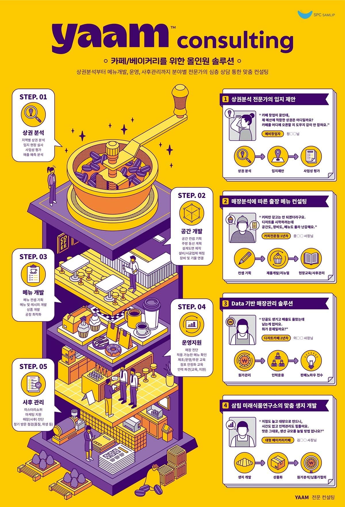

# 案例1｜咖啡店一站式咨询服务信息图

## 基本分类
- **常用信息图形种类**：混合型信息图形（Mixed Charts）。
- **五大数据架构逻辑**：**编目型为主**，右侧案例具有字母表型的并列、独立特征。
- **核心判断**：左侧“有序服务主干＋各阶段下属服务内容”，右侧“独立案例＋各案例的解决方案”。

## A｜基本的数据逻辑
**编目型（编年型主干＋层级型内容）**。

- **主干顺序**：左侧 STEP 01–05 按商圈分析、空间开发、菜单开发、运营支持、售后管理依次展开；这是业务阶段的先后次序，而非时间数值轴。
- **层级归属**：每个阶段含若干具体服务事项，形成“阶段 → 服务内容”的一对多结构。
- **局部并列**：右侧四个客户咨询案例各自完整，案例之间无必要的先后依赖，因此带有字母表型的独立单元特征。

## B｜统计图形、统计方式与计算方式
- **采用的图形**：分阶段流程示意＋分层等轴测场景图＋并列案例卡片。
- **借用的组织方式**：序号排序、分类归纳、一对多的内容归属、问题与方案对应。
- **统计与计算**：**没有实际统计图形或可识别的数值计算**；装饰性小柱形图标不等于柱状统计图。不要将场景插画的大小或层高当作数量编码。

## C｜视觉编码
- **点／节点**：圆形编号、圆形图标突出阶段和案例入口。
- **线**：箭头建立方案阅读顺序，细线与引导关系辅助识别内容。
- **面**：白色文本框和卡片承载分组内容，深紫色标题条区分模块。
- **体**：咖啡器具、门店、人物与产品使用等轴测立体插画表现业务场景；立体体积不代表数据量。
- **符号**：定位、菜单、清单等语义图标帮助识别具体服务。
- **色彩**：黄色主背景与重点标记、深紫色标题及轮廓、白色信息承载区，形成清晰对比与统一风格。
- **字体／版式**：大标题—阶段编号／卡片标题—正文三级信息层次；左侧围绕场景交错布置，右侧纵向等宽卡片排列。

## D｜数据／信息架构
- **整体主题**：咖啡店／烘焙店一站式咨询服务。
- **左侧主结构**：服务总览 → 5 个有序服务阶段 → 每阶段的若干具体服务事项。
- **右侧辅助结构**：4 个独立客户案例 → 各案例的客户需求／问题 → 对应解决方案。
- **两栏关系**：左侧回答“有哪些服务、按什么阶段展开”，右侧回答“面对具体需求如何应用服务”；并不是左侧五阶段与右侧四案例逐项对应。

## E｜视觉叙事架构
**总览主题 → 纵向说明服务流程 → 并列展示问题与解决方案**。

1. 顶部建立“一站式咨询服务”的主题认知。
2. 左侧自上而下引导读者了解从筹备、开发到运营及售后的服务全程。
3. 右侧通过“客户情境／问题 → 解决方案”的卡片，提供可独立阅读的应用实例。

**叙事特点**：左侧线性推进，右侧模块化补充；用具象经营场景帮助理解抽象服务内容。

## 归类理由
- **为什么是编目型（数据逻辑）？** 有序的阶段主干与各阶段的下属内容相结合，符合“编年型主干＋层级型内容”。
- **为什么是混合型（图形种类）？** 一张图内综合流程示意、等轴测场景和案例卡片等表现形式，而非只采用一种图形。
