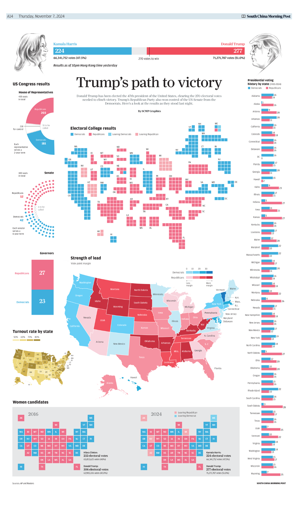

# 案例2｜特朗普的胜选之路（Trump’s path to victory）

> 来源与版面信息：South China Morning Post（南华早报），2024 年 11 月 7 日，A14 版。主题为 2024 年美国总统选举及相关国会、州长和历史投票数据。以下分类针对**信息图形的数据组织和表达方式**，不等同于对选举预测或政治立场的评价。

## 基本分类

- **常用信息图形种类**：**混合型信息图形（Mixed Charts）**。
- **五大数据架构逻辑**：**地理图型为主**；右侧州列表具局部字母表型并列特征，底部含年份对照。
- **核心判断**：围绕美国大选这一共同主题，组合多种具备不同统计功能的图形：上方票数对比、中部州级网格及地理地图、左右议席/历史投票图、底部跨年份对照。
- **关键区分**：混合型是**常用信息图形的表现形式**；地理图型是**五大基础数据逻辑**中的主要组织方式；“比较”是数据表达目的，不应因存在两党对照就直接判为独立的比较型主类。

## A｜基本的数据逻辑

**地理图型为主：地理单元（州）→ 属性绑定 → 分类与数量比较 → 空间格局判断。**

- **地理索引**：以美国各州为重复使用的分析单元，每州关联选举人票、胜选党派、领先幅度、投票率、历史胜选次数等不同指标。
- **空间关系**：中部领先优势地图和左下投票率地图保留州的位置与邻接关系，颜色映射的意义依附于地理区域，具有典型的地理图型逻辑。
- **多维属性**：单个州可同时具有党派类别、票数、比例、百分点差、年份等字段，允许对同一对象从多个角度作图。
- **局部非空间组织**：右侧将各州作为并列单元展示历史胜选次数，主要依靠州名标签与数量比较阅读；这一模块并不依赖空间位置，可视为局部字母表型。
- **跨期对照**：底部 2016 与 2024 两组单位方格图展示同一指标口径下的年度差异；有时间维度，但整版并非按不可逆时间序列推进的编年型。
- **基本性质**：地理位置固定、记录单元可独立比较、不同统计图共享相同地理对象、多维指标之间存在可检索的对应关系。

**抽象数据示意**：

| 州 ID | 州名 | 年份 | 胜选党派 | 选举人票 | 领先幅度（百分点） | 投票率 |
| --- | --- | --- | --- | ---: | ---: | ---: |
| CA | California | 2024 | 民主党 | … | … | … |
| TX | Texas | 2024 | 共和党 | … | … | … |
| … | … | … | … | … | … | … |

表格仅表示适合复用的数据结构，省略号不代表对原图数值的转录。

## B｜统计图形、统计方式与计算方式

| 图形所在位置 | 采用的统计图形 | 对应的统计任务与计算 |
| --- | --- | --- |
| 顶端候选人得票 | 对比条形图（含胜选门槛参考线） | 比较选举人票 224 与 277；270 为获胜门槛；并标注普选得票和得票率 |
| 左上众议院 | 半环／半圆环图 | 对席位按党派分类计数，观察构成及控制多数所需席位 |
| 左中参议院 | 议会点阵图（Parliament Chart） | 一个点编码一个席位，按党派累计数量并表现多数门槛 |
| 左中州长 | 堆叠条形图 | 按党派统计州长数量，比较总体构成 |
| 中上选举人票 | 州级单位方格图／网格式地图（Tile Cartogram） | 以小方格数量编码选举人票，以色彩区分政党；空间形状为示意，不等于真实地理面积 |
| 中央领先优势 | 分级设色地图（Choropleth Map） | 对各州计算两党得票率之差，按照领先方和差距分级设色 |
| 左下投票率 | 分级设色地图 | 计算各州投票人数在符合统计口径的人口中的占比，并映射为色阶；具体分母须以来源定义为准 |
| 右侧历史投票 | 左右对照水平条形图 | 统计 1900—2024 各州历次投给民主党／共和党的次数，分别以条长表示；属于双组对照，并非展示单次2024得票 |
| 底部女性候选人 | 2016 与 2024 并列单位方格图（Small Multiples） | 在相同党派色彩与州标记规则下，比较希拉里·克林顿与卡玛拉·哈里斯两届选举格局 |

**主要统计方式**：分类计数、总量汇总、比例计算、两组数量比较、百分点差、分级设色、跨年度同口径比较。

**与 RAWGraphs 的关系**：普通／堆叠条形图可借用 RAWGraphs 的 Bar Chart、Stacked Bar Chart 等基本统计表达。议会点阵、选举人票网格地图与分级设色地图属于专门化或定制化的地理／政治图形，**不能因为外观相似就强行认定为 RAWGraphs 原生图表**。

## C｜视觉编码

- **点**：参议院的重复圆点形成席位计数单元，点数代表席位数量；不是装饰性散点。
- **线**：条形长度编码票数与次数；地图行政边界区分州；门槛参考线与引导线帮助读取比较标准。
- **面**：州域色块显示党派和领先差距；矩形方格承载选举人票；半环区域呈现议席构成。
- **体**：未使用三维体积表达定量数据，避免透视导致数值误读；人物头像属于具象视觉辅助。
- **符号**：候选人肖像、州缩写、议席单元、图例和数值标签分别承担人物识别、地理索引、数量识别和数据释义。
- **色彩**：蓝色稳定指代民主党，红／粉红色稳定指代共和党；党派色阶深浅表示领先幅度，浅蓝／浅粉还用于标识“倾向”；投票率地图另用黄至棕的顺序色阶，避免误认为党派归属。
- **字体系统**：大号英文衬线标题建立报刊主标题层级，较小加粗小标题划分子图，再以州名、数值、注释建立阅读层级。
- **版式系统**：上方结果总览，中部中央大地图作为主视觉，左侧放席位与投票率，右侧窄栏放历史条形图，底部横排年代对照；形成“核心图—辅助图”的面积与密度差异。
- **辅助图像系统**：两位候选人的手绘肖像提升识别速度和版面叙事性，不直接编码数值。
- **图译／图例系统**：党派、领先程度、投票率等级、方格含义均通过颜色、标签和解释文字建立可读规则。

**核心编码规律**：色相辨认类别，色阶显示强弱，长度／数量显示规模，地理位置显示空间关系；同一语义尽量维持一致编码。

## D｜数据／信息架构

### 数据基础层
同一州级实体关联不同选举指标；除此之外还存在全国汇总数据、国会席位数据及跨年份历史数据。不同口径不可未经转换直接放在同一刻度比较。

### 信息组织层
1. **核心结果层**：标题 + 两位候选人的选举人票及普选得票对照，先说明胜者和结果。
2. **主证据层**：选举人团单位方格图与各州领先幅度地图，回答“各州如何贡献胜选、优势分布在哪”。
3. **政治格局层**：众议院、参议院、州长三类结果补充同一选举周期的党派力量分布。
4. **背景解释层**：各州投票率与 1900—2024 年历史胜选次数，补充不同维度的背景，不与2024总统得票混同。
5. **历史对照层**：2016 与 2024 年女性候选人图在相同视觉规则下并列比较。

**整体结构**：核心结论 → 州级证据 → 相关政治格局 → 历史与参与度补充。它是信息叙事上的分层，不意味着其基础数据逻辑自动变成五大类中的“层级型”。

## E｜视觉叙事架构

**结果先行 → 空间展开 → 优势解释 → 相关结果补充 → 历史对照。**

1. 读者首先由人物肖像、标题和顶端对比得知特朗普获胜，并理解 270 票胜选门槛。
2. 视线进入中央的州级方格图，追踪两党在各州获得的选举人票格局。
3. 再向下查看领先优势分级设色地图，区分“在哪些州胜出”和“领先程度有多大”。
4. 左侧席位与投票率图补充政治及参与背景，右侧历史条形图说明州级长期投票倾向。
5. 底部通过 2016 与 2024 的并列对照，为主叙事提供跨年度比较。

**叙事特征**：报刊式非单一路径阅读，中央视觉核心明确；辅助模块可独立读取又围绕同一主题交叉解释。

## 归类理由

- **为什么是地理图型（五大数据逻辑）？** 关键指标绑定到州级地理单元，中央领先幅度图和投票率图依靠位置与行政区域形状展示空间格局；空间组织为整版重要主干。右侧按州列出的历史条形图则具有局部并列属性，应保留这一异质性判断。
- **为什么是混合型（常用信息图形种类）？** 多种图形各有独立统计任务：条形图比较票数，半环／点阵图说明席位构成，地图展示地理差异，网格图呈现选举人票，跨期并列图呈现历史变化；它们在同一报刊版面中形成统一的选举结果解释。
- **为什么不直接叫单一地图型／比较型？** 版面并非只由地图构成；两党对照贯穿多个图形，但“比较”是常见表达目的，并不足以覆盖此案例的全部数据内容和混合表现形式。

**可迁移识别规则**：一个主题下存在多个承担不同统计任务的图形模块，且通过共同对象、统一色彩与主辅层级形成完整叙事，可判为混合型信息图形。若关键指标以位置和区域关系承载，五大数据逻辑可判为地理图型主导；但须逐模块注明非地理子结构。
