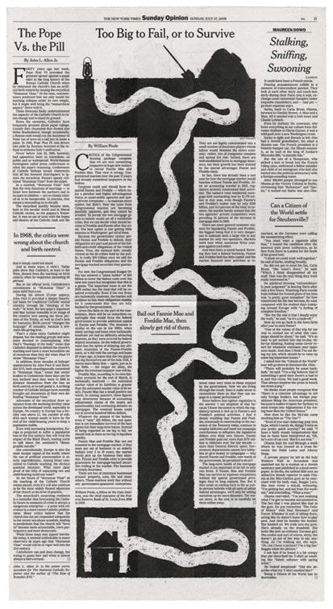
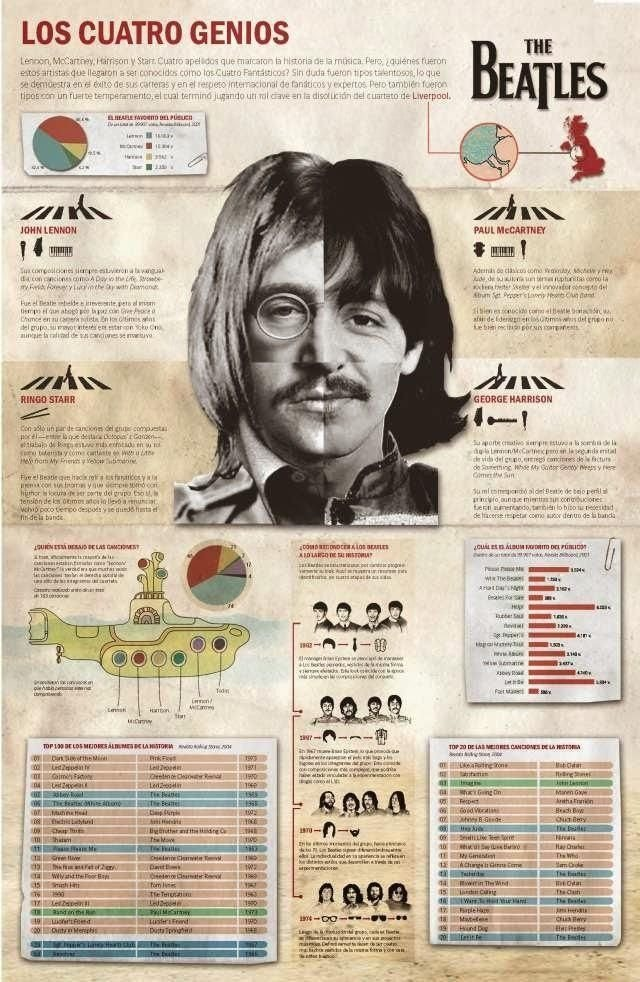

# 文字型与列表型信息图形 Informational / List Infographics

课件第 23 页把两种以文本为主要线索的作品放在一起。文字型作品可以围绕一篇文章组织主图和文本入口。列表型作品把多个条目排成可扫读的模块，允许读者跳读。局部可按内容加入统计图、地图或时间轴。

## IL-01 Too Big to Fail, or to Survive

课件第 23 页左图，报纸版头可见 *The New York Times Sunday Opinion*。

| 分析项 | 图中所见 |
| --- | --- |
| 信息单位 | 标题、栏内正文与插入的文字块。画面邻接其他文章时，可根据各自标题辨认版面边界。 |
| 统计图形 | 中间有贯穿版面的黑白曲线形插图，画面未显示供定量读数的刻度。 |
| 视觉编码 | 用标题字号、栏宽、黑白反差和嵌入的文字块形成主次。曲线提供连续的视觉形态。 |
| 阅读路径 | 先辨认顶部标题和中间大图，随后进入文本。长文依靠标题和栏列提供继续阅读的位置。 |

**提炼方法**　文字较密时，先划分标题、段落和插图的职责，并核对不同文本块之间的阅读关系。遇到形似路径的画面，确认线上是否真的连着有顺序的节点。

## IL-02 Los cuatro genios The Beatles

课件第 23 页右图。主画面为四位成员的专题，原图可见成员名及多个图表模块。

| 分析项 | 图中所见 |
| --- | --- |
| 数据架构 | 四位成员分别有姓名和说明。下部按主题排布时间片段、统计小图和列表。成员与专题模块都可成为独立入口。 |
| 统计图形 | 可辨认饼图、横条和表格，分别呈现图上所列指标的构成、大小与明细。复现时应按原图图例或原始数据确认数值和口径。 |
| 视觉编码 | 肖像形成视觉入口，成员名及周围短文负责索引。下方表格用色块、栏线和行对齐帮助查阅。 |
| 叙事路径 | 先识别乐队与四位成员，再选一个人物或专题深入阅读，最后回到图表或列表核查细节。 |

**提炼方法**　同类人物条目重复使用一套字段，例如 `姓名、角色、简介、图像来源`。题目、统计单位和来源保留在对应的图表模块。读者可在同一位置找到同类信息。

[编目型数据逻辑](../01-信息图形数据逻辑/03-编目型信息图形概念定义.md) · [案例目录](README.md)
