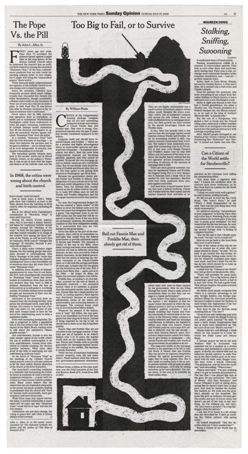

# IL-01 Too Big to Fail, or to Survive

课件第 23 页左图，报纸版头可见 *The New York Times Sunday Opinion*。

| 分析项 | 图中所见 |
| --- | --- |
| 信息单位 | 标题、栏内正文与插入的文字块。画面邻接其他文章时，可根据各自标题辨认版面边界。 |
| 统计图形 | 中间有贯穿版面的黑白曲线形插图，画面未显示供定量读数的刻度。 |
| 视觉编码 | 用标题字号、栏宽、黑白反差和嵌入的文字块形成主次。曲线提供连续的视觉形态。 |
| 阅读路径 | 先辨认顶部标题和中间大图，随后进入文本。长文依靠标题和栏列提供继续阅读的位置。 |

**提炼方法**　文字较密时，先划分标题、段落和插图的职责，并核对不同文本块之间的阅读关系。遇到形似路径的画面，确认线上是否真的连着有顺序的节点。

[返回本组案例](README.md)
