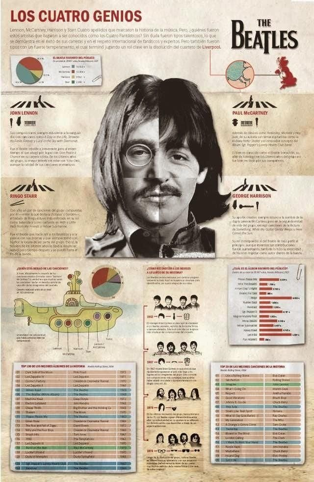

# IL-02 Los cuatro genios The Beatles

课件第 23 页右图。主画面为四位成员的专题，原图可见成员名及多个图表模块。

| 分析项 | 图中所见 |
| --- | --- |
| 数据架构 | 四位成员分别有姓名和说明。下部按主题排布时间片段、统计小图和列表。成员与专题模块都可成为独立入口。 |
| 统计图形 | 可辨认饼图、横条和表格，分别呈现图上所列指标的构成、大小与明细。复现时应按原图图例或原始数据确认数值和口径。 |
| 视觉编码 | 肖像形成视觉入口，成员名及周围短文负责索引。下方表格用色块、栏线和行对齐帮助查阅。 |
| 叙事路径 | 先识别乐队与四位成员，再选一个人物或专题深入阅读，最后回到图表或列表核查细节。 |

**提炼方法**　同类人物条目重复使用一套字段，例如 `姓名、角色、简介、图像来源`。题目、统计单位和来源保留在对应的图表模块。读者可在同一位置找到同类信息。

[返回本组案例](README.md)
