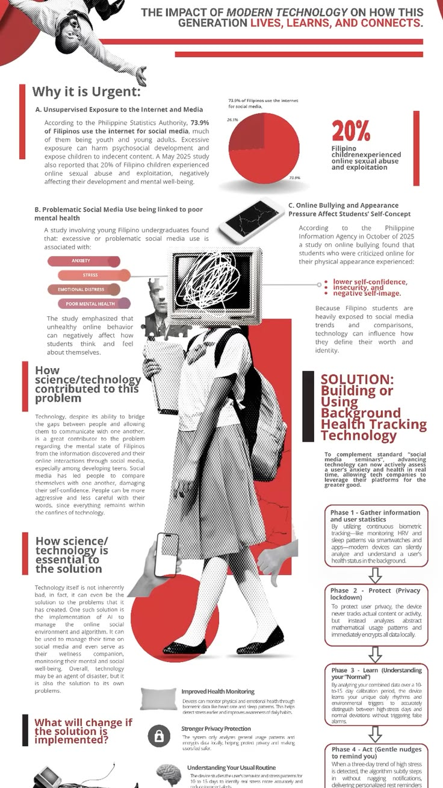

# 案例1｜现代技术对年轻一代的影响：文字型／列表型信息图形



> **常用信息图形种类**：02-文字型与列表型信息图形（Informational / List Infographics）  
> **五大数据架构逻辑**：**层级型为主**；右侧解决方案四个 Phase 属局部编年型顺序结构。  
> **主要图形形式**：饼图、百分比大数字、分类胶囊标签、阶段流程图、图文拼贴。  
> **资料说明**：依据用户提供的案例截图进行视觉与结构分析；图中研究数据仅作原图信息转录，未独立核实来源。截图底部部分内容不完整。

## 基本分类与判断依据

- **为什么是文字型／列表型？** 以标题、段落、分组条目和分阶段说明为主要信息载体；饼图、数字、图标、人物拼贴服务于文字解释，并非多个统计图共同主导内容。
- **为什么是层级型？** 总主题统辖多个一级模块；例如「Why it is Urgent」下分 A 网络与媒体暴露、B 社交媒体使用与心理健康、C 网络霸凌与外貌压力，各项又包含数据和解释；「Solution」下含四阶段及其说明。核心是「总主题→分类模块→子议题／阶段→对应证据及解释」的包含关系。
- **为什么不是编目型？** 本仓库定义的编目型需「编年型的不可逆主干＋层级内容」。本图多数模块是可以重排的专题说明，而非整版共同遵循的不可逆步骤链；右侧 Phase 1–4 仅是局部有序流程，不能改变整体主类。
- **视觉叙事顺序不等于数据顺序**：读者按「问题→原因→方案→预期效果」阅读，是编辑论证路线，并不意味着各专题本身存在严格的编年型依赖。

## A｜基本的数据逻辑

**核心：层级型——主题统领、分类分层、父子包含、同层并列、局部有序。**

| 特征 | 原图表现 | 结构含义 |
| --- | --- | --- |
| 总主题统辖 | “The Impact of Modern Technology…” | 各模块共同回答一个中心问题 |
| 模块分层 | 紧迫性、技术如何造成问题、技术解决价值、解决方案、预期变化 | 一级模块下展开二级内容 |
| 同层并列 | 紧迫性下 A／B／C 三种问题 | 子议题可分别理解、检索、比较 |
| 节点含多项属性 | 数据、解释文字、引用说明、图形 | 单一子议题不仅对应一个数值 |
| 局部严格顺序 | Phase 1→2→3→4 | 具体实施流程具有阶段依赖，不代表整版主干 |

**抽象规律**：`主题→模块→条目→证据／解释`。同层条目可以是并列分类；个别模块内部另有步骤顺序。

## B｜统计图形、统计方式与计算方式

| 原图位置 | 图形形式 | 统计方法／计算方式 | 备注 |
| --- | --- | --- | --- |
| 上方网络使用率 | **饼图（Pie Chart）** | 将总量划分为 73.9% 与 26.1%；占比＝部分数量÷总数量×100% | 扇形角度和面积传达比例；这两个百分数属于原图标注 |
| 上方右侧 | **大数字指标（KPI / Big Number）** | 单项 20% 比例直接标注 | 文字强调，不是另一种独立统计图表 |
| 中部心理健康问题 | **胶囊式分类标签** | 对焦虑、压力、情绪困扰等主题分类 | 没有相应刻度或数值，**不能当作定量条形图** |
| 右侧解决方案 | **流程图（Flowchart）** | 按 Phase 1—4 组织连续步骤和节点说明 | 主要编码过程关系，不涉及统计计算 |
| 下部效果说明 | **图标＋文字列表** | 对健康监测、隐私、行为规律理解等功能进行分类描述 | 不存在可比较的数值标尺 |

**主要统计方式**：比例统计、部分与整体比较；其余大部分属于分类整理、过程排序和解释性叙述。  
**RAWGraphs 使用提示**：此图的主要诉求是信息组织而非统一的统计图制作；不能把胶囊标签、流程图或装饰性红色色块强行对应为 RAWGraphs 的定量统计图。

## C｜视觉编码

| 要素 | 使用方式 | 作用／边界 |
| --- | --- | --- |
| **点** | 饼图圆心、圆形背景与局部节点 | 强调视觉焦点；装饰圆形不表示数量 |
| **线** | 红色横线和竖条、细引导线、向下箭头 | 划分段落与连接流程，箭头编码方向 |
| **面** | 饼图扇形、红色矩形与大面积底色 | 饼图扇形表达比例，其余背景面积主要为装饰 |
| **体** | 黑白人物、手机、电脑及半调网点拼贴 | 提供主题象征和画面纵深，不承担三维数据编码 |
| **符号** | 手机、锁、脑部图标与心理相关插画 | 迅速指向技术、隐私、认知等语义 |
| **色彩** | 红、白、黑与灰为主 | 红色形成警示感和视觉强调，黑白保持文字对比 |
| **字体** | 英文全大写主标题、粗体模块标题、大百分比、细小正文 | 形成「主题→小标题→重点数值→解释」的信息等级 |
| **版式** | 顶部主题、左右分栏、中央人物贯穿、右侧步骤纵列 | 通过图文交错组织高密度说明并引导视线 |
| **图像辅助** | 人物黑白半调剪贴与设备实物图 | 增强科技与青少年主题辨识，不直接编码统计值 |

**核心编码规律**：字号／字重表示信息重要性；模块位置与留白表示分组；红色色块表示强调；箭头表示局部顺序；只有标明比例的扇形具有定量面积含义。

## D｜数据／信息架构

### 信息层级结构

```text
现代技术对年轻一代的影响（总主题）
├─ 问题与紧迫性
│  ├─ A. 网络与媒体接触 → 73.9%等统计及解释
│  ├─ B. 社交媒体与心理健康 → 焦虑、压力等标签及解释
│  └─ C. 网络霸凌与自我认知 → 文字说明及影响列表
├─ 技术对问题的影响 → 解释性段落
├─ 技术为何也可能成为解决工具 → 解释性段落
├─ 解决方案：后台健康追踪
│  ├─ Phase 1 信息收集
│  ├─ Phase 2 隐私保护
│  ├─ Phase 3 理解个人规律
│  └─ Phase 4 温和提醒
└─ 预期改变
   ├─ 健康监测改善
   ├─ 隐私保护增强
   └─ 理解日常行为规律
```

**最小 Excel 节点表示例**（每行一个节点，按需另存数据证据）：

| 节点ID | 上级ID | 层级 | 节点名称 | 信息类型 | 排序／数值 |
| --- | --- | --- | --- | --- | --- |
| T | — | 0 | 现代技术的影响 | 总主题 | — |
| P | T | 1 | 问题与紧迫性 | 分类模块 | — |
| P-A | P | 2 | 网络与媒体接触 | 子议题 | 73.9%（原图标注） |
| P-B | P | 2 | 社交媒体与心理健康 | 子议题 | 分类标签 |
| P-C | P | 2 | 网络霸凌 | 子议题 | 解释文字 |
| S | T | 1 | 解决方案 | 分类模块 | — |
| S-1 | S | 2 | 信息收集 | 步骤 | Phase 1 |
| S-2 | S | 2 | 隐私保护 | 步骤 | Phase 2 |

**底层数据与表现分开**：节点表描述归属关系；数字可放在「节点ID、指标、取值、单位、来源」证据表；插画和色彩只是表现层属性，避免把版面层次误当作数值关系。

## E｜视觉叙事架构

**整体论述路线：主题提出 → 风险举证 → 问题解释 → 技术反思 → 方案与机制 → 预期作用。**

1. **入口**：顶部全大写标题建立议题，红色线条引出下方内容。
2. **风险举证**：左上正文与饼图／20%大数字并置，形成「观点＋数据」的组合。
3. **影响展开**：A、B、C 子议题以列表和短说明分组，中央人物拼贴作为情绪与主题焦点。
4. **观念转折**：左侧解释技术既可能带来问题，也可以参与解决问题。
5. **方案演示**：右侧“Solution”标题及四个 Phase 形成可依次向下阅读的流程。
6. **价值落点**：图标式短列表说明健康追踪、隐私与个人规律理解等预期益处。

**叙事与数据逻辑的区别**：这里的“先问题后方案”是推荐阅读顺序；数据主架构仍是主题包含分类模块，只有方案模块的四个阶段具有明确的步骤先后关系。

## 归类理由／可迁移判断方法

- **五大逻辑：层级型**。判断关键不是标题大或小，而是「每条信息归属于哪个模块，模块又归属于哪个主题」，可以用「节点ID＋上级ID」记录。
- **为什么不是编目型？** 不能只因叙事中有前后转折就认定有不可逆编年主干；整体多个议题没有必须按发生顺序推进的约束。
- **常用类型：文字型／列表型**。图像、饼图和流程图虽存在，但核心内容靠标题＋正文＋分组条目承载；去掉多数辅助图仍可读取主要论点。
- **不是混合型主类**。多种视觉素材不代表多种统计图共同主导；本例以知识说明为主，饼图只是局部证据。

**一句话总结**：这是一张**层级型信息架构＋文字／列表型呈现＋局部比例图与步骤流程**的信息图形。
