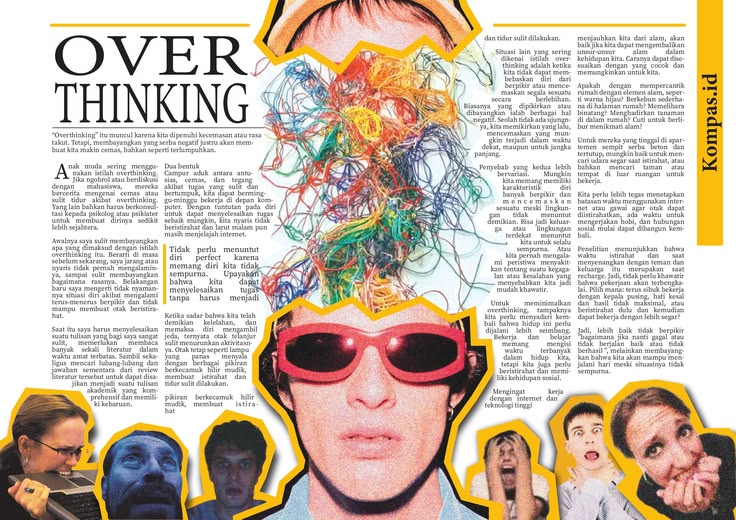

# 案例2｜Over Thinking（过度思考）：文字型／列表型信息图形



> **常用信息图形种类**：02-文字型与列表型信息图形（Informational / List Infographics），偏文字解释型。  
> **五大数据架构逻辑**：**层级型（语义层级）**。  
> **主要图形形式**：多栏正文、剪贴摄影、视觉隐喻插画、艺术化字体。  
> **资料说明**：依据用户提供的 Kompas.id 案例截图进行视觉及结构分析；原图具有报刊编辑设计属性，以下内容分类是对正文语义的抽象，并非原图中明确标注的分类层级。

## 基本分类与判断依据

- **为什么是文字型／列表型？** 核心信息依靠正文解释；图像辅助理解过度思考的概念。没有独立编号列表，故偏文字解释型而非典型列表型。
- **为什么是层级型？** 从过度思考这一主题展开定义、表现、影响及应对方式，每一方面包含解释与例子。该关系可抽象为语义上的主题包含子主题；仅有标题和正文大小差异并不能证明层级。由于原图未明确划分全部子模块，判定属于弱显式层级。
- **为什么不是编年型或编目型？** 解释顺序并非不可逆的真实阶段主干；各方面内容可独立讨论，原图没有贯穿全图的步骤序列。
- **为什么不是比较型或示意图型？** 没有多个独立主体及同维度视觉对照；大脑线团是隐喻而非对解剖结构或机制的精确示意。
- **典型性边界**：仍保留大量连续正文，结构化与快速浏览能力弱于典型信息图形，宜作为文字解释型与报刊编辑设计之间的边界案例。

## A｜基本的数据逻辑

**核心：层级型——主题统摄、语义从属、多维展开、同层并列。**

| 特征 | 原图表现 | 结构含义 |
| --- | --- | --- |
| 中心主题 | OVER THINKING | 内容共同解释过度思考 |
| 语义归属 | 概念、表现、影响、应对建议等 | 多方面内容从属于主题 |
| 同层并列 | 不同角度的解释 | 同层专题可调整展示次序 |
| 节点属性 | 文字解释、例子与相关图像 | 一个主题节点可含多项定性信息 |
| 方向性 | 总主题到具体解释 | 父子归属不可倒置；不等于阅读次序固定 |

**抽象规律**：`主题→子主题→解释／例子`。此处的语义层级属于分析归纳，不应把普通段落或字号层次直接视为明确的树状数据。

## B｜统计图形、统计方式与计算方式

**没有使用实际的统计图形，也没有可识别的统计计算或数值映射。**

| 表现形式 | 信息处理方式 | 备注 |
| --- | --- | --- |
| 多栏正文 | 主题解释、举例、归类 | 非量化文字信息 |
| 大脑与线团 | 视觉隐喻 | 线条数量、颜色不对应统计量 |
| 人物表情照片 | 情绪与行为的形象化辅助 | 人物数量不表示频数 |
| 标题、首字母、侧栏 | 信息强调与版面组织 | 非统计图形 |

**RAWGraphs 使用提示**：原图没有实际使用 RAWGraphs 统计图形；不能因线团形态而认定为网络图或因人物拼贴而认定为 ISOTYPE 数量图。

## C｜视觉编码

| 要素 | 使用方式 | 作用／边界 |
| --- | --- | --- |
| 点 | 彩色线团的局部交叉点与颗粒肌理 | 增强复杂感，不是统计节点 |
| 线 | 多色纠缠曲线、黄色粗描边、标题横线 | 隐喻思绪纠结，强化主体轮廓与区隔 |
| 面 | 白色背景、黄色侧栏、人物剪贴色面 | 组织留白与视觉强调 |
| 体 | 人物摄影的明暗和空间层次 | 提供真实感，并非三维数值编码 |
| 符号 | 大脑、红框眼镜、底部人物表情 | 将抽象心理主题转化为易辨认的视觉形象 |
| 色彩 | 黑白为基础、明黄为统一强调色，红蓝等局部对比 | 建立版面一致性与视觉焦点，不对应定量值 |
| 字体 | 超大英文衬线标题、小字号多栏正文、放大段落首字母 | 建立阅读层次与入口 |
| 版式 | 中央大幅人物及线团贯穿画面，两侧多栏文字绕图排列，底部照片形成连续视觉带 | 形成中心聚焦、图文穿插的编辑布局 |
| 图像辅助 | 摄影剪贴与手绘线条混合 | 以视觉隐喻辅助解释主题 |

**核心编码规律**：文字承载详细语义，图像承载主题隐喻，色彩和轮廓强化注意力；点、线、面、体的尺寸和数量没有定量含义。

## D｜数据／信息架构

### 信息层级结构（语义归纳示意）

```text
过度思考（总主题）
├─ 概念与解释 → 过度反复思考的含义
├─ 表现及相关情境 → 对事情持续担忧与反复思虑
├─ 影响 → 疲劳、注意力及睡眠等相关描述
└─ 应对与建议 → 休息、环境调整及平衡日常活动等说明
```

上述模块为根据正文主题作出的概括，而非原图明确设置的小标题。

**最小 Excel 节点表示例**

| 节点ID | 上级ID | 层级 | 节点名称 | 信息类型 |
| --- | --- | --- | --- | --- |
| T | — | 0 | 过度思考 | 总主题 |
| A | T | 1 | 概念 | 子主题 |
| B | T | 1 | 表现 | 子主题 |
| C | T | 1 | 影响 | 子主题 |
| D | T | 1 | 应对 | 子主题 |
| C1 | C | 2 | 疲劳与睡眠相关说明 | 解释文字 |

底层语义归属与版面的视觉层次分开记录；展示顺序另设字段，不作为父子关系的判断依据。

## E｜视觉叙事架构

**主题引入 → 隐喻吸引 → 多角度解释 → 建议与理解。**

1. **主题引入**：左上超大标题建立主题认知，黄色横线强化入口。
2. **视觉吸引**：中央人物头部的大脑线团把抽象的反复思虑形象化。
3. **正文展开**：文字从左侧多栏延展至右侧，解释概念、影响及相关情境。
4. **辅助表达**：底部不同人物表情及统一黄色轮廓形成情绪化的视觉补充。
5. **理解收束**：通过阅读正文了解相关应对建议；图像并不构成不可逆的过程链。

## 归类理由／可迁移判断方法

- **五大逻辑：层级型（语义层级）**。依据可归纳的主题与子主题关系，而非仅依据字号、排版分栏或图像位置。
- **常用类型：文字型／列表型，偏文字解释型**。全文主要依靠阅读文字理解，图像发挥隐喻与辅助作用。
- **边界**：原图仍是连续正文为主的报刊编辑设计，未充分形成可独立浏览的知识模块。保留其非典型性，不将其作为严格树状层级图或典型列表图。

**一句话总结**：这是一个以语义层级组织内容、以文字解释为主、以剪贴摄影和视觉隐喻辅助表达的报刊式信息图形边界案例。
