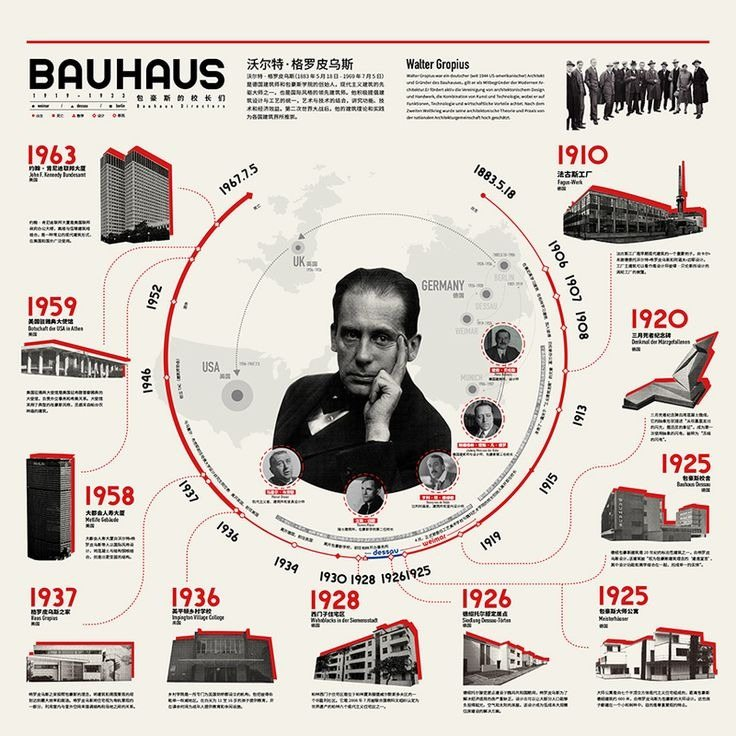
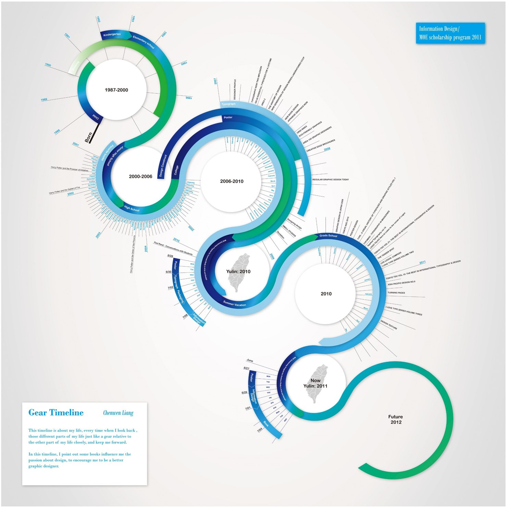
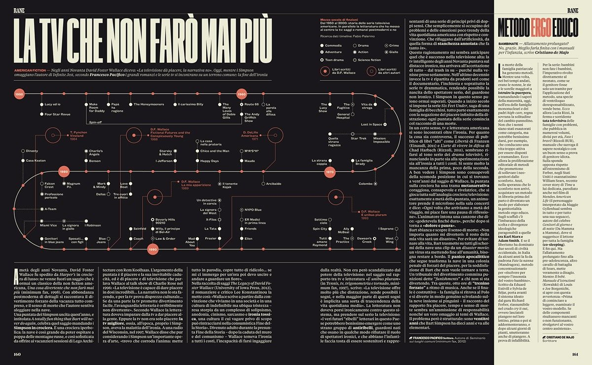

# 时间轴型信息图形 Timeline Infographics

时间轴型以日期、年份或时期标记事件，把这些记录布置成可追踪的主线。直线、折线、弧形都可以使用，页面应给出开端、方向及节点和注释的对应。课件第 24 页提供包豪斯范例，第 3、5 页展示其他曲线与折返形式。

## TL-01 包豪斯人物与建筑

课件第 24 页。图中可见 Walter Gropius 及建筑、人物和年份节点。

- **数据架构**　年份和建筑事件提供主要顺序，人物和地点构成补充信息。外围建筑卡片与轴上节点有连线对应。
- **统计与编码**　年份文本可用于比对事件先后，红色弧线串联主轴，点定位节点，虚线连到建筑图和说明。同年可包含多栋建筑或多条事件。要计算间隔，从年份值读取并求差。
- **叙事**　中心肖像交代人物主线，再沿年代浏览代表建筑。阅读时可从较早年份找到同一条连续路径。内侧的人物和地点信息可作第二层阅读。

## TL-02 Gear Timeline

课件第 3 页。标题可见 *Gear Timeline*。

- **数据架构与编码**　沿盘曲路径布置由早至晚的个人经历。圈内的年份或阶段标签形成导航，外围同色线带和引出标注承担细节。未来标记延续了阅读方向。
- **叙事**　先沿主线走一遍建立大致阶段，再从某一圈向外读注释。曲线把长顺序收进一页，同时要保留跨圈接续关系。
- **可复用方法**　阶段占多少版面可以由叙事需要决定。若视觉长度应代表实际年限，另给等比例刻度或写明按段变换尺度。

## TL-03 Francesco Muzzi 的折返布局

课件第 5 页，课件标注 Francesco Muzzi，图题 *La TV che non farò mai più*。

- **数据架构与编码**　黑底跨页中，折返路线依次连接多行，多处红色节点用作视觉锚点。较小的标记和短标签沿途排布。
- **叙事**　从路线的一端进入，在折返点切换行的阅读方向，章节点旁可读出注释。页面边缘的文字区提供补充内容。
- **可复用方法**　对折返排版，检查每一行末端是否能接到下一行。如果节点间隔按版面需要布置，用清楚的标签保留顺序和日期等原始信息。

## 时间轴复核

逐项检查 `事件 ID、开始日期或年份、结束日期或年份、说明、来源`，需要时增加并行轨道。同年事件共用日期，各自保留事件标识。将实际日期间隔与设计间距分开记录，编辑时检查图例与节点方向。

[编年型数据逻辑](../01-信息图形数据逻辑/01-编年型信息图形概念定义.md) · [案例目录](README.md)
