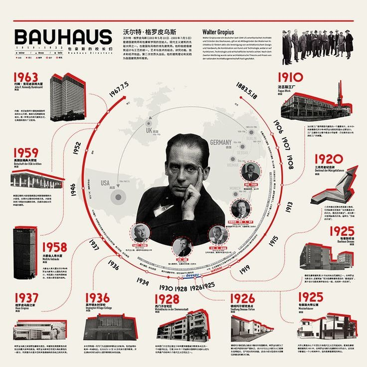

# TL-01 包豪斯人物与建筑

课件第 24 页。图中可见 Walter Gropius 及建筑、人物和年份节点。

- **数据架构**　年份和建筑事件提供主要顺序，人物和地点构成补充信息。外围建筑卡片与轴上节点有连线对应。
- **统计与编码**　年份文本可用于比对事件先后，红色弧线串联主轴，点定位节点，虚线连到建筑图和说明。同年可包含多栋建筑或多条事件。要计算间隔，从年份值读取并求差。
- **叙事**　中心肖像交代人物主线，再沿年代浏览代表建筑。阅读时可从较早年份找到同一条连续路径。内侧的人物和地点信息可作第二层阅读。

[返回本组案例](README.md)
