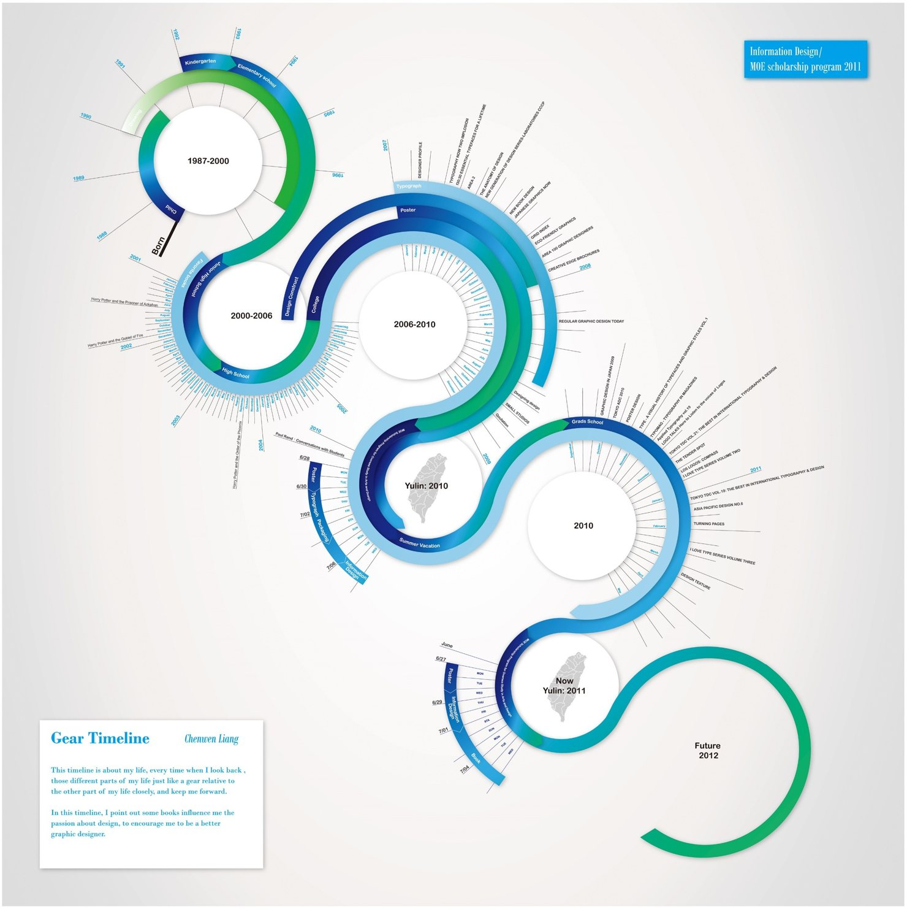

# TL-02 Gear Timeline

课件第 3 页。标题可见 *Gear Timeline*。

- **数据架构与编码**　沿盘曲路径布置由早至晚的个人经历。圈内的年份或阶段标签形成导航，外围同色线带和引出标注承担细节。未来标记延续了阅读方向。
- **叙事**　先沿主线走一遍建立大致阶段，再从某一圈向外读注释。曲线把长顺序收进一页，同时要保留跨圈接续关系。
- **可复用方法**　阶段占多少版面可以由叙事需要决定。若视觉长度应代表实际年限，另给等比例刻度或写明按段变换尺度。

[返回本组案例](README.md)
