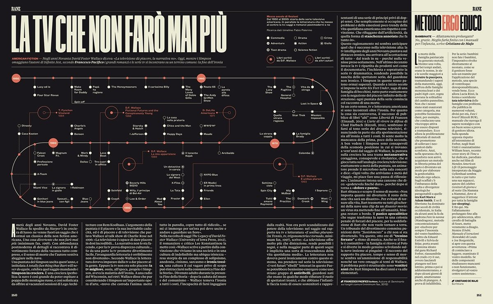

# TL-03 Francesco Muzzi 的折返布局

课件第 5 页，课件标注 Francesco Muzzi，图题 *La TV che non farò mai più*。

- **数据架构与编码**　黑底跨页中，折返路线依次连接多行，多处红色节点用作视觉锚点。较小的标记和短标签沿途排布。
- **叙事**　从路线的一端进入，在折返点切换行的阅读方向，主要节点旁可读出注释。页面边缘的文字区提供补充内容。
- **可复用方法**　对折返排版，检查每一行末端是否能接到下一行。如果节点间隔按版面需要布置，用清楚的标签保留顺序和日期等原始信息。

[返回本组案例](README.md)
