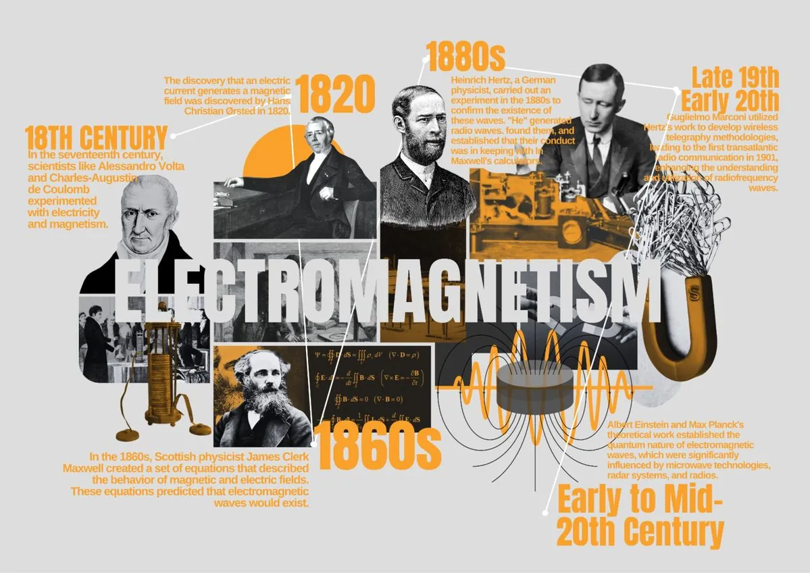

# 案例1｜电磁学发展史（Electromagnetism）

> **常用信息图形种类**：03-时间轴型信息图形（Timeline Infographics）  
> **五大数据架构逻辑**：**编年型**（Chronological）  
> **图形机制**：事件时间轴／阶段节点＋历史人物、科学公式及实验器材拼贴  
> **定量程度**：以定性历史事件为主，未建立等比例时间刻度或其他数值标尺

## 基本分类与判断依据

- **为什么是编年型？** 主干依次对应18世纪、1820年、1860年代、1880年代、19世纪末至20世纪初、20世纪前中期，事件的实际发生顺序不能任意颠倒；这是整张图最重要的数据关系。
- **为什么是时间轴型？** 不同年份／年代标记将历史人物、理论成果与技术发展连接到同一条历史演进叙事；信息以“何时发生、发生了什么”为主。
- **为什么不是编目型？** 事件旁的肖像、文字、设备与公式是**节点属性和辅助说明**，不是独立的“阶段 → 下级类别 → 子项目”父子分支；不能因为图文丰富就判为编目型。
- **为什么不是混合型主类？** 虽有图片、文字、符号和装饰性波形，但没有多个各自承担独立统计任务的图表共同构成主体；全图由单一历史时间轴组织。

## A｜基本的数据逻辑

**编年型：单向、不可逆、顺序排列；一条主序列对应多个事件属性。**

| 本质特征 | 本案例表现 |
| --- | --- |
| 单向性 | 由较早阶段向较晚阶段推进 |
| 不可逆性 | 交换关键历史节点会破坏史实先后关系 |
| 顺序性 | 年份、年代、世纪标签构成主要排序线索 |
| 单维主干 | 时间是唯一明确的主排序键 |
| 节点属性 | 每一阶段附人物、研究／技术成果、图像和说明 |
| 非层级性 | 未显示贯穿全图的多级父子分支关系 |
| 非等距性 | 版面节点间距没有严格按历史间隔成比例计算 |

**抽象数据规律：** `主题 → 有序事件序列 → 节点属性（人物／事件／描述／图片）`。这里的“→”描述阅读展开，并不代表节点属性是另一层级的数据节点。

## B｜统计图形、统计方式与计算方式

**主要图形形式：事件时间轴（Event Timeline），是顺序组织型图形，不是定量统计图。**

| 操作／形式 | 具体用法 | 是否有可验证计算 |
| --- | --- | --- |
| 时间排序（Sorting） | 按历史先后排列阶段与事件 | 用日期或顺序键比较，非数值汇总 |
| 分期分组（Grouping） | 18世纪、1820年、1860年代、1880年代、19世纪末至20世纪初等 | 基于年份／年代标签分组 |
| 事件匹配（Event Mapping） | 人物、成果与对应时期关联 | 事件 ID／顺序键关联属性 |
| 时间标注（Labeling） | 以大号橙色字突出关键年代 | 标签不代表数值大小 |
| 图像／公式拼贴 | 解释电磁学概念和历史材料 | 不承担数量或比例计算 |

**关键限制：** 年份之间的视觉距离**不是**按照实际年份差等比例绘制；人物像、磁铁和色块的面积也**没有**与事件重要性、发现数量等指标建立定量映射。

**与 RAWGraphs 的关系：** 没有必要强行匹配单一原生定量图表。可先使用事件顺序表整理数据，再定制时间轴节点、连线与图像版式；仅当有开始／结束时间和持续时长时，才适合借用甘特图或区间条的时长编码机制，不能反推原图是甘特图。

## C｜视觉编码

| 元素 | 画面使用方式 | 数据功能／视觉效果 |
| --- | --- | --- |
| **点** | 白色圆点与关键日期连接端点 | 标记事件位置、引导文字与图像对应 |
| **线** | 白色细引导线、磁场线、电磁波曲线 | 前者建立图文联系；后者主要作科学主题意象 |
| **面** | 黑白历史照片、矩形拼贴区、橙色底块 | 承载素材、区分模块，营造节奏 |
| **体** | 立体马蹄形磁铁和器材图像 | 具象展示科学对象；体积不编码数量 |
| **符号** | 电磁波、磁感线、数学公式、实验装置 | 将电磁学主题转换成识别符号 |
| **色彩** | 浅灰背景、黑白人物／器材、橙色年份与强调图形 | 以高对比突显年份和视觉重点 |
| **字体** | 中央巨型“ELECTROMAGNETISM”、大号橙色年代、小号说明文字 | 建立“主题 → 关键节点 → 解释文字”阅读优先级 |
| **版式** | 自由拼贴、错位排布、照片裁切与重叠 | 强化视觉冲击与历史资料感，但弱化严格线性轨道 |
| **图像** | 奥斯特、麦克斯韦、赫兹等人物肖像及设备图 | 帮助识别对应人物和历史成果，非统计量 |

**核心编码：** 年代标签＝顺序识别；图文连接＝节点属性对应；橙色＝强调；黑白照片＝历史感；波形／磁场符号＝主题象征。

**阅读性限制：** 1860年代的版面位置低于1880年代，历史次序主要靠显式日期辨别，不能将屏幕上“从上到下”的空间次序直接视作数据排序。

## D｜数据／信息架构

**总主题 → 有序历史阶段 → 各事件对应的属性集合。**

**原图可辨识的主要阶段：**

1. 18世纪：早期电学、磁学研究（包括伏打、库仑的相关研究）。
2. 1820年：奥斯特发现电流的磁效应。
3. 1860年代：麦克斯韦建立电磁场理论并预言电磁波。
4. 1880年代：赫兹通过实验研究、验证电磁波。
5. 19世纪末—20世纪初：无线电通信技术的发展，包含马可尼的相关工作。
6. 20世纪前中期：电磁理论与量子研究、无线电／雷达等应用发展。

> 以上是按原图进行的内容归纳，不等于完整电磁学史。图中“18TH CENTURY”标签下的英文正文出现“seventeenth century”等不一致之处，应按原图忠实记录，不把这种文字差异理解为新的时间节点。

**建议 Excel 基础字段：** `事件ID｜顺序键｜时间标签｜人物｜事件／成果｜说明｜图像文件｜来源`。

| 顺序键 | 时间标签 | 代表人物 | 事件／成果 | 关联图像 |
| ---: | --- | --- | --- | --- |
| 1 | 18世纪 | 伏打、库仑 | 早期电学及磁学研究 | 人物肖像 |
| 2 | 1820年 | 奥斯特 | 电流磁效应 | 肖像及实验相关图 |
| 3 | 1860年代 | 麦克斯韦 | 电磁理论和电磁波预言 | 肖像、公式 |
| 4 | 1880年代 | 赫兹 | 电磁波实验验证 | 肖像、实验设备 |
| 5 | 19世纪末—20世纪初 | 马可尼 | 无线电通信进展 | 肖像、通信相关图 |
| 6 | 20世纪前中期 | 爱因斯坦、普朗克（原图说明） | 相关理论及技术发展 | 电磁波、磁铁等主题图 |

**数据表结构：** 一个历史事件或阶段对应一行；人物、图片与文字为字段，必要时一段时期有多个事件便分为多行。此结构不依赖“父节点 ID”或“子类 ID”。

## E｜视觉叙事架构

**叙事模式：历史演进型／科学发现型。**

1. **主题引入**：中央大标题“ELECTROMAGNETISM”先确立整体概念。
2. **早期探索**：用早期科学家和研究照片交代电、磁现象的研究背景。
3. **重要发现**：以1820年为代表呈现电流与磁场联系的建立。
4. **理论建立**：用麦克斯韦肖像和公式表现科学理论的系统化。
5. **实验验证**：用赫兹肖像、器材呈现对电磁波存在的实验检验。
6. **技术应用与延伸**：从无线电通信扩展到现代电磁理论与技术应用。

**阅读路线：** 大标题吸引 → 橙色年代标记定位 → 查阅对应人物、器材和文字 → 还原历史演进。虽然排版不是一条严格直线，但历史先后仍构成主叙事的不可逆约束。

## 归类理由／可迁移判断方法

- **五大逻辑：编年型。** 关键判断是是否存在不可随意打乱的历史／步骤顺序。
- **17种类型：时间轴型。** 时间节点把事件和附属图文连到同一发展叙事。
- **不是编目型。** 多样的节点属性不能代替真正的下级类别与项目。
- **不是定量统计图。** 时间间隔、图片面积、字体大小均没有明确数值比例规则。

**一句话总结：** **编年型数据主干＋时间轴型视觉表现＋非等比例事件节点＋历史图像拼贴**，通过关键人物与事件呈现电磁学的发展过程。
