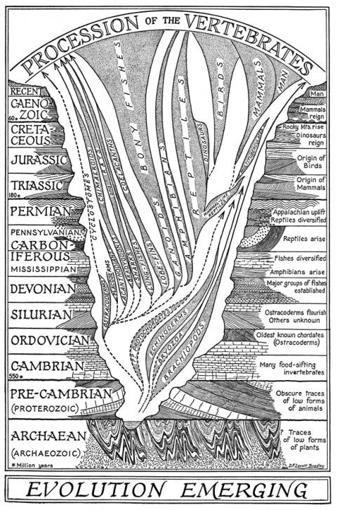

# DA-01 脊椎动物谱系

课件第 6 页，标注为威廉·金·格雷戈里（William King Gregory）两卷本《进化论的出现》的卷首插画。原图题名 *Procession of the Vertebrates*。

底部汇集较早的来源，向上形成多支谱系。左侧的地质时代标注提供另一条顺序线索。沿某条分支可读谱系归属，横向在相近高度对照可看同一阶段的不同支系。图里有年代基准，谱系线宽的数量含义需由图例确认。

[返回本组案例](README.md)
