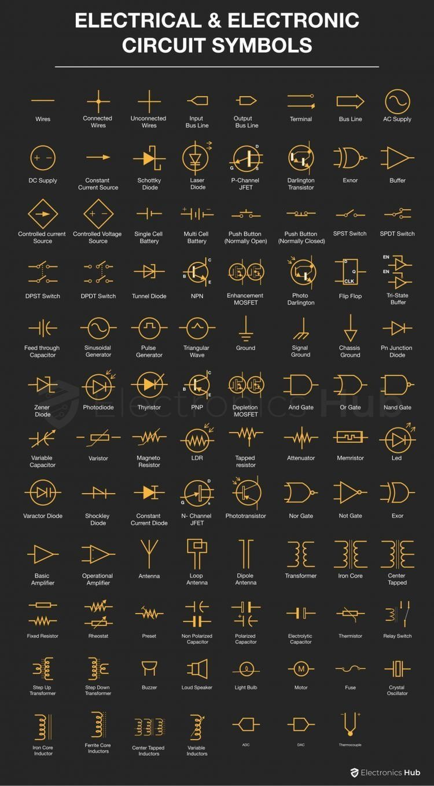

# DA-05 电子电路符号表

课件第 14 页右图，图题 *Electrical & Electronic Circuit Symbols*，原图底部署名 Electronics Hub。

每格由符号与英文名称构成。形状提供识别线索，网格和一致的符号位置帮助查找。可以按形状找名称，也可以从名称回查符号。图中未采用 A–Z 顺序，因此适合对照字母表型中的「索引」功能。

[返回本组案例](README.md)
