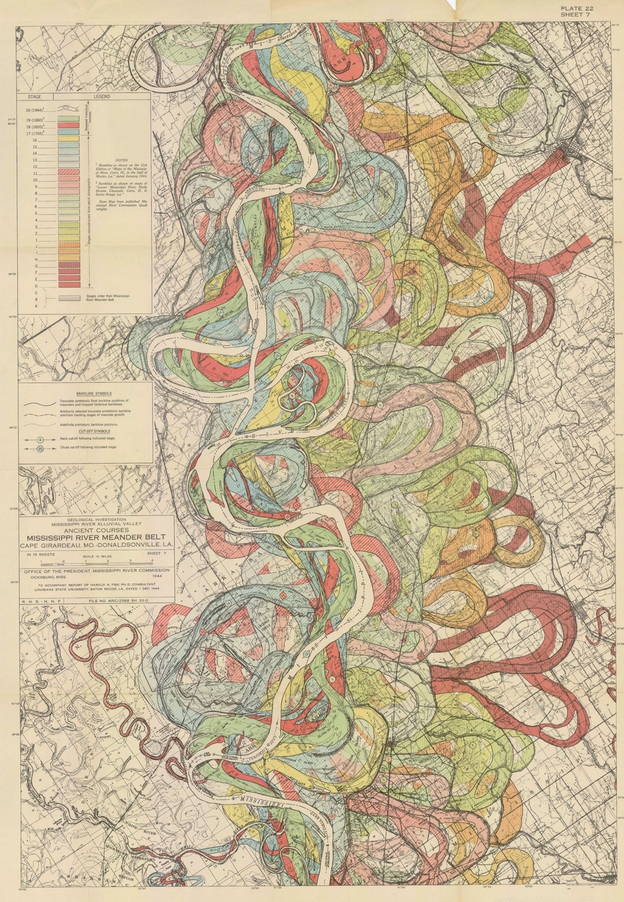

# DA-07 密西西比河历史河道

课件第 20 页左图，图上可见 *Ancient Courses, Mississippi River Meander Belt*。

多种颜色勾画河道曲流带，现有底图提供对照位置，图例说明颜色与类别的对应。读者先认清河谷范围，再在局部看不同河道怎样叠合。若要重建源数据，需分别记录河道标识、可核实的时期或组别，以及空间几何。

[返回本组案例](README.md)
