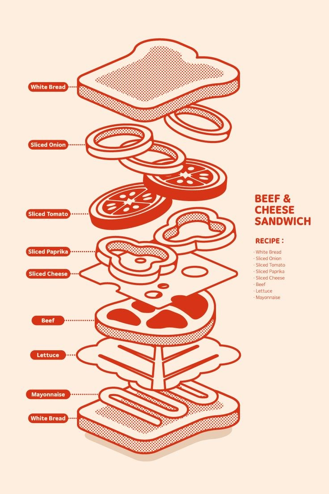

# HOW-01 牛肉芝士三明治

课件第 25 页。图题或图中标识 *Beef & Cheese Sandwich*。

## 数据与信息组织

面包、蔬菜、芝士与牛肉各是一条材料记录，按成品中的相对层次排列。右侧配料清单为快速复核入口。

## 图形与视觉编码

插画沿竖向拆开，使每层轮廓可见。左侧短标签用点状引线匹配切片、牛肉和调味料。

## 阅读路径与复用

先看整叠轮廓，再逐层找材料。复用时可为需要称量的配料另标重量与份数，图中的层间距服务于辨认。

[返回本组案例](README.md)
