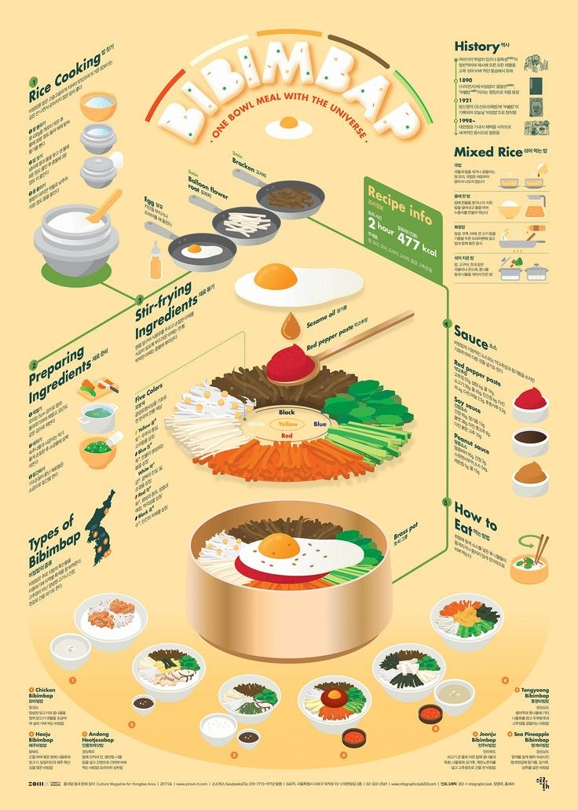

# HOW-02 韩式拌饭

课件第 25 页。图题或图中标识 *Bibimbap*。

## 数据与信息组织

图以成品为中心，周围组织米饭、食材处理、酱料、吃法和不同品类等模块。

## 图形与视觉编码

等轴插画表现锅、配料和碗，文字标题与小图标区分各模块，绿色引线帮助把说明连回主图。

## 阅读路径与复用

先看碗与配料的组合，再选择烹饪或调味模块。若用于逐步教学，可给需要顺序执行的操作增加编号。

[返回本组案例](README.md)
