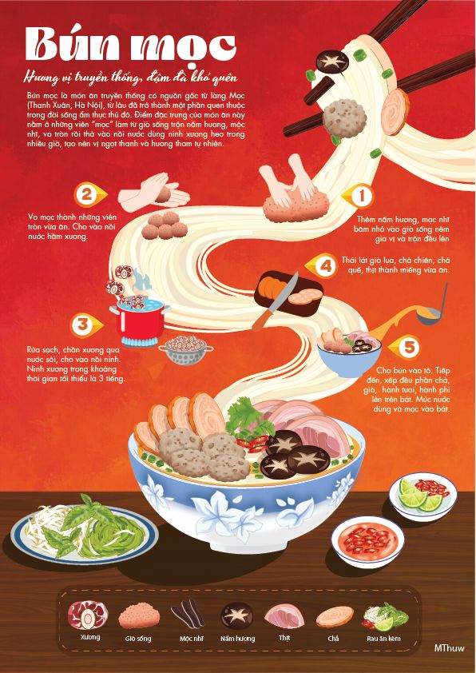

# 案例1分析｜越南肉丸米粉 Bún mọc：How-to 制作示意信息图



> **五大数据架构逻辑**：**编年型（Chronological）**，以五个编号的制作步骤组织单一主要操作序列。  
> **17种常用信息图形类型**：**04-示意图型（How-to Infographics）**，以图解具体操作为目的。  
> **图形与统计**：步骤序列示意图；有序分类、步骤计数与分段组织，无可验证的定量统计图。  
> **资料与判断边界**：依据用户上传的越南语菜谱海报原图及其17种类型笔记分析。操作步骤按原图编号概括，不代表精确时间间隔、烹饪用量或全部真实操作依赖。

## 基本分类与判断依据

- **为什么是编年型数据逻辑？** 五个步骤构成一条标明先后的操作序列；编号是结构性顺序键，互换节点会改变说明的步骤含义。编年型不必出现具体日期。
- **为什么是示意图型？** 主要传播目的是“如何做出一碗米粉”（How-to），每步通过食材、厨具、动作插画与简短指令示范操作；图像承担说明操作的方法，而非仅装饰信息节点。
- **为什么不优先归为流程图型？** 本图使用编号与连续视觉路径，具有流程表达特征；但并未着重描绘多个线程、条件判断、分支、合流或工序间复杂的依赖网络。**注意：流程图可以是单路径，不能把“必须多线程”当作所有流程图的硬条件。** 此例以具体动作示范作为主导任务，按仓库约定优先归为 How-to 示意图型。
- **为什么不是编目型？** 编号＋步骤文字／食材插画，只表示每个步骤的属性，**没有**明确的“有序主干节点→下级类别或独立子项目”的真实父子数据结构；底部食材图例是独立辅助模块，非五个步骤各自的层级子节点。
- **为什么不是时间轴型？** 图中有先后次序，却没有将日期、时长或间隔映射到可读刻度上；主目的是操作教学而非时间历程比较。

## A｜基本的数据逻辑

**底层规律：有序操作单元 → 阶段性动作 → 成品结果。** 采用**单主干、单维为主、有序、方向明确、具有部分操作依赖**的编年型数据结构。

| 数据特征 | 原图表现 | 结构含义 |
| --- | --- | --- |
| 顺序键 | 黄色圆形编号1—5 | 用离散序号固定阅读／讲解次序 |
| 单向主干 | 从备料、制作、处理到装碗 | 有共同目标的连续操作过程 |
| 单维为主 | 主索引只有“第几步” | 不依赖日期、数值刻度或地理位置 |
| 操作依赖 | 成丸、备汤、装碗等活动共同服务成品 | 整体教学顺序不能随意反读 |
| 局部可并行 | 某些食材处理与熬汤可并行 | **“不可逆”指主序列的说明次序，不声称所有动作在物理上只能严格串行** |
| 终点明确 | 大幅成品碗 | 结果指向一份完成的菜肴 |

**判断式**：若交换两个有序节点会使“先做什么、后做什么”被误读，顺序就是结构字段；只有编号而无先后意义的列表不自动等于编年型。

## B｜统计图形、统计方法与计算方式

**图形形式：步骤序列示意图（Step-by-step Instructional Diagram），不是传统定量统计图。**

| 画面要素 | 使用的组织／处理方式 | 是否代表统计数值 |
| --- | --- | --- |
| 编号1—5 | 将制作动作拆成5个类别，按序号排序；步骤总数为5 | 编号只编码次序，不是量值大小 |
| 各步骤插画 | 建立“编号—动作—对象—文字说明”对应关系 | 不表示频数、比例或平均值 |
| 连续米粉曲线 | 以主题形态形成非等距视觉引导与空间连接 | 曲线长短、粗细、弯曲度**不编码**持续时间／流量 |
| 底部食材图例 | 食材类别枚举与名称对应 | 没有数量刻度 |
| 成品碗 | 表现任务完成的结果 | 视觉面积大不等于统计总量 |

**统计处理／计算**：步骤计数 `N=5`、基于整数顺序键排列；原图没有对食材克重、时间分布或完成率等作定量映射。第3步文字涉及熬汤时长，但没有用长度或比例对时长进行可视化编码。

**RAWGraphs 对应**：无能直接、完整生成这种插画式 How-to 海报的标准统计图形；不应为满足“统计图”栏而强行归为折线图、桑基图、河流图或条形图。可先在表格里整理有序步骤，再用图形设计工具排布插画。

## C｜视觉编码

| 视觉编码要素 | 原图表现 | 数据功能／设计作用 |
| --- | --- | --- |
| **点** | 1—5黄色圆形标签 | 标识有序步骤节点；圆点大小不表示数量 |
| **线** | 米白色、连续折返的米粉带 | 视觉引导、联系分散步骤；不属于量值曲线 |
| **面** | 红橙底色、米粉浅色带、木纹底与深色食材栏 | 形成信息分区、强化主辅对比；不编码面积比例 |
| **体** | 成品碗、肉丸、锅具、食材明暗和遮挡 | 呈现食物立体感，不表示第三个数值变量 |
| **符号** | 菌菇、骨头、肉丸、刀具、筷子、碗等 | 直接指向操作对象与行为 |
| **色彩** | 红橙主背景、米白主体、黄色编号、蓝白成品碗 | 暖色营造食物氛围，蓝白形成主视觉对比；无连续数值色标 |
| **字体** | 大幅白色菜名、装饰性副标题、小号步骤正文、醒目阿拉伯数字 | 建立“主题→介绍→步骤→辅助信息”层级 |
| **版式** | 纵向海报，编号沿非规则米粉曲线散布；下方大幅成品 | 通过形态路径与视觉焦点引导阅读，实际次序仍以编号为准 |
| **图译与辅助图** | 具象插画替代大量操作描述，底部独立食材图例 | 降低理解门槛、帮助识别食材 |

**最有代表性的编码创新**：`米粉这一主题物 → 连续曲线式版面骨架 → 制作步骤的视觉串联`。主题元素同时承担形象表现和组织信息的功能。**视觉路径不等于严格流程箭头**，需结合编号确定正确顺序。

## D｜数据／信息架构

**总布局：主题介绍＋五个有序步骤＋成品展示＋独立食材图例。**

```text
主题层｜Bún mọc 菜名／文化背景／简短介绍
  ↓
步骤主干｜步骤1→步骤2→步骤3→步骤4→步骤5
          每个节点：序号＋操作对象＋操作文字＋图解插画
  ↓
结果层｜米粉成品大碗
辅助层｜底部食材名称与小图标的横向图例
```

**原图步骤内容概括（依据图中文字与插画）**：

| 步骤 | 操作概述 | 对应图像 |
| --- | --- | --- |
| 1 | 把切碎的香菇、木耳与生肉馅调味混合 | 筷子、菌菇与肉馅 |
| 2 | 把肉馅搓成适口肉丸并放入骨汤 | 手部成丸、肉丸 |
| 3 | 清洗／焯烫骨头并熬制骨汤 | 熬汤锅、骨头 |
| 4 | 切配火腿、肉片等配料 | 刀、砧板、肉类 |
| 5 | 将米粉与准备好的配料组合装碗 | 小碗与成品 |

*顺序完全按海报标注，真实备汤可提前进行；不据此推断唯一可行的厨房操作排程。*

**最小可复用 Excel 结构（5行×6列）：**

| step_id | seq | action | object | visual_asset | explanation |
| --- | ---: | --- | --- | --- | --- |
| S1 | 1 | 混合调味 | 菌菇与肉馅 | 混合插画 | 步骤1文字 |
| S2 | 2 | 搓丸入汤 | 肉馅与汤 | 搓丸插画 | 步骤2文字 |
| S3 | 3 | 熬骨汤 | 猪骨与水 | 锅具插画 | 步骤3文字 |
| S4 | 4 | 切配料 | 肉类配料 | 切菜插画 | 步骤4文字 |
| S5 | 5 | 组合装碗 | 米粉与配料 | 成品插画 | 步骤5文字 |

食材图例可另用同构小表 `ingredient_id｜ingredient_name｜image` 保存；这是**辅助分类索引**，不改变主序列的编年型性质。

## E｜视觉叙事架构

**叙事路线：认识菜品 → 观察操作 → 按编号学习制作 → 成品展示 → 食材识别。**

1. **主题引入**：左上大字“Bún mọc”和解释文字建立菜品身份与文化背景。
2. **操作拆解**：五个带编号的动作／食材场景，把抽象食谱拆成可识别的任务。
3. **路径引导**：长条米粉穿行于各步骤之间，制造连续的观看节奏；读者依编号阅读，并非按照曲线任意拐向。
4. **成果突出**：大幅蓝白成品碗占据下半部，成为视觉高潮，明确最终目标。
5. **信息补足**：底部横向食材图例方便辨认，属于补充浏览，不是步骤6。

**叙事特点**：教学式、具象图解、顺序主线、形态隐喻、成果导向；视觉注意力可以先被成品吸引，再回到编号步骤，**视觉浏览路线不改变底层数据的顺序键**。

## 可迁移判断规则

- **五大逻辑与17种类型必须分开判断**：底层是“步骤先后”，判编年型；表现目的是“教人怎么做”，判示意图型（How-to）。
- **有序不自动等于流程图**：流程图型强调流程节点、连接与流转关系，也允许单条路径；本例动作插画和教学指令占主导，故优先选示意图型。
- **有步骤不等于时间轴型**：需要辨别画面究竟重在时间历程还是具体方法教学。
- **“编号＋说明”不等于编目型**：只有存在实质的有序主干到下属类别／项目的父子结构，才满足本仓库的编目型组合定义。
- **路径／面积／图像大小与数值无映射时，不称为统计图**。

**一句话总结**：该海报以**编年型有序操作数据**为底层结构，使用**How-to 示意图型**的具象操作插画、编号和米粉曲线进行表达，形成“主题介绍→步骤教学→成品展示→食材补充”的叙事。
