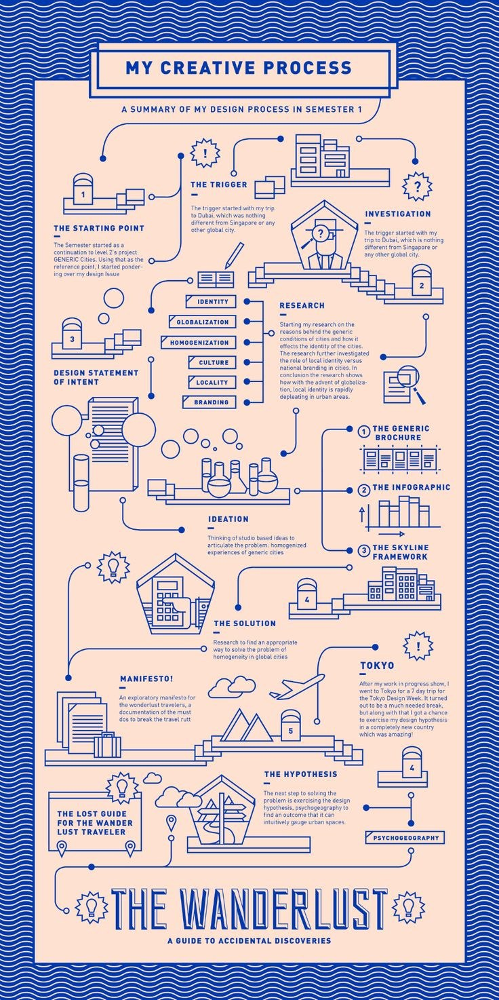

# PRC-01 我的创作流程

课件第 26 页。图题或图中标识 *My Creative Process*。

## 数据与信息组织

以起点、触发、调查、研究、构思和解决方案等阶段组织设计过程，局部从同一环节展开多项内容。

## 图形与视觉编码

蓝色线稿串起小场景、标题和圆点，横向支路收纳选项或参考方向，周边小字解释阶段内容。

## 阅读路径与复用

从上方起点进入，沿连续线追到方案与后续验证。重画时可用箭头或阶段编号补足拐角处的方向提示。

[返回本组案例](README.md)
