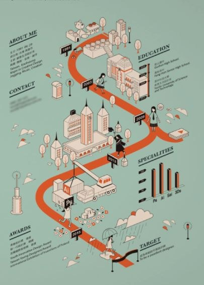

# PRC-02 个人经历路线图

课件第 26 页。图题或图中标识 *道路式履历*。

## 数据与信息组织

把个人经历、教育、专长、奖项和目标分别放在道路节点或路径附近，局部有专长的小柱图。

## 图形与视觉编码

橙色连续道路建立走向，路牌标识节点，建筑和人物帮助辨认阶段。

## 阅读路径与复用

沿路线扫读发展轨迹，再向两侧进入资料模块。其内容也可归入视觉简历，课件在此突出路径表现。

[返回本组案例](README.md)
