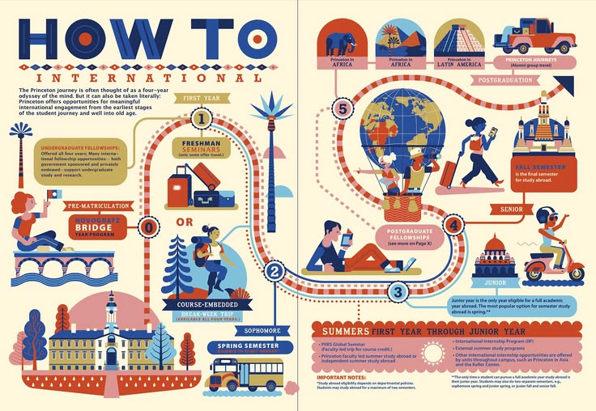

# 案例1分析｜HOW TO INTERNATIONAL：大学国际交流参与路径流程图



> **五大数据架构逻辑**：**编目型（编年主干＋层级内容）**，按0—5学习阶段建立有序主干，在各阶段归纳所属项目／活动及对应说明。  
> **17种常用信息图形类型**：**05-流程图型信息图形（Process Infographics）**，具体为阶段路径引导式流程图。  
> **统计与图形机制**：顺序编码、阶段分类、阶段—项目关系映射、节点—连线路径；无可验证的定量统计或时间等比例刻度。  
> **内容边界**：这是“在不同阶段有哪些国际交流选择”的参与路径指南，**不是**所有人必须按0—5逐项完成的工序，也不是带条件判断的算法流程图。

## 基本分类与判断依据

- **为什么优先归为流程图型？** 题名为“HOW TO INTERNATIONAL”，图的核心任务是引导学生沿学习阶段理解“怎样参与国际交流、何时有哪些机会”。贯穿两页的S形路线与六个数字节点直接承担阅读导航；项目标签和插画在不同节点展开。
- **为什么不是以时间轴型为主？** 图中确有“Pre-matriculation、First year、Sophomore、Junior、Senior、Postgraduation”等阶段，但没有以具体年份、日期或时长刻度衡量事件间隔；重点不是回顾历史发生了什么，而是说明面向未来的参与路径。**出现年级和先后顺序，不自动等于时间轴型。**
- **为什么不归为示意图型？** 插画是参与场景与项目含义的识别符号，并未逐幅示范如何完成某个实际动作；跨页的阶段路线才是核心组织结构。
- **为什么不是混合型主类？** 虽然组合地图插画、人物、建筑、项目文字和路线，但没有多种彼此独立、承担不同统计任务的图表作为并列主体。视觉元素的多样性不等于统计图表混合型。
- **为什么在本仓库五大逻辑中归为编目型？** 阶段0—5是有序主干，而同一阶段可包含不同项目／课程／交流机会等**独立的下级选项**（如第一年研讨课程与嵌入式短期旅行课程；毕业后项目包含多个不同方向）；阶段与项目形成明确的归属关系。这比仅在时间节点旁贴一张图和一段说明更接近“有序主干＋下级项目”的组合结构。
- **判断边界**：只看0—5的顺序，可抽取出**编年型子结构**；只有确认“阶段→多个独立项目选项”的归属关系，才进一步判作**编目型整体结构**。单个项目的图片、描写文字只是属性，不能另算下级项目。

## A｜基本的数据逻辑

**主导逻辑：编目型（编年型主干＋层级型内容）。** 底层可抽象为：`有序学习阶段 → 阶段对应的可选交流项目 → 项目说明／条件`。

| 数据特征 | 本案例表现 | 核心含义 |
| --- | --- | --- |
| **单向与顺序** | 圆形节点0→1→2→3→4→5 | 明确入学前、各学年、毕业后的阶段先后 |
| **不可随意逆序** | 学年顺序由学习进程决定 | 不可把毕业后放到新生阶段之前作为主叙事 |
| **单主干** | 一条贯穿双页的连续曲线路线 | 以学习阶段为主要组织索引 |
| **一对多归属** | 第一年的不同课程选项、毕业后的不同项目等 | 同一阶段对应多个独立项目／机会 |
| **局部层级** | 阶段→项目／活动→项目备注与条件 | 子项目从属于阶段，备注属于项目属性 |
| **跨阶段专题** | “SUMMERS FIRST YEAR THROUGH JUNIOR YEAR” | 部分选项适用多个年级，不能机械归给单一年级 |
| **非强制顺序** | 各阶段展示机会而非必修动作 | 学年顺序固定；具体项目无需人人依次参加 |

**本质规律**：用一个有序的“阶段索引”承载多个可分类的信息单元；主线回答“走到哪个阶段”，项目单元回答“此时有哪些选择”。

## B｜统计图形、统计方法与计算方式

**主要借用“路径式节点—连线图”（route-like node-link diagram）来表现流程阶段。** 这张图不是折线统计图、桑基图或任何以数值大小编码的标准统计图。

| 画面形式 | 借用的组织／统计方式 | 是否代表定量数值 |
| --- | --- | --- |
| 0—5圆形数字节点 | **顺序编码**：依阶段先后生成离散序号 | 数字标识次序，不表示参与人数或项目数量 |
| S形连续曲线路径 | **节点—连线关系**：按顺序连接阶段 | 曲线长度、转折次数、线宽不代表时长、流量或规模 |
| “Freshman Seminars”“Course-embedded Break-week Trips”等 | **按阶段分组／分类**：项目归属于适用阶段 | 不直接表现项目数量统计 |
| “Postgraduation”上方不同项目名称 | **类别枚举／阶段—项目映射** | 不代表各类别占比大小 |
| 暑期跨学年专题 | **适用范围映射**：同一专题关联多个年级 | 不是按长度精确表示持续时间的甘特条 |
| 人物、行李、汽车、建筑、地球等 | **语义符号映射**：图像匹配活动主题 | 插画尺寸不编码数值 |

**实际数据处理**：①提取学年阶段；②以整数顺序键排序（0—5）；③为每个项目记录适用阶段／所属分类；④为项目添加名称、参与条件、简介、插画关键词；⑤可按阶段聚合展示。

**计算限制**：原图没有提供足以计算项目占比、参与人数、均值或增长率的数值表，也没有建立可量度的时间轴比例。因此不应虚构任何定量计算。若以后有项目人数或申请数，可**另行**统计频数或比例，但那不是本图已经使用的图形。

**RAWGraphs 对照**：没有可直接重现这张完整插画式阶段流程图的现成标准统计图形；其接近的是**节点—连线的结构思想**。不能仅因路径弯曲就叫折线图，也不能因为节点之间有路线就称桑基图。

## C｜视觉编码

| 要素 | 原图具体表现 | 数据作用／视觉优化 |
| --- | --- | --- |
| **点** | 0—5深蓝描边的数字圆形节点，部分使用淡黄／淡蓝底 | 构成视觉锚点、明确阶段先后，便于快速定位 |
| **线** | 跨两页的红白棋盘格弯曲路线，伴随蓝色、粉色点线和细实线 | 主线组织顺序；辅助线连接标签与说明，强化节奏和导视 |
| **面** | 彩色丝带标签、圆角矩形说明框、底部暑期专题色块 | 分组、承载文本、区分主信息与跨阶段补充信息 |
| **体** | 扁平插画中的人物、建筑、校车、汽车、行李、热气球／地球等 | 构造空间场景和行动氛围，不以立体体积编码数量 |
| **符号** | 地球代表国际交流，行李与交通工具代表出行，校园建筑代表在校阶段 | 用熟悉的视觉意象解释抽象项目主题 |
| **色彩** | 米白底、深蓝结构色、砖红路径、橙黄与粉蓝辅助色 | 深蓝确立结构与标题；砖红增强路线连续性；辅色活跃分区；没有连续数值色阶 |
| **字体** | 巨大英文标题；全大写阶段／项目丝带标题；小号简介和脚注 | 建立“总主题→阶段→项目→说明”的视觉层次 |
| **版式** | 双页横向展开、S形路线回转、左右跨页延续、底部横向专题区 | 利用曲线路径承载较长的阶段跨度，同时保留局部项目阅读区 |
| **辅助图像系统** | 校园、旅行者、交通工具、世界地球与建筑群组合 | 加强国际交流主题识别，增加可读性和记忆点 |

**核心视觉编码公式**：`数字圆点＝阶段索引；连续路径＝阶段衔接；标题色块＝项目归属；插画符号＝活动语义；字号变化＝阅读优先级`。

**审读提醒**：图中的地球是国际化的主题意象，**不是**绘制地理分布数据的地图；路径的空间位置也不是精确地理坐标。

## D｜数据／信息架构

**总主题 → 有序学习阶段 → 对应项目／活动选项 → 条件和补充说明**；在主结构之外另有“跨阶段暑期项目”专题模块。

```text
HOW TO INTERNATIONAL｜主题：大学国际交流参与指南
  └─ 有序阶段主干（sequence 0→1→2→3→4→5）
       ├─ 0 入学前（Pre-matriculation）
       │    └─ Novogratz Bridge Year Program 等
       ├─ 1 第一学年（First Year）
       │    ├─ Freshman Seminars（部分含旅行）
       │    └─ Course-embedded Break-week Trips
       ├─ 2 第二学年（Sophomore）
       │    └─ Spring Semester 等海外学习安排
       ├─ 3 第三学年（Junior）
       │    └─ 学期／年度海外学习机会及相关说明
       ├─ 4 第四学年（Senior）
       │    └─ Postgraduate Fellowships 相关信息
       └─ 5 毕业后（Postgraduation）
            ├─ Princeton in Africa
            ├─ Princeton in Asia
            ├─ Princeton in Latin America
            └─ Princeton Journeys
  └─ 跨阶段专题：Summers First Year Through Junior Year
       └─ 暑期课程、海外学习、实习等机会和注意事项
```

*说明：上面是依原图可辨识名称和视觉连接进行的结构化概括；不是学校官方最新项目清单。图中有“study abroad”等描述，不据此推断每项活动一定只属于单一年级。*

**推荐 Excel 结构：两张主表＋一个跨阶段关联表。**

**表1：阶段主干**（一个阶段一行，6行；字段举例）

| stage_id | order | stage_name |
| --- | ---: | --- |
| S0 | 0 | Pre-matriculation |
| S1 | 1 | First Year |
| S2 | 2 | Sophomore |
| S3 | 3 | Junior |
| S4 | 4 | Senior |
| S5 | 5 | Postgraduation |

**表2：项目内容**（一个独立项目一行；示例）

| project_id | parent_stage_id | project_name | note |
| --- | --- | --- | --- |
| P01 | S0 | Novogratz Bridge Year Program | 入学前项目 |
| P02 | S1 | Freshman Seminars | 第一学年项目 |
| P03 | S1 | Course-embedded Break-week Trips | 短期旅行课程 |
| P04 | S5 | Princeton in Africa | 毕业后项目 |
| P05 | S5 | Princeton in Asia | 毕业后项目 |

跨阶段项目可加关系表 `project_id｜stage_id｜eligibility_note`，让同一项目关联多个阶段，避免复制成多个互不相干的项目。插画、文字介绍、颜色等是项目或阶段的**属性字段**，不能凭字号和位置错认成数据父子级别。

## E｜视觉叙事架构

**主叙事：起点引入 → 沿学年路径逐步推进 → 展示每阶段的交流选择 → 毕业后机会延伸；跨学年暑期专题作为补充阅读模块。**

1. **主题引入**：双页左上巨幅“HOW TO INTERNATIONAL”标题说明主题，简短导语指出国际交流贯穿学业前后。
2. **起点建立**：0号节点关联入学前项目，把旅程的开始提前至正式入学之前。
3. **阶段推进**：沿S形路线进入1、2、3、4号节点，年级丝带提供状态定位，课程、旅行、学期海外学习等项目在节点附近展开。
4. **局部停留**：读者沿路径移动时在项目标签处暂停，阅读内容说明和欣赏对应场景插画；主线与详细信息交替出现。
5. **毕业后延伸**：5号节点与页面上方的地区性交流计划、毕业旅行项目关联，扩大时间和生活阶段的边界。
6. **跨阶段补充**：底部“SUMMERS FIRST YEAR THROUGH JUNIOR YEAR”用横向带状区域补充多学年适用的信息，不强行塞入某一节点。

**视觉阅读路线**：大标题吸引 → 寻找0号节点 → 按0—5沿弯曲路径依次阅读 → 在各阶段查看项目模块 → 最后浏览暑期及重要备注。路径上下回旋和跨页延伸制造“旅行／探索”氛围。

**叙事性质**：面向参与机会的**阶段路线图**；是信息引导性的流程叙事，**不是**严格的工艺操作步骤、决策算法或可计量里程地图。

## 可迁移判断规则

1. **先看核心传播任务**：若主要告诉读者“沿哪些阶段参与某件事、各阶段有什么选项”，且路径节点主导阅读，应优先检验**流程图型**，不能只因为出现“学年／时间”就归时间轴型。
2. **再看底层五大逻辑**：只有顺序阶段而无真正的下级项目可归编年型；当**有序阶段＋多个具有独立身份的项目归属**共同构成信息骨架时，才符合本仓库的编目型定义。
3. **区分项目与属性**：一个项目的介绍、插画、装饰标签不是三个子项目；同一阶段并列的独立项目才构成一对多关联。
4. **不要臆造统计图**：未定义量值编码和统计口径的线、面、体、颜色，不代表数量、比例或时长。
5. **类型判断服从表达目的**：流程图、时间轴、示意图都可能有编号和连线；核心究竟是参与路径、事件时间演变还是具体动作示范，决定优先类别。

**一句话总结**：本图以**编目型的“有序学年主干＋可选项目归属”结构**为底层，采用**流程图型的“连续S形路线＋节点＋场景插画”**来引导学生认识国际交流机会，是**阶段推进、局部选项展开、跨阶段补充**的视觉叙事。
