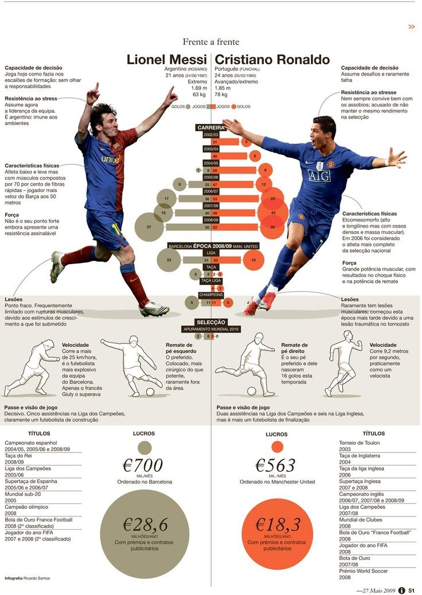

# CMP-01 梅西与克里斯蒂亚诺·罗纳尔多对照

课件第 27 页。图题或图中标识 *Frente a frente*。

## 数据与信息组织

以两名球员为并列对象，按职业生涯、赛季、国家队、荣誉和收入等主题组织内容。

## 图形与视觉编码

人物照片建立左右身份，中央并排统计标记和数值对齐相同指标，动作线稿解说球员特点。

## 阅读路径与复用

先认人，再沿中线逐项比较，最后阅读独立的荣誉列表。复用时应单独写明统计赛季、比赛范围和收入单位。

[返回本组案例](README.md)
