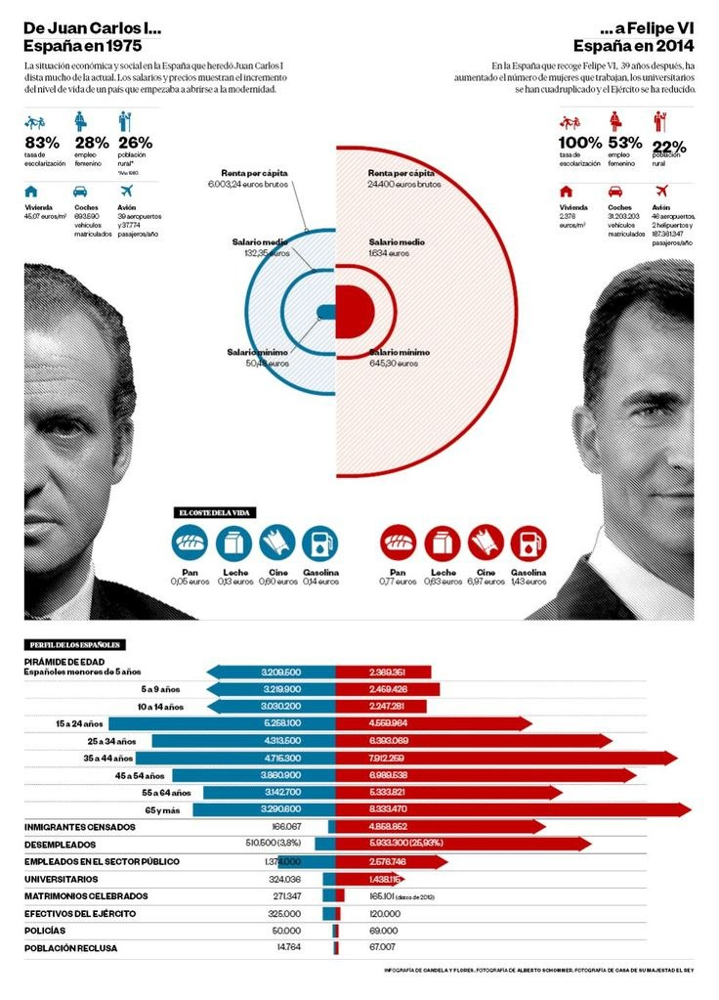

# CMP-02 西班牙两时期对照

课件第 27 页。图题或图中标识 *España en 1975 y en 2014*。

## 数据与信息组织

以 1975 年和 2014 年为两组，在各组下列社会与经济指标、价格及各年龄组人口。

## 图形与视觉编码

蓝、红分别绑定两个时期，年龄条沿共同中线左右展开，上部并置指标图标、几何符号和文字。

## 阅读路径与复用

左、右反复对读对应条目。年龄段保持对齐，涉及跨时期货币价值时，需要在计算变化前确认价格口径是否可比。

[返回本组案例](README.md)
