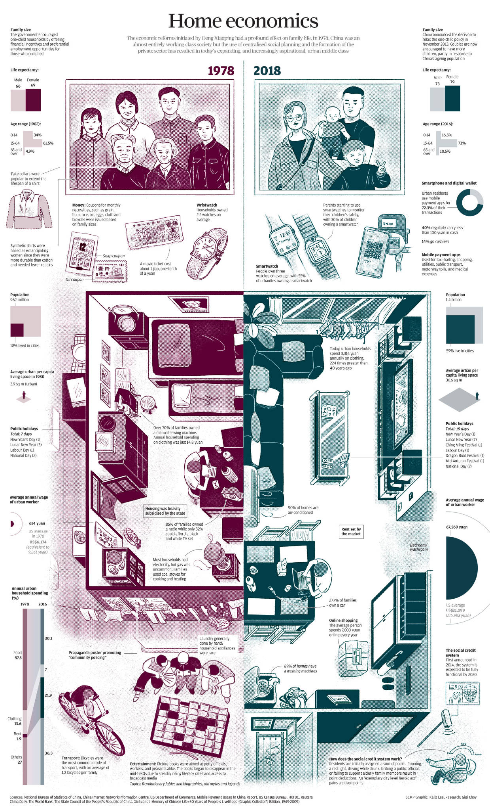

# 案例1分析｜Home economics：1978与2018年中国家庭经济生活对比

> **五大数据架构逻辑**：字母表型（Alphabetically），指独立、平行、可重排的多指标记录集合；这里采用本仓库的扩展定义，而非按 A–Z 字符检索。  
> **17种常用信息图形**：06-比较型信息图形（Comparison Infographics），采用1978与2018双时期并列对照。  
> **统计图形**：柱状图、水平条形图、堆叠条形图、环形比例图、比例符号；外围多种图形为辅助，整图按**比较目的**分类，而不是见到多个统计图就判“混合型”。  
> **图像来源线索**：用户提供案例原图；图内标题 *Home economics*，底部署名 *SCMP Graphic: Kaliz Lee; Research: Gigi Choy*。相关数字图文专题见[《南华早报》2018年报道](https://multimedia.scmp.com/news/china/article/2176472/china-reforms/)。  
> **统计年份说明**：全图以1978与2018为两端，但个别人口或消费指标使用1980、1982、2016等实际年份，不能把每项数字都当作精确的1978／2018同期值。

## 归类判断

- **为什么是字母表型（五大数据逻辑）？** 家庭人口、寿命、收入、居住面积、消费支出、支付方式等构成一组**相对独立、平行组织、可以重排的主题指标**，同类指标在两时期进行比较，不存在必须逐个经过的不可逆事件链，也没有跨指标的严格父子从属结构。更精确地说，每个“指标 × 时期”是一个记录，字段同构；不同指标有不同单位，不能在同一量尺上无条件比较。
- **为什么是比较型（17种表现类型）？** 左侧1978与右侧2018明确构成A/B两组对象；家庭肖像、室内生活场景、外围统计图都支持**左右对应对照**。读者的核心任务是判断“改变了什么、改变了多少”。
- **为什么不是时间轴型？** 两个年份表示对照端点，画面没有按连续时间节点组织不可逆的事件推进。年份不是一条事件流程。
- **为什么不能单纯按混合型判定？** 图中虽然混用条形、圆环、插画和说明文字，但这些手段共同服从**两个时期的比较**，不是多个互不统摄的图表主题。

## A｜基本的数据逻辑

**独立主题指标集合 → 在统一的“时期”字段下形成成对记录 → 相同指标做横向对照 → 归纳整体变化。**

| 判断维度 | 此案例的特征 |
| --- | --- |
| 最小单元 | 一项指标在一个实际统计年份的一条观测记录；生活物品可作为另一个定性描述表 |
| 独立性 | 人均居住面积、寿命、消费等可以分开读取 |
| 平行性 | 各指标是同一主题下的不同观察角度；没有跨指标的父子继承关系 |
| 同构性 | 对同一指标复用“指标—年份—数值—单位—来源”等字段和统计口径 |
| 顺序性 | 可根据主题重新调整指标组；年份是分组／比较维度，并非不可逆流程主干 |
| 比较性 | 通过双对象的相同或相近指标形成差值、占比与倍数比较 |
| 边界 | 不同指标的单位、统计年份、数据来源可能不同，不能假定所有指标完全同口径 |

**可复用公式**：多项独立指标 × 两个或多个比较对象 → 对齐同一指标 → 识别数值与情境差异。  
**核心性质**：独立、平行、部分同构、可重排、按对象配对比较。

## B｜统计图形、统计方法与计算方式

| 统计图形／图形原理 | 原图中的用途 | 统计方法／读取方式 |
| --- | --- | --- |
| **Bar Chart（柱状图）** | 男性与女性预期寿命等 | 同一单位下比较数量高低与绝对差值 |
| **Horizontal Bar Chart（水平条形图）** | 不同年龄段人口的百分比 | 分类占比对照，如儿童、劳动年龄人口与老年人口 |
| **Stacked Bar Chart（堆叠条形图）** | 家庭开支结构、城镇／非城镇人口组成等 | 将整体划分成多个部分，再比较各部分比例 |
| **Donut Chart（环形比例图）** | 2018年手机／电子钱包及无现金支付的相关占比信息 | 用环形扇区表示整体中的部分；是否可精确读数取决于图例和数值 |
| **比例图形及数字直接标注** | 家庭居住面积、人口规模、工资等 | 单位一致时比较数值，必要时计算增量或倍数 |
| **跨组带状连接** | 不同时期家庭支出组成的并列条与连接区域 | 强化结构变化的视觉联系；**不能默认是实际流量迁移的桑基图** |

**与 RAWGraphs 的关系**：数值映射原理可借用 **Bar Chart（柱状图）**等标准统计图；部分比例图、符号图、带状连接和插画是组合或定制结果。应区分“统计原理类似”与“RAWGraphs 必然原生支持此完整版式”。

### 原图可读的统计示例

| 指标 | 早期数值 | 后期数值 | 可计算的比较 |
| --- | ---: | ---: | --- |
| 男性预期寿命 | 66 岁 | 73 岁 | +7 岁 |
| 女性预期寿命 | 69 岁 | 79 岁 | +10 岁 |
| 城镇人口占比 | 18% | 59% | +41 个百分点 |
| 城镇人均居住面积 | 3.9 m² | 36.6 m² | 后者约为前者 9.38 倍 |
| 城镇职工年平均工资 | 614 元 | 67,569 元 | 名义数值约为 110 倍（后期为2016年） |

计算方式：`绝对差值 = 后期值 − 前期值`；`变化倍数 = 后期值 ÷ 前期值`；`占比 = 部分值 ÷ 总值 × 100%`。**工资倍数为名义金额比较，并未扣除通胀；跨年份统计应以图内实际数据年份为准。**  
原图还有粮票、电视、洗衣机、智能手表、移动支付等事实性或场景性说明，它们**不一定对应连续量化数据**。

## C｜视觉编码

| 要素 | 画面中的编码 | 意义／局限 |
| --- | --- | --- |
| **点** | 密集印刷网点、插画颗粒与小标记 | 主要营造复古报刊肌理；不代表独立散点样本 |
| **线** | 纵向中轴线、房屋轮廓、注释引导线、图表参照线 | 划清1978与2018边界，并建立文字—对象的定位关系 |
| **面** | 酒红／紫红与深青／蓝绿的图形和大块室内场景 | 强化左右对照、承载组成与数量差异 |
| **体** | 俯视／透视住宅室内、家电与家具的空间层次 | 表现生活情境；透视体积不自动对应可量化变量 |
| **符号** | 粮票、机械手表、自行车、旧式电器、手机、二维码、智能手表等 | 用典型物品替代抽象描述，成为时代特征的索引 |
| **色彩** | **1978＝酒红色**，**2018＝深青色**，辅以灰白 | 一致的对象分组编码；两种主色具有对称、对立的识别作用 |
| **长度／面积** | 柱状图长度、堆叠比例、圆环扇区 | 定量编码，需按相同口径与图例读取 |
| **字体** | 大标题、粗体年份、数据标签、短注释分级 | 构建“主题 → 比较对象 → 指标 → 细节证据”的阅读层次 |
| **版式** | 纵向长画幅、左右双栏镜像、中央巨大住宅场景、两侧外围数据 | 主场景传达感性差异，统计图提供证据，文字补充解释 |

**视觉编码总式**：`比较对象→颜色与左右位置；生活主题→具象场景／物件；数值→统计图形；解释文字→细线引导与近旁注释`。  
**关键边界**：不能把插画的房间大小、家具图示面积或图案疏密自行当成精确的数值编码。

## D｜数据／信息架构

**总主题 → 两个时期／比较对象 → 独立主题指标组 → 数值、注释及生活场景。**  
其中“主题指标组”属于内容编排，不自动成为严格的父子型数据关系。

建议的**长表（Excel）**结构如下：

| 指标 | 实际统计年份 | 比较组 | 数值 | 单位 |
| --- | --- | --- | ---: | --- |
| 男性预期寿命 | 原图早期时点 | 过去 | 66 | 岁 |
| 男性预期寿命 | 原图后期时点 | 现在 | 73 | 岁 |
| 女性预期寿命 | 原图早期时点 | 过去 | 69 | 岁 |
| 女性预期寿命 | 原图后期时点 | 现在 | 79 | 岁 |
| 城镇人口占比 | 原图早期时点 | 过去 | 18 | % |
| 城镇人口占比 | 原图后期时点 | 现在 | 59 | % |

> 这是记录结构示例，不把未知的实际统计年份硬写为1978或2018。正式录入时应补足年份、定义、来源、量纲、可比性标记。

若需复刻整图，建议另外在同一工作簿中建立**情境素材表**（时点／物品／描述／图像／视觉位置）和**指标定义表**（指标／单位／统计口径／来源），避免将定性场景硬当作连续数值。

## E｜视觉叙事架构

**两个时期亮相 → 大场景制造直观反差 → 周边各项统计证明差异 → 典型物件强化时代印象 → 读者形成整体变化的认识。**

1. **建立对照**：标题与1978／2018年份在顶部建立“过去／现在”两个明确比较对象。
2. **生活场景先行**：两张家庭肖像与左右室内场景使人口结构、居住条件和设备使用的差异直观化。
3. **量化证据环绕**：外围寿命、年龄段、收入、开支、住房面积等数据进一步回答“变化了多少”。
4. **物件叙事补充**：粮票和当代数字支付、传统手表和智能穿戴等形成生活方式的象征对照。
5. **认知收束**：以跨时期同类信息的对应比较，呈现家庭经济生活变化的综合图景。

**视觉阅读特征**：双栏对照、左右横向跳读、纵向分组浏览。设计可引导从上到下阅读，但读者也能从任意一组对照项目切入；这种视觉导向不等于编年型数据的不可逆序列。

## 可迁移的设计规律与判断方法

1. **先判断整张图要回答的问题**。如果核心是“A 与 B 有何差别”，优先考虑17种表现形式中的比较型，而不是以年份、图表数量直接判断时间轴型或混合型。
2. **再判断底层数据关系**。多个指标若相对独立、可重排，并由同一“对象／时期”字段进行对应对照，可作为字母表型的扩展扁平数据结构理解；如果存在不可逆阶段或真正父子关系，应重新判断。
3. **统计证据与场景插画分工**。用同尺度图表表达量化变化，用符号和插画表达具体生活体验，并明确何者不是数据编码。
4. **让比较对象使用固定色系及位置**。从人物到住房、从图表到图注使用一致映射，便于读者快速查找同类信息。
5. **保持统计口径透明**。如不同指标使用1982、2016等不同年份，应分别注明，避免虚构全图所有指标具有相同统计时点。

**一句话结论**：以字母表型的独立多指标数据集合为基础，用“1978 vs 2018”左右双栏视觉系统，将统计图、生活场景和时代符号整合成一张**比较型信息图形**。
