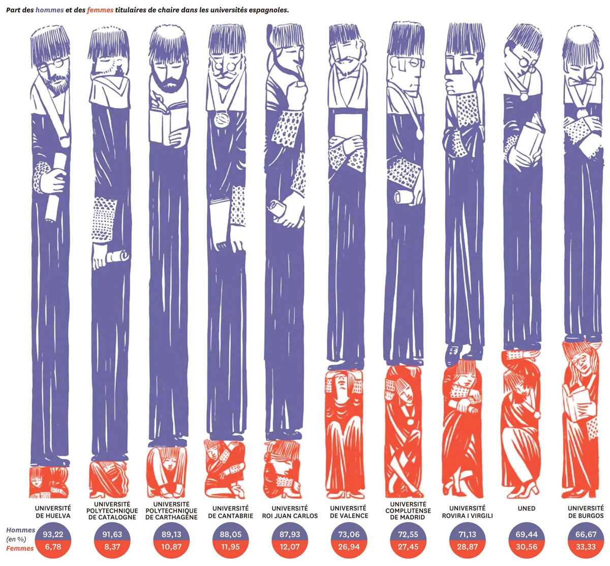

# 案例2分析｜西班牙大学讲席教授的性别比例对比

> **五大数据架构逻辑**：字母表型（Alphabetically）。
> **17种常用信息图形**：06-比较型信息图形（Comparison Infographics）。
> **基础统计图形**：100%堆积柱状图（100% Stacked Bar Chart），经人物插画化处理。
> **图像来源**：用户提供的案例原图；原始统计年份、人数及出处待核实。

## 归类判断

- **字母表型**：十所大学是独立、平行、同构的统计对象，共享男性占比和女性占比两个指标；不存在强制固定的先后关系或校际父子关系。
- **比较型**：以男性与女性两组比例为明确比较对象，并通过各大学的重复模块展开横向比较。
- **不是编年型**：男性占比降序是展示排序，而非数据自身不可逆的顺序。若未来各校性别比例变化，排序可以变化；换位只会破坏当前降序展示，不改变各校记录的含义及校际关系。
- **不是层级型**：各校之间没有上下级关系；男女比例是单元内的互补构成，不构成贯穿全图的父子主干。

## A｜基本的数据逻辑

| 判断维度 | 案例特征 |
| --- | --- |
| 最小单元 | 一所大学的性别比例记录 |
| 独立性 | 每所大学的统计记录可以独立成立 |
| 平行性 | 各校没有上下级或先后依赖 |
| 同构性 | 所有大学采用相同字段和占比计算框架 |
| 可交换性 | 可按名称、比例或其他条件重排 |
| 互补性 | 图中每校男性与女性比例合计为100% |

**核心性质**：独立、平行、同构、无强制顺序、可重排、可比较。

**判断规则**：编年型的顺序必须由数据自身的内在规则强制确定，不限于时间，也可来自固定的大小、阶段或隐性规则。人为选用的可变指标排序，即使呈单向视觉递进，也不能单独作为编年型依据。

## B｜统计图形、统计方法与计算方式

基础原型为 **100% Stacked Bar Chart（100%堆积柱状图）**，可借用 RAWGraphs 的堆积条形图原理，先计算归一化比例，再定制人物造型。

| 统计方式 | 应用 |
| --- | --- |
| 分类统计 | 以大学为独立统计对象 |
| 比例计算 | 计算每校男性与女性各占讲席教授总人数的比例 |
| 归一化 | 各校总量转换为100%，便于对照构成 |
| 构成比较 | 比较同校男女占比 |
| 横向比较 | 比较不同大学的性别比例 |
| 辅助排序 | 按男性占比降序组织画面 |

计算公式：

- 男性占比 = 男性讲席教授人数 ÷ 该校讲席教授总人数 × 100%。
- 女性占比 = 女性讲席教授人数 ÷ 该校讲席教授总人数 × 100%。
- 按图中两类统计口径，男性占比 + 女性占比 = 100%（显示值可能受四舍五入影响）。

**边界**：百分比不能用来推断各校教授绝对人数。人物高度与比例的精确映射需依据原图尺度核实；以图中数字直标为准，不以人体轮廓面积反推数值。

## C｜视觉编码

| 元素 | 画面表现 | 编码意义 |
| --- | --- | --- |
| 点 | 人物服装点状纹理 | 装饰肌理，不代表独立数据 |
| 线 | 人物轮廓、服装纹理 | 塑造人物造型 |
| 面 | 紫蓝与橙红色块 | 区分两个性别类别 |
| 体 | 平面人物插画 | 无独立三维数据编码 |
| 长度 | 男女图形纵向占据的空间 | 表达比例大小；以数字直标核实 |
| 位置 | 大学横向排列、两色纵向组合 | 组织单元内部及单元之间比较 |
| 符号 | 男女人物形象 | 直译统计对象，建立主题识别 |
| 色彩 | 紫蓝对应男性、橙红对应女性 | 冷暖对照并统一类别编码 |
| 字体 | 标题、大学名称、百分比 | 建立主题、对象和精确数值的阅读层次 |
| 版式 | 重复人物模块、横向排列及留白 | 支持快速扫读与单元定位 |

**视觉系统**：人物插画替代抽象矩形柱；双色系统贯穿人物和数值标注；服装、姿态与书籍等辅助元素强化学术主题；留白分隔独立模块。

**格式塔原则**：相似性使同色性别数据形成集合；接近性将人物、大学名称和数字组成单元；连续性引导横向浏览；图底关系强化双色人物与背景的区分。

**视觉隐喻**：男性人物纵向拉长、女性人物压缩的造型，可解读为“占据空间”与“受到挤压”，强化性别比例失衡的主题。该解释属于设计分析，不是额外的统计字段。

## D｜数据／信息架构

底层是平行、同构的扁平表格：一所大学一行，各行具有一致字段。

| 大学名称 | 男性占比（%） | 女性占比（%） |
| --- | ---: | ---: |
| 大学A | 93.22 | 6.78 |
| 大学B | 73.06 | 26.94 |
| 大学C | 66.67 | 33.33 |

上表为案例比例示意，完整大学名称与统计口径以原图及原始数据为准。全图十所大学对应10行×3列（不含表头）；两个比例互补，只有一个独立数值自由度。可另附统计年份、人数、来源等元数据。

**信息组织**：共同主题 → 多个独立大学模块 → 每校男女比例及标签。单元内是整体与部分关系，单元间为平行比较；主题、模块、指标的视觉层次不等于数据父子层级。

## E｜视觉叙事架构

**主题引入 → 双色人物建立对照 → 横向重复模块展开比较 → 数值降序强化差异 → 形成性别比例失衡的认识。**

1. 标题建立讲席教授性别构成的主题。
2. 男女形象和固定色彩建立比较对象。
3. 读者从左至右浏览，观察男性占比降低、女性占比提高的视觉递进，也可跳读任意大学。
4. 人物的拉伸与压缩加强空间占比的隐喻，底部百分比提供精确读数。
5. 所展示大学中男性均占多数；不同大学的比例存在差异。

**叙事特点**：单元内部构成对比、单元之间横向对比、视觉排序引导与具象隐喻相结合。视觉阅读方向并非底层强制顺序。

## 可迁移的设计规律与判断方法

- 对独立同构对象使用统一比例尺度、重复模块与固定颜色映射。
- 将统计图形转化为主题人物或物件，保持比例关系并附精确数字。
- 区分视觉排序与数据强制顺序：可变指标排名不等于编年型；视觉主次也不等于数据层级。
- 不把人物的宽度、面积、纹理或装饰性细节当作未经验证的定量字段。

**对应概念**：[字母表型信息图形概念定义](../../01-信息图形数据逻辑/04-字母表型信息图形概念定义.md)。
