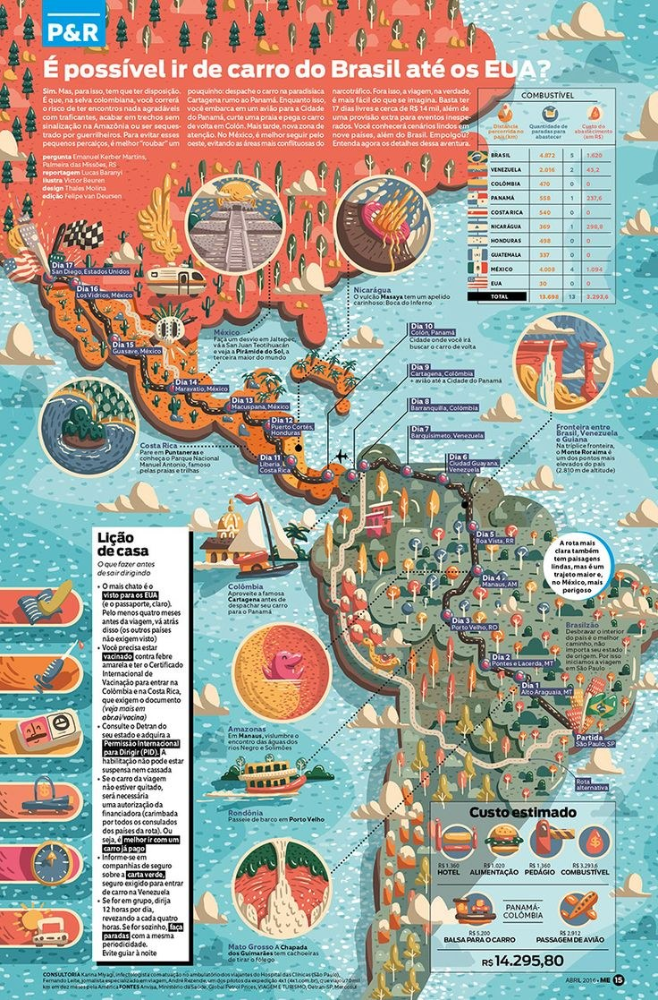

# LOC-01 从巴西开车到美国的路线

课件第 28 页。图题或图中标识 *É possível ir de carro do Brasil até os EUA?*。

## 数据与信息组织

从沿途地点和分段路线组织一段跨国旅程，旁边补充交通方式、途中注意事项和估计费用。

## 图形与视觉编码

插画底图定位海陆，线路与地名串起停靠点，圆形小窗及引线放大路途中的场景。

## 阅读路径与复用

先找出发地、目的地和沿途区域，再查看有特殊通行条件的段落。距离或费用应按表中标注读取。

[返回本组案例](README.md)
