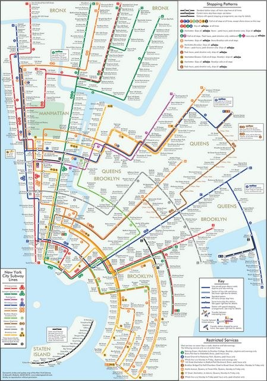

# LOC-02 纽约市地铁线路图

课件第 28 页。图题或图中标识 *New York City Subway*。

## 数据与信息组织

站点、线路和换乘是主要记录，水域和行政区地名提供空间背景，角落图例补充服务规则。

## 图形与视觉编码

颜色和路线编号区分服务，折线串起站点，文本与符号区分到站及换乘信息。

## 阅读路径与复用

从起点站定位线路，跟着站序查找目标或换乘点。版面可调节站间距以容纳标注。

[返回本组案例](README.md)
