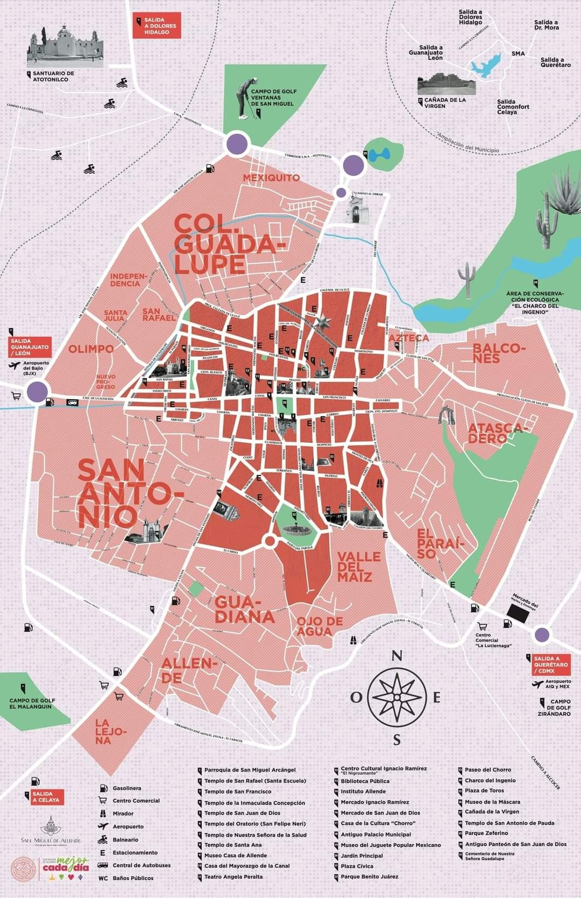

# 案例1分析｜圣米格尔德阿连德城市导览地图

> **五大数据架构逻辑**：**地理图型**（Geographically）。地理位置、区域形状、道路连通和方位关系决定信息组织方式。  
> **17种常用信息图形**：**07-地标型信息图形**（Location Infographics）。通过地图、地标、功能图例和地点注释提供城市导览。  
> **主要图形机制**：区域分布、点位定位、道路网络、类别符号、局部地标照片、说明图例。  
> **定量程度**：以空间信息与定性分类为主；未明确以符号大小、颜色深浅或道路线宽映射统计数值。  
> **图像**：用户提供的案例原图；图中标示墨西哥圣米格尔德阿连德（San Miguel de Allende）的街区、道路、景点及周边设施。

## 归类判断

- **为什么是地理图型（五大数据逻辑）？** 这张地图的核心是“某地点在哪里、与哪些街区或道路相邻、如何与周边连通”。GUADALUPE、SAN ANTONIO、BALCONES 等街区的空间位置及轮廓、道路交汇和城市出口并非可任意交换的独立卡片。调换街区的位置会破坏原有地理关系。
- **为什么是地标型（17种表现类型）？** 整个画面以城市导览为目的，通过地名、道路、景点照片、服务设施图标与指北针完成**地点识别和空间导航**。核心问题是“哪里有、怎么找、与周边有什么关系”。
- **为什么不是层级型／编目型？** 地图底部景点清单和图例是辅助检索；街区与设施可以存在“区域—地点”的归属属性，但读者的主任务不是沿着固定的父子层级或顺序目录阅读。
- **为什么不是流程图型或时间轴型？** 道路连接表示物理空间可达，不是预先规定的单向步骤；没有按不可逆时间序列推进的主干。
- **为什么不是混合型主类？** 图中虽然叠加照片、标注、图标、区域色块及局部示意，但它们共同服务于**同一张地理导览图**；不能因为元素多样就自动判为混合型。

## A｜基本的数据逻辑

**核心结构：空间参照 → 区域、道路与点位 → 位置／连接／包含关系 → 附加的名称、类别及图片信息。**

| 判断维度 | 本案例的本质特征 |
| --- | --- |
| 最小空间单元 | 地点（点）、道路／水系（线）、街区／绿地（面） |
| 主排序依据 | 空间位置，而非编号、数量大小或时间先后 |
| 方向性 | 多方向、非线性；无必须从头到尾遵循的单向顺序 |
| 不可任意置换 | 地点或道路位置被改变会损坏方位、邻接及连通信息 |
| 空间关系 | 邻近、包含、相交、连接、沿路分布、城区内外 |
| 数据维度 | 二维地理空间为基础，附带地点类型、名称、用途和图片等属性 |
| 独立与关联 | 单个地点可以独立被检索，同时与周边道路和所属区域关联 |
| 图形约束 | 图面形状可为可读性适当简化，但应维护重要拓扑与方位关系 |

**可复用规律**：地理单元不是“随便摆放的多个对象”；其坐标、边界与相互空间关系本身就是数据。即使不使用数量刻度，也仍具有明确的数据组织逻辑。

**快速判断**：尝试互换两个街区或删除一段道路；若会直接改变“在哪、相邻谁、怎样连通”的结论，则地理图型特征成立。

## B｜统计图形、统计方法与计算方式

本图更准确地说是**非定量城市专题导览地图**，而非以均值、频率、百分比或数量比较为中心的传统统计图。

| 图形机制／统计原理 | 图中应用 | 数据操作／计算方式 |
| --- | --- | --- |
| **定位地图（Location Map）** | 街区、景点及路口的地图位置 | 位置与地名或地点 ID 绑定；由坐标或已测绘底图定位 |
| **区域分布／分类地图** | 暖红街区、浅绿绿地及自然保护区、蓝绿水系 | 根据空间几何划分区域，使用**离散类别色相**区分地物 |
| **点位符号地图（Point/Symbol Map）** | 停车、加油站、机场、商场及景点的图标 | 按设施类型对位置点进行分类、符号匹配 |
| **网络／路径表达** | 白色街巷、道路连接、城市外部出口 | 将道路视为路段与交点，记录连接、交叉、可通行关系 |
| **地标图片注释** | 左上宗教建筑、右上遗址、街区内建筑照片 | 为地点关联图片和名称，帮助实物识别；无定量计算 |
| **方位指示与局部导览** | 下方指北针、外围出城方向、右上周边道路示意 | 为地理阅读提供方向与局部参照 |

**可复用的数据处理方法（是建模原理，不是对原作者软件或算法的断言）：**

1. **空间坐标映射**：将地点、道路及多边形几何转换到统一地图坐标与绘图范围。
2. **类别分组**：对街区、绿地、水体、服务设施分组，各类别使用固定色相或图标。
3. **空间关系分析**：判断点是否位于某区域、道路是否相交或连通、地点与区域是否邻近。
4. **空间概括**：在不破坏关键位置与连通的前提下，简化道路、轮廓或局部尺度以提升可读性。
5. **标签关联**：将名称、照片及图例文本与同一个地点 ID 或空间对象对应。

**对应 RAWGraphs 的判断**：RAWGraphs 的 **Scatterplot（散点图）**可以借用“两个坐标维度定位点”的基础编码原理，但它**并不能直接替代地理底图**：投影、道路与面状几何、地图注记仍需地理制图及后期矢量设计。不能把这张图硬说成 RAWGraphs 某一种原生统计图。

**不应误读为定量编码**：图中的红色深浅、道路宽窄、紫色节点大小、照片面积及背景网点均未附明确统计数值或定量图例；不能据此推断人口密度、交通流量、地标重要性等量化变量。图面也未提供可据以测量实际距离的明确比例尺。

## C｜视觉编码

| 视觉要素 | 画面中的使用 | 数据含义／设计效果 |
| --- | --- | --- |
| **点** | 紫色圆形路口节点、小型位置符号 | 强调重要交汇位置及设施位置；不代表数值大小 |
| **线** | 白色道路、细灰色街巷、虚线边界、蓝绿色水系 | 以不同线型和颜色表达道路连接、行政或发展边界及自然水系 |
| **面** | 暖红色街区、绿色自然地块、浅色城市外围 | 用区域填充区分城市建设空间与自然空间 |
| **体／具象图像** | 宗教建筑、建筑地标照片，以及植物小插图 | 增加地点的现实识别与城市地域感；体积和透视不编码数量 |
| **符号** | 飞机、停车、加油站、购物设施、公共厕所等 | 让不同地点类别在密集地图上快速被识别 |
| **色彩** | 暖红街区、浅绿绿地、蓝绿水系、紫色重要节点、浅粉灰底、白色路网 | 建立“区域类别—色相”的一致映射，并通过冷暖对比区分空间角色 |
| **文字** | 超大街区名、中小地标名、沿道路排布的细小路名、图例文本 | 建立“区域识别 → 目标定位 → 局部细节”的字号层级 |
| **版式** | 纵向长画幅、中央建成区大面积占位、外围留给远郊地标和交通入口、底部图例 | 主地图先行，补充信息围绕地图展开，减少跳转负担 |
| **辅助系统** | 指北针、外围出口指示、景点目录、照片、图标图例 | 支持方向判读、空间导览及按类别检索 |
| **纹理** | 浅色背景网点、红色地块细密斜线 | 增添层次及空间分隔；不应自行解释为频率或强度数据 |

**核心编码关系**：**位置＝地理定位；线的走向＝道路／水系形状；线的相交＝空间连接；面的形状与色相＝区域及类别；图标＝设施类型；文字与照片＝地点属性；指北针＝方位参照。**

**视觉优化重点**：在空间结构不可随意移动的约束下，使用局部标签缩写、颜色层级、照片缩略图和外置图例减少遮挡。原图大字号街区名称有助于快速识别，但局部密集路网及细小标签在缩放后仍可能降低查找效率。

## D｜数据／信息架构

**总空间范围（城市及周边） → 多图层的点／线／面空间对象 → 属性与图例 → 用户按位置自主检索。**

| 图层／信息对象 | 本案例内容 | 建议字段 |
| --- | --- | --- |
| 街区与区域（面） | GUADALUPE、SAN ANTONIO、BALCONES 等街区 | 区域 ID、名称、类别、面几何、填充色 |
| 道路与交点（线／点） | 中心城区街巷、外围公路、重要交汇节点 | 道路 ID、名称、线几何、起止节点、道路类别 |
| 绿地与水系（面／线） | 高尔夫球场、自然保护区、溪流／水体 | 地物 ID、类别、空间几何 |
| 景点与服务设施（点） | 寺庙、文化场所、停车场、商场、加油站等 | 地点 ID、名称、类型、坐标、所属区域、图标 |
| 地标图片与注释 | 宗教建筑、遗址、建筑实景照片及文字 | 地点 ID、图片文件、图注、来源 |
| 导航辅助信息 | 指北针、城市出入口、底部景点清单及符号图例 | 标签 ID、对象引用、类别、说明 |

**概念性 Excel／数据表形式**（示例结构而非原图公开数据）：

| 表 | 最小字段（每行一条记录） | 用途 |
| --- | --- | --- |
| 地点表 | 地点ID｜名称｜经度｜纬度｜类别｜区域ID｜图标｜图片 | 放置景点及公共服务点 |
| 区域表 | 区域ID｜区域名称｜类别｜边界几何｜颜色 | 生成分区、绿地、水体 |
| 路网表 | 道路ID｜道路名称｜路径几何｜起点ID｜终点ID｜等级 | 生成道路与连通关系 |
| 图例表 | 类别ID｜类别名称｜符号文件｜颜色｜说明 | 保持全图符号含义一致 |

道路、区域不是只有一对经纬度的普通数据行，需要在 GIS 中保留**线或多边形几何**；Excel 可存储属性索引，也可将复杂几何单独存储为 GeoJSON 等空间文件。

**架构特征**：空间关系是数据的结构性约束，区域／设施类别是属性；图面上的照片、图例和景点清单属于展示或检索层，并不把整张图变成以固定父子顺序组织的编目型。

## E｜视觉叙事架构

**叙事模式：地图总览 → 区域识别 → 地点定位 → 路网与周边关系 → 设施／景点信息检索。**

1. **认识范围**：先通过暖红色的中心城区轮廓及自然绿地区分城市与周边空间。
2. **识别主要街区**：超大的 SAN ANTONIO、GUADALUPE 等区名帮助建立城市内部的区域认知。
3. **寻找目标位置**：读者以地标照片、图标、地名或道路名称寻找目的地。
4. **判断空间关系**：沿道路识别附近路口、不同街区之间的连接及外部出口方向。
5. **补充信息**：根据底部图例和景点清单确认设施含义，用指北针理解方位。

**阅读路线**：可从任意街区、地标或图例进入，并返回地图查找其位置；这是一种**多入口、非线性、自由探索**的视觉叙事，而不是有明确终点的单向流程。

## 可迁移的设计规律与判断方法

1. **先确认底层关系是不是“空间位置”**，不要因为有地名或地理题材就直接判地理图型；判断依据是坐标、相邻、包含、连接、区域形状是否对理解不可替代。
2. **再判断表现类型的核心目的**：如果以实际地点识别、城市设施查找和导航为主，属于地标型；不是看见几个图标或地名就判定。
3. **空间地图与定量统计图要分开**：类别色相、地名字体、插画和照片并不天然代表数量。如果要编码人口、密度、流量等，需要明确值域、单位与图例。
4. **先建立空间底图，再叠加信息层**：点、线、面各自保持独立的数据对象与属性，最后加入标签、图例、图片和视觉润色。
5. **用空间总览支持非线性阅读**：读者按目的选择地点，信息图提供可反复返回的地点查找入口，而非强制的叙事路线。

**一句话结论**：以**地理图型的空间位置、邻接及道路连通关系**为数据组织基础，用**地标型信息图形**的区域色块、道路、地点图标、照片和图例进行城市空间导览；属于**非线性、多入口、以地点检索为目标的空间叙事**。
