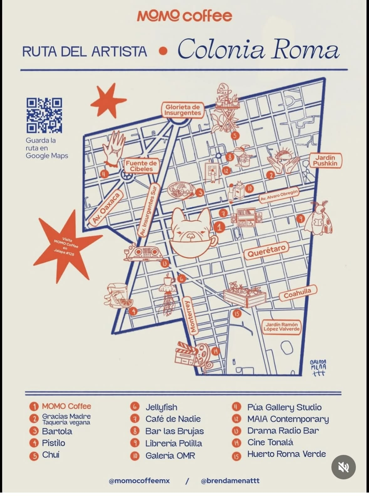

# 案例2分析｜MOMO Coffee「Ruta del Artista · Colonia Roma」艺术路线导览图

> **五大数据架构逻辑**：**地理图型**（Geographical）。地点在街区中的二维空间位置、道路关系和邻近关系构成核心数据组织。  
> **17种常用信息图形**：**07-地标型信息图形**（Location Infographics）。主图是地图，点位编号、手绘图标、下方地点名录以及 Google Maps 二维码服务于地点发现和导览。  
> **核心图形机制**：街区定位地图＋点位符号地图＋编号—地点名称索引；以空间呈现和定性描述为主，**没有数值大小、密度或百分比编码**。  
> **图像来源信息**：用户提供的案例图。画面署名为 MOMO Coffee、@momocoffeemx 与 @brendamenattt（依原图可见文字），主题为墨西哥城 Roma 街区「艺术家路线」。

## 归类判断

- **为什么属于地理图型（五大数据逻辑）？** 主体是 Colonia Roma 的街道与地点位置。读者根据“在哪条街、相对哪条道路、与哪些地点接近”寻找目标；调换标记位置就会改变其地理含义。
- **为什么属于地标型（17种表现形式）？** 画面旨在让人找到并辨认15个咖啡、餐饮、画廊、书店、影像与文化相关场所。地图占据主体，地点名称目录与装饰插画都服务于空间导览。
- **为什么不是编年型或流程图型？** 1—15是**地点索引编号**，不等于时间先后、必须依次访问的行动步骤或一条已绘制的单向路线。原图未以箭头或连线规定1→2→…→15的行进过程。
- **为什么不是层级型或编目型主导？** 下方三栏清单具有检索功能，但没有支配整幅图的父子从属结构或“编年主干＋层级内容”的组织方式。地点名称可以重新排列，而地图的空间点位不能任意置换。
- **为什么不是混合型主类？** 编号、插画、文字清单、地图和二维码承担同一个“定位—识别—导航”任务，没有组合多个独立统计图来完成不同的数据论证。

## A｜基本的数据逻辑

**核心结构：地理区域 → 道路／街区空间参照 → 15个地点的位置坐标 → 编号与地点属性的一一关联。**

| 判断维度 | 本案例的本质特征 |
| --- | --- |
| 最小数据单元 | 一个可定位的地点／兴趣点（POI）；主图中为1—15号标记 |
| 主要关系 | 地理位置、方向、邻近、道路连通；而非数量排序或时间顺序 |
| 基础维度 | 二维空间位置；附加编号、名称、场所类别等属性 |
| 方向性 | 多方向、非线性，读者可自由选择任意地点作为入口 |
| 空间约束 | 地点位置与道路形状不能任意交换，否则地理信息失真 |
| 单元独立性 | 各地点可独立查阅，也可按空间邻近关系共同浏览 |
| 索引关系 | 地图编号1—15与下方15条地点名称一一对应 |
| 表现精度 | 手绘地图可以适度概括街道，但不能将示意图当作精确比例尺地图 |

**可复用规律**：只要地理位置本身承担核心信息，即使无复杂统计计算，仍属于地理图型。地图上的编号只是指向说明文字的检索键，**不自动生成编年顺序或层级关系**。

## B｜统计图形、统计方式与计算方式

本图主要借用**点位符号地图（Point/Symbol Map）＋道路定位地图（Location/Street Map）**，并非以均值、占比、相关系数或频率统计为主的传统数量图表。

| 图形机制／统计原理 | 画面中的应用 | 对应操作与计算 |
| --- | --- | --- |
| **定位地图（Location Map）** | Colonia Roma 区域的街道框架与地名 | 将道路、位置及地名映射至同一平面参照；图形可做概括 |
| **点位符号地图（Point/Symbol Map）** | 15个橙红色编号圆点 | 按地点位置布置点位，并绑定编号、名称 |
| **分类／主题符号辅助** | 狗、咖啡、植物、书店／影像等手绘插画 | 以主题联想与装饰帮助识别，不是明确的数值符号映射 |
| **索引式图例／地点目录** | 下方三栏1—15的名称清单 | 按地点ID进行一对一查找和文字匹配 |
| **简单计数** | 总计15个收录点位 | 地点数量＝记录条数；无额外的数值权重 |
| **导航链接** | 左侧二维码指向 Google Maps 路线／位置资源 | 从印刷地图跳转至外部数字地图，二维码本身不代表统计量 |

**可用于制作的处理步骤（非对原作者工作流程的断言）：**

1. 将地点ID、名称、空间坐标或手工标定位置整理为表格。
2. 将道路与地点映射到同一地图底图；必要时简化路网几何。
3. 将15个地点点位分别与1—15的目录文字绑定。
4. 保持地点符号大小近似一致；让颜色承担“目标位置突出”的作用。
5. 单独添加街道名、插画与二维码；不得把插画大小解释成客流、距离或重要性。

**与 RAWGraphs 的关系**：可借鉴 **Scatterplot（散点图）**的“x、y两个位置维度确定点”的基础编码逻辑，但 RAWGraphs 普通散点图不等于带真实道路拓扑及地理空间参照的底图。若要完整重制本图，仍需地图/GIS数据或矢量设计。**不能把本图硬说成 RAWGraphs 的原生地图统计模板。**

**不应误读为定量信息**：原图没有给出比例尺、路线距离、步行时长、地点间客流、密度、面积或权重；点的编号大小、道路宽度、插画面积、装饰性星形均不能推导这些量。

## C｜视觉编码

| 视觉要素 | 画面处理 | 数据含义与视觉作用 |
| --- | --- | --- |
| **点** | 橙红色编号圆点分布于地图的地点位置 | 一点对应一个收录地点；颜色强调检索目标，圆点面积不编码量值 |
| **线** | 深蓝色街道轮廓、道路走向和地图边框 | 强调街道路径、道路交叉和位置参照 |
| **面** | 浅米色背景、地图覆盖区域和大块留白 | 区分底图与海报背景；未采用分级设色表现数值大小 |
| **体** | 无三维体量统计 | 保持扁平手绘风格，插画不承担体积或数值信息 |
| **符号** | 狗、手、星形、咖啡杯、植物、收音机／电影等线描插画 | 传达品牌调性、街区气质与场所主题；并非每个插画都有明确的一对一图例 |
| **色彩** | 深蓝＋橙红＋浅米白为主 | 蓝色稳定承载地图与文字；橙红色强调地点编号、街名标签和插画；米白留白减轻视觉负担 |
| **字体** | 细衬线英文大标题、无衬线地图标签、下方并列清单 | 建立“主题—位置—地点细节”的层级 |
| **版式** | 上标题／中地图／下三栏目录；左置二维码 | 地图成为主视觉，目录作为反查层，二维码作为行动入口 |
| **图译／索引** | 地图圆点数字与目录数字重复一致 | 建立视觉—文字双向查找关系，减少地图内文字拥挤 |
| **装饰** | 大型橙红星形、手绘趣味插画 | 强化艺术路线的文化氛围，但不改变基础地理数据关系 |

**核心编码对应：位置＝地点在哪里；路网线形＝空间通路／街道结构；编号＝地点ID；名称＝地点属性；图形插画＝主题联想；色彩对比＝优先关注的点位。**

**视觉优化要点**：保持所有编号点的字形和颜色统一，把详细名称移到下方目录；通过高对比蓝色路网与橙红标记建立清楚的空间层级。相应代价是原图细小街巷在缩小观看时会拥挤，若用于实际导航还应核对地图位置及数字地图链接。

## D｜数据／信息架构

**总体架构：主题层 → 空间底图层 → 编号地点层 → 地点目录层 → 二维码导览层。**

| 信息层 | 图中实际内容 | 适合的数据字段 |
| --- | --- | --- |
| 主题层 | MOMO Coffee、Ruta del Artista、Colonia Roma | 主题、城市／街区、品牌 |
| 地图底图层 | 街道与街名，如 Av. Insurgentes Sur、Querétaro、Coahuila 等 | 道路ID、名称、线几何、交汇位置 |
| 位置层 | 图中1—15号橙红圆点 | 地点ID、坐标或地图位置、所属街区 |
| 属性层 | MOMO Coffee、Bartola、Cine Tonalá 等地点名称 | 地点ID、名称、类别、地址（若可核实） |
| 索引层 | 底部按1—15排列的三栏清单 | 编号、显示顺序、对应地点ID |
| 扩展层 | QR码、品牌社交媒体、插画署名 | 链接、署名、来源、说明 |

**概念性 Excel 结构**（表示如何建表，不等于从图中读取到精确经纬度）：

| 地点ID | 地点名称 | 经度 | 纬度 | 类别 | 插画/备注 |
| --- | --- | --- | --- | --- | --- |
| 1 | MOMO Coffee | 待补 | 待补 | 咖啡 | 主体品牌 |
| 2 | Gracias Madre | 待补 | 待补 | 餐饮 | 图注含 Taquería vegana |
| 3 | Bartola | 待补 | 待补 | 待核实 | — |
| … | … | … | … | … | … |
| 15 | Huerto Roma Verde | 待补 | 待补 | 城市花园／文化场所 | — |

**信息结构判定**：地图与目录之间的编号对应属于**交叉索引**，不是五大类型中的“编目型＝编年主干＋层级内容”；分栏只是排版优化，不能决定底层数据类型。若独立抽取底部清单，它可以按并列条目阅读，但整图仍以空间关系为主导。

## E｜视觉叙事架构

**叙事模式：艺术路线主题引入 → Roma 街区空间总览 → 重点地点探索 → 编号反查 → 数字地图导航。**

1. **主题先行**：上方品牌、标题和手绘星形提示这是一次关于 Roma 街区的艺术文化探索。
2. **建立空间认识**：视线进入中央的街道网络，凭借道路、街名与区域轮廓建立位置参照。
3. **自由选择目标**：观察橙红色1—15号点位及附近插画，选择感兴趣的场所。
4. **地图—名录双向查找**：通过下方三栏地点名称确定某个编号，或从地图点位反向确认名称。
5. **行动转化**：使用左侧二维码进入 Google Maps，延伸至现场浏览与导航。

**阅读方向**：不是固定的1→2→…→15线性路线，也没有明示必须按编号依次游览。读者能够从地图、清单或二维码进入，是**多入口、非线性、空间探索式叙事**。

## 可迁移的判断方法与设计规律

1. **先检验空间是否不可替代**：若地点换位便造成地理含义错误，优先考虑地理图型。
2. **编号≠时间、流程或层级**：地图编号用于对应外部清单时属于ID；除非另外存在方向箭头、时序或父子结构，否则不能凭数字判断为编年或层级。
3. **地标型看主任务**：实际功能是找地点、辨认场所与辅助导航，就属于地标型；插画丰富不等于混合型。
4. **地图符号并不一定是统计数值**：点、图标、街道线和类别色相主要表达位置与类型；需要明确比例尺或数值图例才可进行距离与量值推断。
5. **空间层与检索层分别建模**：地点坐标和道路几何保证“在哪”，地点ID与目录保证“是什么”，扫码功能提供“如何前往”的扩展入口。

**一句话结论**：用**地理图型**的空间定位与道路关系组织15个地点，以**地标型信息图形**的编号点位、地图、手绘插画、三栏目录和二维码进行非线性城市文化导览。它是**空间导航型信息图**，而不是按数字顺序阅读的编年型或层级型。
