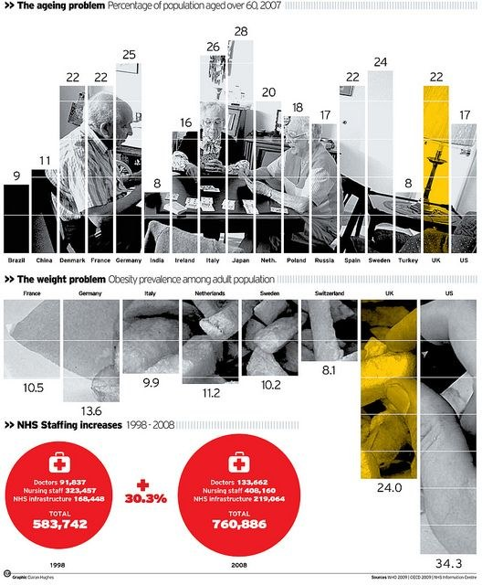

# PHO-01 老龄化、肥胖与医疗人员图表

课件第 29 页。图题或图中标识 *The ageing problem / The weight problem*。

## 数据与信息组织

页面并列比较各国老龄人口比例和成人肥胖率，并用两个年份的数值展示 NHS 人员变化。

## 图形与视觉编码

两组国家比较都带数字和柱形方向，照片裁进图形轮廓。黄色强调特定对象，红色圆章承载人员总数与分项。

## 阅读路径与复用

先看分组标题，再沿基准逐项对照。照片提供议题情境，比较数值时读基线与直接标注。

[返回本组案例](README.md)
