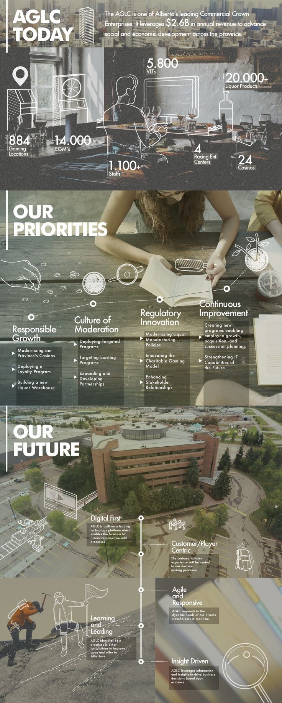

# PHO-02 AGLC 的现状、重点与未来

课件第 29 页。图题或图中标识 *AGLC Today / Our Priorities / Our Future*。

## 数据与信息组织

三段内容分别组织现状指标、行动主题和未来安排。照片中的楼宇、工作场景和航拍地景为各段提供背景。

## 图形与视觉编码

白色大标题形成三个入口，小图标和醒目数字压在照片上，末段用垂直线与节点串联注释。

## 阅读路径与复用

先按段标题确定所读主题，再查看叠加信息。采用此法时应检查文字在照片最亮和最暗区域的可读性。

[返回本组案例](README.md)
