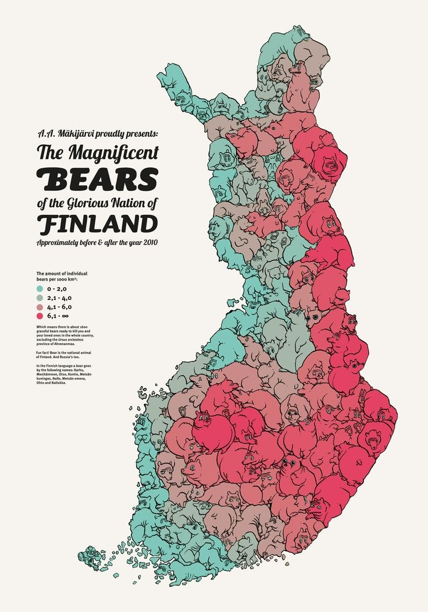

# HIE-01 芬兰熊的地域分布

课件第 30 页。图题或图中标识 *The Magnificent Bears of the Glorious Nation of Finland*。

## 数据与信息组织

图例按每千平方千米的熊数量划分区间，地图内部保留地域分界和连续的空间形状。

## 图形与视觉编码

用多档颜色呈现数值层次，用熊形图案将指标与主题联系起来。熊形密度和大小应结合数值图例读。

## 阅读路径与复用

先读左侧标题和图例，再在芬兰轮廓内寻找不同颜色的区域。此图同时具备地理数据结构，课件在此展示分层组织。

[返回本组案例](README.md)
