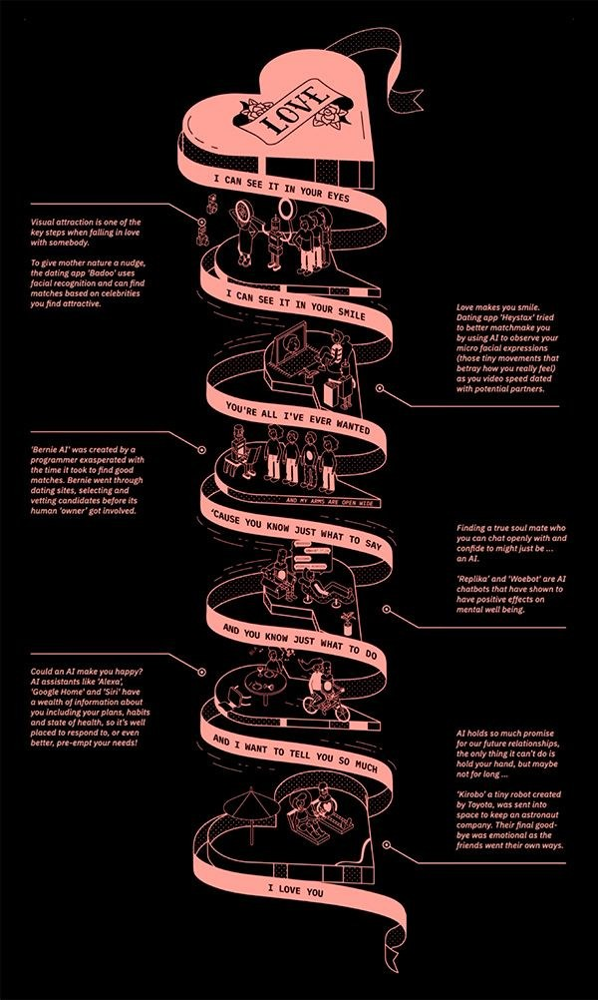

# HIE-02 Love 丝带叙事

课件第 30 页。图题或图中标识 *Love*。

## 数据与信息组织

把不同情境分布在上下叠放的丝带层，每一层配一个短句、插画和局部解释。

## 图形与视觉编码

粉色丝带在黑底上形成连续主线，两侧引线将段落与对应层连起来。

## 阅读路径与复用

从明显的顶部入口沿丝带逐层往下，再选择两侧的文字深读。层高用于安排叙事顺序，图中没有定量高度刻度。

[返回本组案例](README.md)
