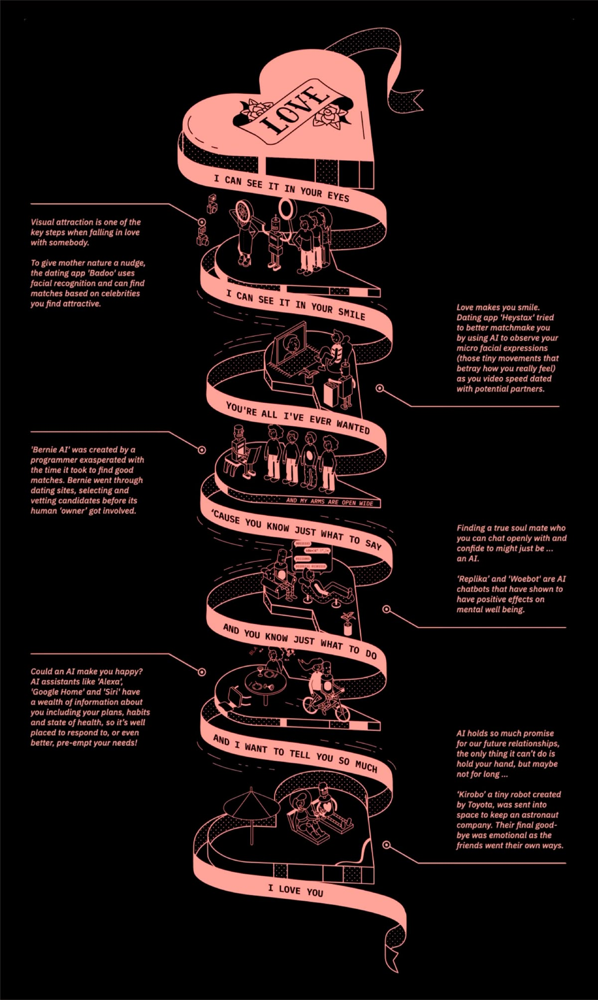

# 案例1分析｜AI与爱情：连续飘带式层级信息图

> **五大数据架构逻辑**：**层级型**（Hierarchically）。由“AI与爱情”总主题统领若干主题单元，每一单元再对应插画场景、AI应用案例和解释文字。这里的层级是**信息归属及主题组织上的层级**，而不是按数值大小分级。  
> **17种常用信息图形**：**09-层级型信息图形**（Hierarchical Infographics）。原课件第30页即以此图为该类型示例。  
> **主要图形机制**：连续飘带式分层排布、主题标签、等轴测感场景插画、双侧引线注释及图文分组。  
> **定量程度**：以定性案例及主题性说明为主；**未呈现可验证的统计量尺、比例、频率或显式数值计算**。  
> **案例图片**：用户提供原图；英文主要内容围绕AI交友、面部识别、微表情、聊天机器人与情感陪伴等主题展开。

## 分类判断

- **为什么归入层级型数据逻辑？** 图中可辨认出“AI与爱情”总主题，下设若干情感/AI应用主题；每个主题再关联具体应用场景及补充说明。主要的信息组织关系是**总主题—分主题—案例/文字解释**。同层分主题可并列，分主题的位置不是由真实年份或明确可测数值强制确定。
- **为什么属于09-层级型表现类型？** 画面把多层信息分布在连续飘带的不同高度：中央承载主题短句，各层插画呈现具体场景，左右文字说明各层内容，形成明显的分层浏览与局部下钻。
- **为什么不是时间轴/编年型？** 读者确实受引导自上而下阅读，但图中没有真实时间刻度和必须按时间先后排序的事件。歌词语句的排列顺序更多服务于情感表达和故事节奏。
- **为什么不直接判编目型？** 仓库定义的编目型要求“不可逆的编年主干＋挂接其上的层级内容”。本图的歌词与飘带虽然形成连续主线，却不足以证明各主题具有不可更改的实际事件/阶段序列；仅凭连贯画面和两侧注释不能推导出编目结构。
- **与流程图型的区别**：既无明确操作起止、决策条件，也没有步骤间输出成为下一步输入的流程依赖；故事性阅读顺序不等于流程运算。
- **注意边界**：课件将它归为层级型，是以**整体展示组织和信息层次**为主要判断依据；如果使用严格的数据结构定义，画中并没有清晰画出复杂的多叉父子树，不能将装饰性的飘带弯折误读为数据关系边。

## A｜基本的数据逻辑

**抽象规律：总主题 → 多个主题模块 → 每个模块内部的案例场景、技术/产品与解释性属性。**

| 判断维度 | 本案例的本质特征 |
| --- | --- |
| 主结构 | 一个总主题，多个分主题，各主题再包含场景和注释 |
| 方向 | 主要按自上而下的阅读方向展开；信息归属为上层主题指向下层说明 |
| 层级 | 可概括为三层：总主题、主题单元、具体案例及解释 |
| 顺序 | 叙事性排序明显，但各应用主题未给出不可颠倒的真实时间键 |
| 并列性 | 同层的AI应用主题可被视为围绕总议题的多个平行分支 |
| 数据维度 | 以定性文本、应用类别、案例、插画为主；单个主题可具有多项属性 |
| 独立与关联 | 分主题可以单独说明，但均指向共同的上级议题 |
| 定量约束 | 未见可验证的长度、面积、位置、间距与某一数值对应的规则 |

**核心判断方法**：移开飘带仍能整理出“总主题—主题—案例/说明”的归属关系；但调换两个同级主题，并不必然改变现实世界的事件先后。这与必须按日期排列的编年型不同。

## B｜统计图形、统计方式与计算方式

本图更准确地说是**无定量标尺的层级式图文信息组织**，并非传统意义上的数值统计图。

| 借用的图形机制 | 本图的运用 | 数据操作或方法 |
| --- | --- | --- |
| **分层布局（Layered Layout）** | 多个内容主题沿中央飘带分布在不同高度 | 定义主题层级、内容归属和显示顺序 |
| **顺序浏览/序列式组织（Ordered Sequence）** | 使用连贯飘带引导读者沿纵向移动 | 设定叙事顺序键；无时长或百分比计算 |
| **注释型插画（Annotated Illustration）** | 每一层用微型人物或AI场景配合引导线和说明 | 将“主题ID—插画—说明”进行匹配 |
| **分类归纳（Categorization）** | 对面部识别、匹配、聊天陪伴、智能助手等内容做主题分组 | 依据语义类别分组，记录案例所属主题 |
| **视觉分组** | 粉色飘带段、场景和两侧说明构成可辨识的内容块 | 依据邻近性、对齐及引导线识别组块 |

**未使用的统计计算**：原图没有呈现求和、平均值、中位数、占比、频数、相关系数、增长率等可核验的统计过程。飘带长度和厚度、不同场景的体积，以及图示人物数量都不能擅自解释成统计指标。

**与RAWGraphs的关系**：可借鉴层级数据表的“节点—父节点”组织思想，必要时使用树图/旭日图等传统层级表现作为辅助结构方案；但这张作品本身**不是矩形树图、旭日图、桑基图或某一种RAWGraphs原生统计图**，主要靠插画与定制版式完成。

## C｜视觉编码

| 视觉要素 | 图中应用 | 信息作用与设计效果 |
| --- | --- | --- |
| **点** | 引线交接处圆形标记、飘带内网点、插画局部小点 | 引导信息对应、增加印刷颗粒肌理；点的大小未映射计量数据 |
| **线** | 立体飘带轮廓、螺旋曲线、向左右延伸的细线、人物与装置线稿 | 曲线引导阅读；细线把正文锚定到对应场景；线稿解释内容 |
| **面** | 宽幅粉色带状区域、顶部心形、局部插画实体平面 | 作为主题标题承载区，分隔不同层，并以大面积形状集中视线 |
| **体／空间** | 透视感飘带、人物、电脑、机器人、沙滩等微型场景 | 通过遮挡、弯曲与透视形成纵向深度，增强具体情境；体积不表示数量 |
| **符号** | 心形、爱情标签、眼睛/面部、聊天界面、机器人等具象图形 | 用易识别视觉母题对应爱情与AI应用 |
| **色彩** | 黑底与单一珊瑚粉/浅粉主色构成强烈明暗对比 | 统一多层内容；高明度粉色强化情感主题与阅读主路径 |
| **字体** | 飘带上的粗体英文大写、两侧较小的粉色斜体文字 | 标题与解释分工，形成“主题短句→段落说明”的字级差 |
| **版式** | 中央纵向S形飘带、左右交错说明、较大黑色留白 | 建立稳定视觉中轴，减少长篇文字拥堵并制造节奏 |
| **辅助纹理** | 网点、虚线和局部阴影/轮廓 | 强化复古丝带质感与空间错觉；不代表信息密度或统计频率 |

**核心映射关系**：中央粉色飘带＝主题与叙事主线；带内文字＝各层情感短句；场景插画＝主题实例；两侧文字＝具体AI技术或产品案例；引线＝场景与解释的对应关系；黑色负空间＝层与层之间的分隔。

**设计局限**：大量非常细小的英文说明在手机屏幕上较难阅读；若作为可复用模板，应保证正文有足够字号并防止引线与插画相互遮挡。

## D｜数据／信息架构

**信息层次：AI与爱情（总主题） → 多个情感/应用主题 → AI技术与现实例子 → 文字说明／场景插画。**

| 结构层 | 在原图中的大致内容 | 作用 |
| --- | --- | --- |
| 第一层：总议题 | LOVE / AI在爱情及关系中的作用 | 统一整张图的讨论范围 |
| 第二层：主题 | 视觉吸引、微笑与微表情、匹配择偶、语言交流、日常助理、情感陪伴等 | 划分信息模块，形成多个内容分支 |
| 第三层：案例 | Badoo、Heystax、Bernie AI、Replika、Woebot、Alexa/Siri、Kirobo等（按图内举例） | 把抽象主题落实到产品、应用或研究场景 |
| 属性层：补充材料 | 每个案例的英文说明、图示场景、对应的歌词短句 | 解释主题，提供背景与情感线索 |

> 图中部分技术、产品及研究介绍来自原设计文本，此处只记录图片呈现的内容，不对这些服务在2026年的功能及可用性作外部核实。

**建议Excel长表字段（复刻用的概念化模型，不是原作者数据）：**

| 主题ID | 上级主题ID | 主题名称 | 歌词短句/主题文案 | AI应用实例 | 说明 | 配图 |
| --- | --- | --- | --- | --- | --- | --- |
| 01 | ROOT | 视觉吸引 | I CAN SEE IT IN YOUR EYES | Badoo | 面部吸引与匹配 | 场景01 |
| 02 | ROOT | 微表情识别 | I CAN SEE IT IN YOUR SMILE | Heystax | 识别微笑及情绪线索 | 场景02 |
| 03 | ROOT | 择偶匹配 | YOU'RE ALL I'VE EVER WANTED | Bernie AI | AI辅助候选人筛选 | 场景03 |
| 04 | ROOT | 交流与陪伴 | 'CAUSE YOU KNOW JUST WHAT TO SAY | Replika / Woebot | 聊天及情感支持 | 场景04 |
| 05 | ROOT | 智能助手 | AND I WANT TO TELL YOU SO MUCH | Alexa / Siri | 个性化助手交互 | 场景05 |
| 06 | ROOT | 情感机器人 | I LOVE YOU | Kirobo | 人机情感互动 | 场景06 |

建模时，“主题ID”用于关联左/右注释和插画；“上级主题ID”用于表达内容统属；“展示顺序”可另设为独立字段。**顺序字段是视觉叙事需要，不应替代父子关系或伪装成实际时间。**

## E｜视觉叙事架构

**叙事模式：情感符号引入 → 连续主题展开 → AI案例解释 → 人机情感关系的反思。**

1. **视觉开场**：顶部大心形与“LOVE”先建立爱情主题；黑底上的粉色大形成为第一注意点。
2. **导入亲密关系线索**：沿飘带依次出现对眼神、笑容的描述，并借AI面部识别及微表情案例说明技术如何参与吸引与判断。
3. **进入择偶与交流**：匹配软件、AI择偶助手、聊天工具及伴侣交流场景对应中段情感短句；中央插画与左右说明形成反复的“歌词—场景—解释”节拍。
4. **扩展到陪伴和生活**：智能语音助手、活动场景与机器人案例扩大“AI与关系”主题的讨论边界。
5. **情绪收束**：末段“I LOVE YOU”形成强烈情感句号，读者在阅读AI陪伴案例后自然产生“机器是否能理解爱情”的思考。

**阅读路径**：**上方爱心 → 中央飘带短句 → 每层插画 → 左右对应注释 → 返回飘带继续下行 → 底部结束语**。读者可以局部跳读，但主视觉系统显著强化由上到下的节奏。

**叙事重点**：歌曲式语言提供连续情绪，案例文本负责说明AI技术；二者形成**情感叙事和知识解释的双轨结构**，不要求每个内容节点对应实际时间或工艺流程。

## 可迁移的设计规律与判断方法

1. **先找真实的“总—分—属”信息关系**。一张纵向长图有阅读顺序不必然是编年型；看各模块是否在共同总主题下分组。
2. **图区分“信息层级”与“数据树”**。本案例有清楚的主题/解释层次，但没有完整画出多叉树；若需要机器可计算的父子关系，必须另用ID建模。
3. **统一的视觉载体承载多个内容层级**。可用连续飘带、建筑楼层、书页或其他形象表达层次，但它们是设计载体，不能替代语义归属。
4. **把叙事顺序和数据归属分成两套字段**：分别记录“这部分属于谁”和“读者先看哪一部分”。
5. **无定量数据就不要强行套统计图**。插画面积、带宽、网点及间距如无量尺，应作为版式或装饰性视觉编码处理。
6. **情感引导+事实解释**。主线文案负责吸引阅读，场景插画负责直观呈现，侧边注释承担深度信息。

**一句话总结**：以**层级型的主题—分主题—案例归属结构**组织多组AI与爱情信息，借助**层级型信息图形的连续粉色飘带、场景插画和侧边注释**，完成由上而下、富情绪感染力的分层叙事；本图**不是定量统计图**。
