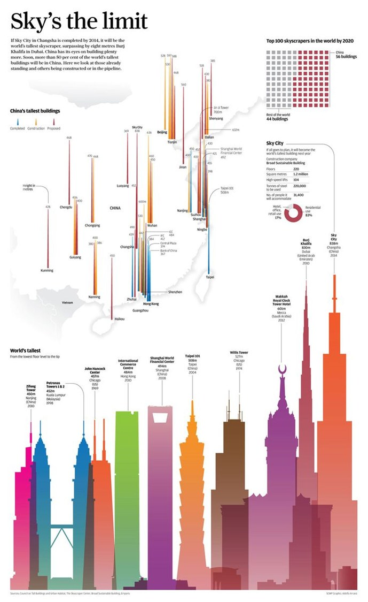

# SGL-01 摩天楼高度对照

课件第 31 页。图题或图中标识 *Sky’s the limit*。

## 数据与信息组织

主体组织有名称的建筑及其高度，局部附中国城市和建筑状态等背景信息。

## 图形与视觉编码

建筑剪影从下方共同底线向上延伸，顶端标注型号或建筑名称和高度。上半部小图补充地理与统计背景。

## 阅读路径与复用

从剪影和高度找到代表建筑，再在顶部小图查看分布。课件的单一图表型在此表现为一个视觉主图统领页面。

[返回本组案例](README.md)
