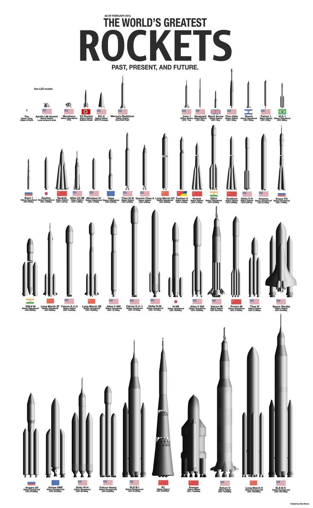

# SGL-02 世界火箭剪影对照

课件第 31 页。图题或图中标识 *The World’s Greatest Rockets*。

## 数据与信息组织

以火箭型号为条目，按若干行列出剪影、名称、国旗及底部文字信息。

## 图形与视觉编码

黑灰剪影突出整体轮廓和相对高低，标签紧靠底线以便在同一行内扫读。

## 阅读路径与复用

先按形态定位型号，再读文字。跨行比较精确高度前，核查各行是否使用同一物理比例或读原始高度标签。

[返回本组案例](README.md)
