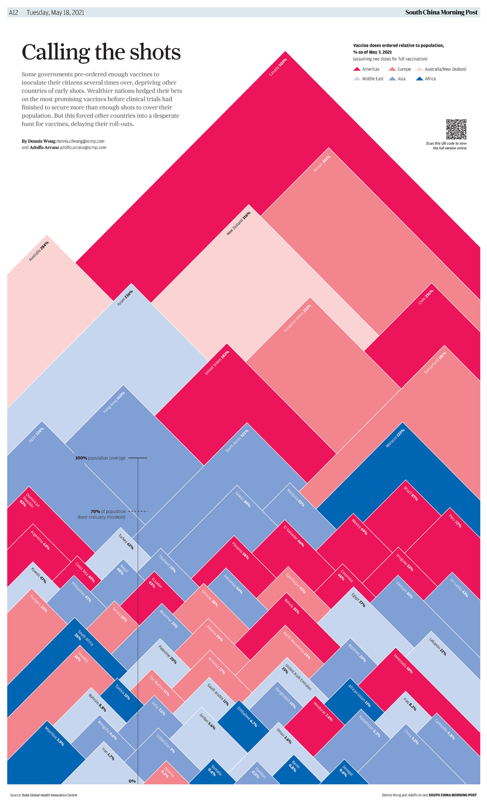

# 案例1｜Calling the Shots：全球疫苗订购比例信息图

> **常用信息图形种类**：10-单一图表型信息图形（Single Chart）  
> **五大数据架构逻辑**：字母表型（Alphabetically）  
> **RAWGraphs 统计图形**：Bar chart（柱状图），进行三角形造型变形  
> **图像来源**：South China Morning Post，《Calling the shots》，2021-05-18。图内数据截至2021-05-07。

## A｜基本的数据逻辑

**字母表型：独立、平行、同构、无强制顺序。**

- **独立性**：各国家是独立的数据单元，不存在国家之间的父子、从属关系。
- **平行性**：所有国家使用同一个核心指标，在同一量化尺度下展示。
- **同构性**：每项有国家名称、所属地理区域、疫苗订购比例等相同字段。
- **可重排性**：对象可按数值高低或地区等方式重新组织；顺序变化不会改变国家本身的数据关系。
- **可比较性**：同一比例指标支持跨国数值对照，但“可以比较”并不意味着在17种信息图形中属于以 A/B 二元对照为主的“比较型”。

**通用抽象**：多个独立对象 → 统一指标 → 数值映射 → 平行展示。

## B｜统计图形、统计方式与计算方式

- **RAWGraphs 对应图形**：**Bar chart（柱状图）**。使用柱状图的“数值→高度”原理，视觉上把矩形柱变为三角形峰形。
- **统计方式**：多类别、单一核心定量指标的比较；另有地理区域作为分类属性。
- **指标计算**：`订购剂次数量 ÷ 国家人口 × 100%`。
- **高度编码**：百分比越大，三角形顶点越高；借助统一的百分比参照辅助判断。
- **参照信息**：图中标记100%人口覆盖、70%群体免疫参考水平；这些属于阅读辅助标记，不代表已实际完成接种。
- **指标限制**：图中比例是“订购剂次／人口”，**不是接种率，也不是完成全程接种人数的比例**；原图注释说明全程接种按两剂假设。
- **非数据通道**：山峰宽度、重叠面积、前后遮挡无明确独立的数值含义，不应当作面积统计或第三维指标。

## C｜视觉编码

| 要素 | 对应编码 | 作用 |
| --- | --- | --- |
| 点 | 三角形顶点 | 提示数值高度 |
| 线 | 峰形斜边、百分比参照线 | 构成连续轮廓，辅助读取 |
| 面 | 重复出现的实心三角形 | 每个面承载一个国家数据，聚合成整体 |
| 体 | 前后错落、遮挡营造空间层次 | 仅是视觉纵深感，不代表真实三维数据 |
| 符号 | 统一的山峰式三角形 | 建立一致的单元图形语言 |
| 色彩 | 不同区域使用不同色系 | 编码大洲／区域类别，帮助分类浏览 |
| 比例 | 垂直高度随百分比变化 | 表示核心定量指标 |
| 字体 | 标题、说明、国家名称及数值分级；名称沿斜边排布 | 在高密度画面中实现直接标注 |
| 版式 | 大峰与小峰错落叠合；标题与图例位于上方 | 利用极值形成焦点，容纳大量独立单元 |

**编码公式**：`国家→三角形`；`订购比例→高度`；`所属区域→颜色`；`国家与比例→文字标签`。

## D｜数据／信息架构

**底层为扁平表格：一个国家一行，同一套字段；不是树状父子节点。**

| 国家 | 所属区域 | 订购比例（%） |
| --- | --- | ---: |
| 加拿大 | 美洲 | 505 |
| 英国 | 欧洲 | 219 |
| 新西兰 | 澳大利亚及新西兰 | 186 |
| 韩国 | 亚洲 | 204 |
| …… | …… | …… |

> 示例数值依据原图可辨识标签整理，仅展示字段结构，并非完整数据集。

- **主题层**：疫苗订购剂次相对于人口的比例。
- **对象层**：多个国家或地区，彼此独立平行。
- **字段层**：国家、区域、订购比例。
- **可视层**：三角形高度表达比例、颜色表达区域、文本直接标明数值。
- **辅助层**：标题说明、图例、参考线和数据来源。

Excel 形态：**多行 × 3个核心字段列**；必要时可附原始“订购剂次”“人口”“日期”列，计算比例后再绘图。

## E｜视觉叙事架构

**主题引入 → 高值焦点 → 整体分布 → 地区识别 → 参照判断。**

1. **主题引入**：用标题和导语说明各国预订疫苗数量差异。
2. **高值焦点**：加拿大等巨大的峰形率先吸引视线，强化极值感。
3. **整体分布**：许多高低不同的峰形统一出现，供读者观察全局。
4. **地区识别**：读者通过颜色，辨认区域类别及其内部国家差异。
5. **参照判断**：结合百分比标签与参考线理解数值水平及不均衡现象。

**叙事规律**：非线性、可跳读；以极值吸引注意，从总体分布转向具体国家。图形中存在量值比较功能，但**不是以两个主体直接对照为结构的“06-比较型信息图形”**。

## 归类理由

- **为什么是字母表型，而非层级型？** 国家之间没有父子关系；高低只表示比例大小，区域颜色只表示分类属性，并不构成主干层级。
- **为什么是10-单一图表型，而非06-比较型？** 全图以一种重复的峰形高度编码表现多国统一指标，并无A/B两组主体的二元比较结构。
- **为什么对应RAWGraphs的 Bar chart？** 统计本质是将各对象的同一数量映射为高度，三角形只是柱状图的视觉变形。

**一句话判断**：字母表型的独立同构数据，借用 RAWGraphs Bar chart 的高度编码，以重复三角形构成单一图表型信息图形。
