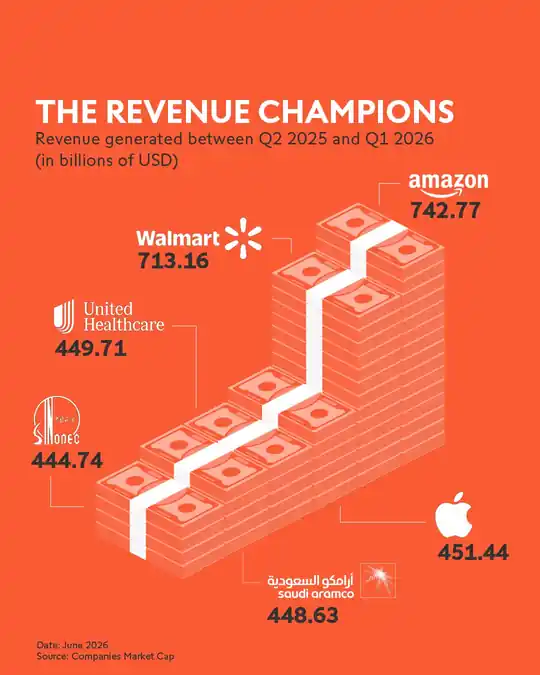

# 案例2分析｜THE REVENUE CHAMPIONS：全球企业营业收入比较

> **五大数据架构逻辑**：**字母表型**（独立、平行、同构、无强制顺序）。  
> **17种常用信息图形种类**：**10-单一图表型信息图形**（Single Chart Infographics）。  
> **借用的 RAWGraphs 统计图形**：**Bar Chart（柱状图）**的类别—数值—高度映射原理；具体采用三维钞票堆的象形化变形。  
> **原图信息**：标题 *THE REVENUE CHAMPIONS*；统计范围“Q2 2025–Q1 2026”；单位“billions of USD”；图注日期“June 2026”；标示来源“Companies Market Cap”。本分析仅依据用户提供的图片，不代表已独立核验企业财报或来源口径。

## 归类判断

- **为什么属于字母表型而非层级型？** 六家企业都是平行的独立对象，采用同一个“营业收入”数值字段；彼此不存在父子、包含、上下级或必须按次序发生的结构关系。**钞票高度的高低、数值大小与排名差异，不等于数据层级**。任意交换企业的图形位置，企业间的底层关系不会改变。
- **为什么归入10-单一图表型？** 全图用一套连续重复的钞票柱体语言展示同一数量指标，标题、Logo、数字均服务于该中心图表。比较是它的**表达目的**，而非必须归入“06-比较型”视觉类型；立体钞票是**造型手段**，也不能仅因有透视就归入“16-三维信息图形”作为主要类别。
- **统计图形对应什么？** 借用 RAWGraphs **Bar Chart** 对多个类别的同单位数值进行比较的基本原理。纸币层数没有不同子分类的含义，故**不是 Stacked Bar Chart（堆叠柱状图）**；原图各钞票堆的几何高度可能不按统一比例精确映射，不能直接将其当成严格尺度柱状图。

## A｜基本的数据逻辑

**字母表型：独立对象 → 统一字段 → 平行比较 → 可选排序。**

| 判断维度 | 本案例特征 |
| --- | --- |
| 最小数据单元 | 一家企业及其对应的营业收入记录 |
| 独立性 | 任意一家企业可单独读取，删去该企业不影响其他企业数据 |
| 平行性 | 企业间没有上级—下级、整体—部分或父—子关系 |
| 同构性 | 每条记录均可整理为“企业名称｜营业收入｜单位｜统计期间” |
| 顺序性 | 逻辑上无固定先后；按收入降序是展示时可选的排序规则 |
| 可比较性 | 所有企业用同一收入指标、同一货币单位进行数值大小比较 |
| 边界 | 一个总标题下列出多个对象，不等于对象被组织为严格的数据层级 |

**可复用公式**：`多个同构独立对象 → 同一数值度量 → 量值对比／排序 → 突出极值`。

## B｜统计图形、统计方式与计算方式

| 项目 | 原图对应 | 统计含义与判断 |
| --- | --- | --- |
| **RAWGraphs 原型：Bar Chart** | 以多个钞票柱体代表企业收入 | 基于单项度量对不同类别进行横向数值比较 |
| 分类变量 | Amazon、Walmart、Apple等六家企业 | 分类名称本身不是连续数值 |
| 数值变量 | 营业收入（十亿美元） | 定量数据，可做大小、差值、倍数或排名比较 |
| 象形图形 | 不断重复的钞票、三维柱体与台阶 | 用金钱符号把收入概念具象化；重复层数不代表独立类别 |
| 直接标注 | 742.77、713.16、451.44等 | 提供精确读数，减少对立体高度估读的依赖 |
| 可选计算 | 差值＝某企业收入－另一企业收入；比值＝前者÷后者 | 例如Amazon较Walmart高29.61（十亿美元）；原图并未单列该差值 |

**重要的准确性边界**：
1. 原图有明显的高度递进、透视和视觉重叠，但未给出共用刻度、零基线或“金额→实际钞票堆高度”的明确比例映射；不能从三维体量直接精确反推收入。
2. 它是**带象形修饰的柱状图思路**，不等于多个分量相加的堆叠柱状图，也不是按体积严格计算的三维统计图。
3. “Q2 2025–Q1 2026”是各企业数值的共同统计窗口，**不是**按季度逐点演进的数据时间轴。

## C｜视觉编码

| 视觉要素 | 图中的具体形式 | 编码功能／限制 |
| --- | --- | --- |
| **点** | 企业Logo、收入数字、钞票顶面小圆形图案 | 前两者是信息识别焦点；钞票印花圆点不代表数据样本 |
| **线** | 细白色转折引导线、层叠钞票的平行纹理线 | 将企业与柱体对应；强化钞票重复堆积感 |
| **面** | 钞票顶面、侧面、白色束带与大面积橙红背景 | 区分纸币方向、建立层次并集中视觉注意 |
| **体** | 轴测／透视的钞票堆及阶梯式高低差 | 用体量隐喻收入规模；纵深和体积并无单独验证的精确定量意义 |
| **符号** | Amazon、Walmart、Apple等品牌标志及纸币形象 | Logo识别对象；纸币把抽象营业收入视觉化 |
| **色彩** | 高饱和橙红底色、浅粉色钞票、白色标记、深色数字 | 品牌之外整体色系统一；用明度差强化层次和可读性 |
| **文字** | 大写粗体主标题、说明副标题、企业Logo字样、加粗数值与底部来源 | 构建“主题／口径→对象／读数→来源”阅读优先级 |
| **位置和尺度** | 图形整体从左下向右上抬升 | 制造空间递进和冠军感，但**不是**企业间上下级结构 |

**核心映射**：`企业 → Logo`；`收入 → 数值标注＋钞票堆高度的视觉暗示`；`对象对应 → 引导线`；`重要性 → 字号／粗细／空间位置`。

**设计优势**：金钱隐喻切题、形态统一且有记忆点；**设计风险**：透视、重叠与非严格比例的高度容易使读者误判数值差异。若用于精确统计，应补足统一基线与数值映射规则。

## D｜数据／信息架构

### 1. 底层数据表

底层是一张**扁平二维表**：**六行企业记录 × 两列核心字段**。日期、单位和来源可作为共用元数据，实际生产时建议各行保留统计口径。

| 企业名称（按收入降序） | 营业收入（十亿美元） |
| --- | ---: |
| Amazon | 742.77 |
| Walmart | 713.16 |
| Apple | 451.44 |
| United Healthcare（原图Logo文字） | 449.71 |
| Saudi Aramco | 448.63 |
| Sinopec | 444.74 |

> 数据仅转录自图片，未独立核验；原图画面位置与数值高低不完全对应。本表按**实际数值**重新排序，不能把画面位置直接当作严格排名。

推荐Excel字段：`企业名称｜营业收入（十亿美元）｜统计区间｜来源｜图形标注位置（可选）`。图形位置是**设计元数据**，不是数据层级。

### 2. 信息呈现层

- **主题层**：THE REVENUE CHAMPIONS＋统计区间／货币单位。
- **对象层**：六个并列的品牌Logo及企业名称。
- **数据层**：每家企业的营业收入数值与对应的钞票堆。
- **说明层**：图注日期与图中标示的数据来源。

**必须区分**：`共同主题 → 各企业数值`是阅读组织结构，不等于企业之间有父子归属；即使视觉上有高低阶梯，底层仍是无层级的平行记录集合。

## E｜视觉叙事架构

**主题亮相 → 纸币象形吸引 → 空间阶梯递进 → 品牌及数字对照 → 领先者印象。**

1. **主题引入**：醒目的大写标题先给出“营收冠军”主题，副标题交代统计范围与单位。
2. **视觉隐喻**：统一的钞票堆图形快速建立“钱／营收”的语义，不需额外解释柱形的含义。
3. **空间递进**：钞票堆呈从左下向右上逐级抬高的走势，将读者视线带向画面高处。
4. **数据比较**：品牌Logo与粗体金额作为近旁直接标签；读者能够独立跳读任意企业。
5. **结论强化**：右上方最高钞票堆对应Amazon及742.77，形成对最大数值的聚焦。

**叙事特征**：空间递进式、极值引导式、非时间型、可跳读；画面阅读路径是**视觉修辞**，不构成不可逆的编年数据逻辑或真正的层级关系。

## 可迁移的规律与判断方法

1. **先看数据结构，再看图形形式**：各对象是否独立、平行、同字段？若是，可归字母表型；“高低”“排名”“阶梯”都不是层级型的充分条件。
2. **区分层级型**：层级型要有真实的父子、包含或归属关系（例如集团→部门→产品线），而不只是“总标题→六家独立企业”。
3. **统计原型与造型分开**：统计原型是 RAWGraphs **Bar Chart** 的类别数值比较；钞票、束带、透视及明度是设计表达。
4. **优先保障数值准确性**：象形图可提高吸引力，但若高度未按同一量尺构造，应以直接数值标注为主，切勿由装饰体积推断精确差距。
5. **对待时间谨慎**：图中文字包含年份／季度，只说明统计覆盖范围；没有按多个时间点展开的记录，就不能判断为编年型或时间轴型。

**一句话结论**：这张图以**字母表型**的独立企业单指标数据为底层结构，借用 **Bar Chart** 的量值比较逻辑，以三维钞票堆和阶梯式空间叙事呈现为**10-单一图表型信息图形**。
