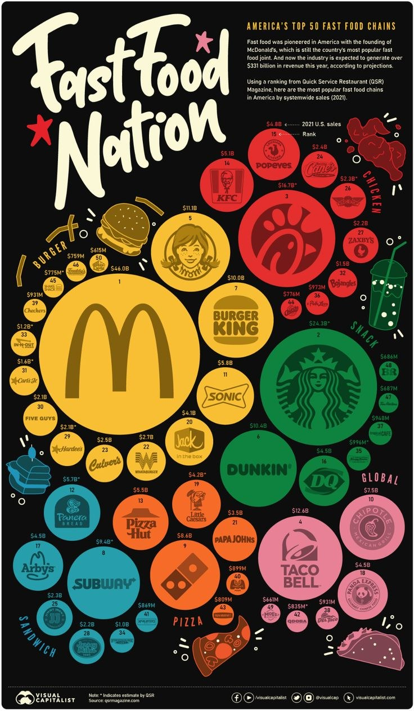

# VTX-01 美国快餐连锁品牌

课件第 32 页。图题或图中标识 *Fast Food Nation*。

## 数据与信息组织

把快餐连锁作为条目，按品类组织，有品牌标志与销售额标签，图内文字给出数据范围。

## 图形与视觉编码

不同颜色的圆形形成品类聚集，圆内用品牌字样或商标定位对象，旁边标出金额。

## 阅读路径与复用

先识别颜色类目，再找品牌及金额。重绘时应核查金额口径，并明确圆面积和数值的对应方式。

[返回本组案例](README.md)
