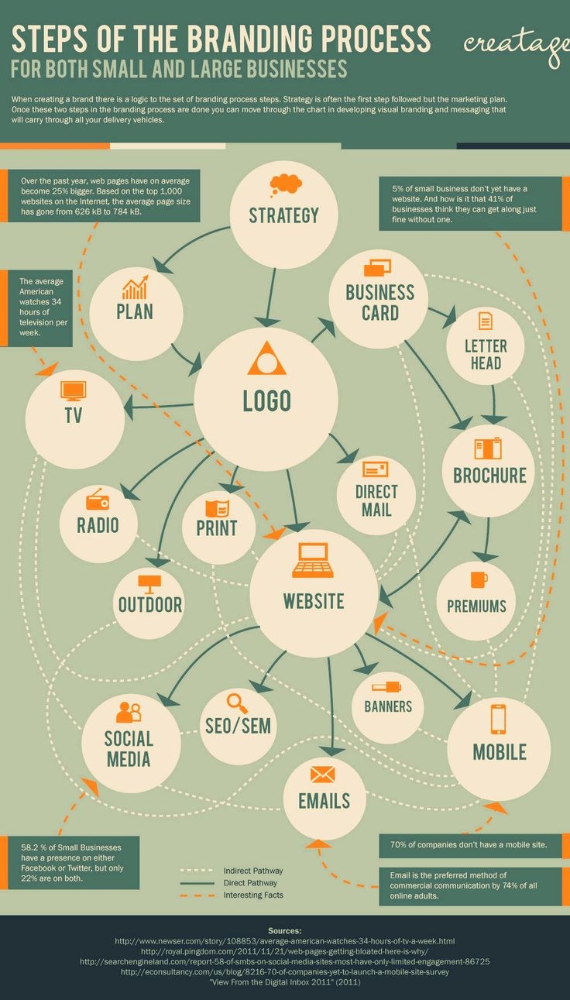

# VTX-02 品牌建设步骤

课件第 32 页。图题或图中标识 *Steps of the Branding Process*。

## 数据与信息组织

将策略、计划、标志和网站等关键词组织成网络，再连到广告、物料与电子传播分支。

## 图形与视觉编码

圆形节点用图标配短词，箭头和虚实路径表示不同连接，四周文本框补充数字或解释。

## 阅读路径与复用

从策略等上游节点开始，沿箭头找可能的后续项目。复用时检查节点文字能否独立读懂，并为路径线型保留图例。

[返回本组案例](README.md)
