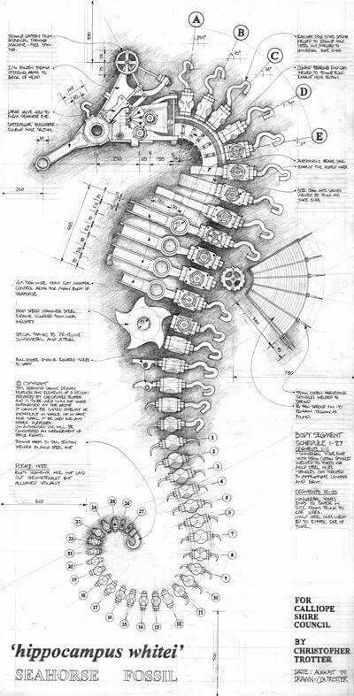

# ANA-01 海马形构件示意

课件第 33 页。图题或图中标识 *Hippocampus whitei / Seahorse Fossil*。

## 数据与信息组织

海马形对象占据主图区，头、身体和卷尾分布着编号、构件线稿与说明。

## 图形与视觉编码

细引线、字母标记和测绘式笔触帮助辨认部位；统一主轮廓为局部分析提供位置参照。

## 阅读路径与复用

先看整体，再跟编号逐部位查阅。按课件画面的拆解方法解读，图的生物学用途和尺寸口径需由原始来源确认。

[返回本组案例](README.md)
