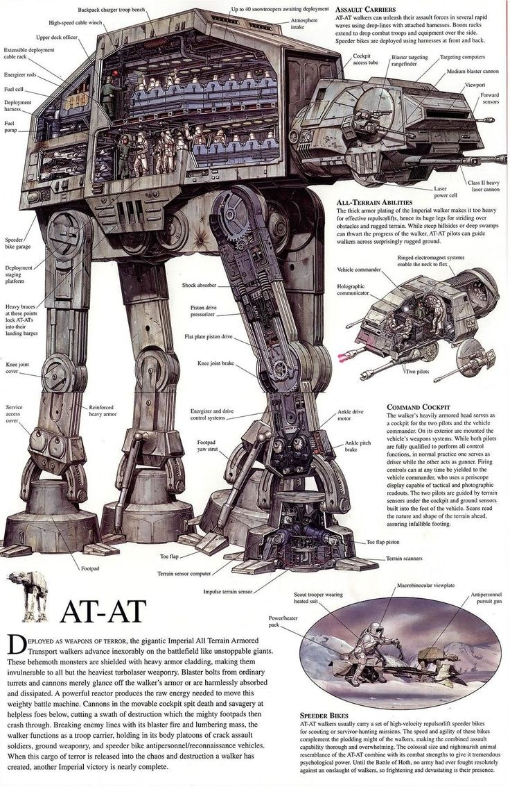

# ANA-02 AT-AT 载具剖视

课件第 33 页。图题或图中标识 *AT-AT cutaway*。

## 数据与信息组织

把虚构载具按机舱、驾驶区、关节和其他部件组织，主剖面之外另有局部透视图。

## 图形与视觉编码

切开外壳后露出内部空间，引线标注元件，放大图处理主体视角不易读到的部位。

## 阅读路径与复用

先比较整体外形和内部空间，再去局部图查阅驾驶舱等细节。保留原图的引线与部件对应。

[返回本组案例](README.md)
