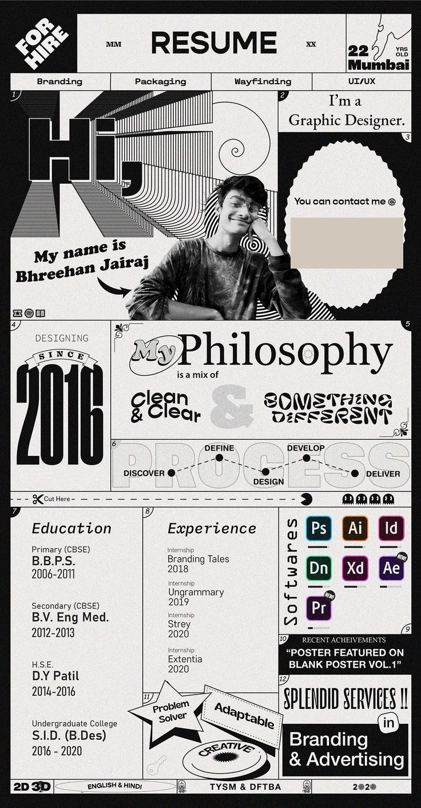

# CV-01 黑白拼版图形设计简历

课件第 34 页。图题或图中标识 *Resume*。

归档图遮盖了直接联系方式。

## 数据与信息组织

页面以职业定位开头，下方独立组织教育、项目经验、软件和近期成就，局部加入设计流程。

## 图形与视觉编码

黑白大字和肖像形成入口，栏线与块标题承载分区，日期和软件图标使重复项目便于扫描。

## 阅读路径与复用

先看职业和经验，再根据目标查看软件或教育背景。联系方式在归档图中已遮盖，模块位置仍可辨认。

[返回本组案例](README.md)
