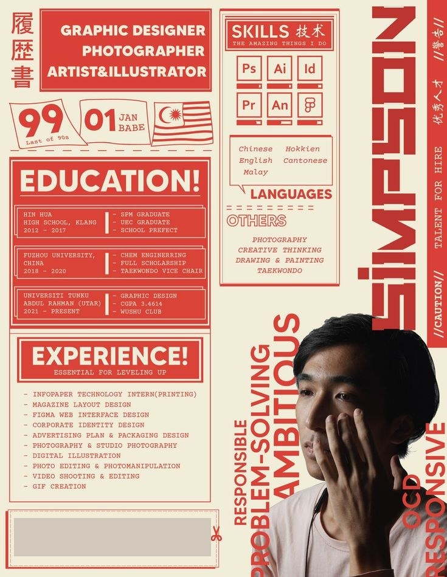

# CV-02 红白模块化设计简历

课件第 34 页。图题或图中标识 *Education / Experience / Skills*。

归档图遮盖了直接联系方式。

## 数据与信息组织

以教育、经验、技能与语言四组组织个人资料，教育以带日期的重复卡片呈现。

## 图形与视觉编码

红底大标题和共同网格建立可扫读结构，肖像与竖向文字定位作者身份，软件图标简化技能列表。

## 阅读路径与复用

先扫主栏目判断相关经历，再读卡片细项。联系方式在归档图中已遮盖，版面布局保留。

[返回本组案例](README.md)
