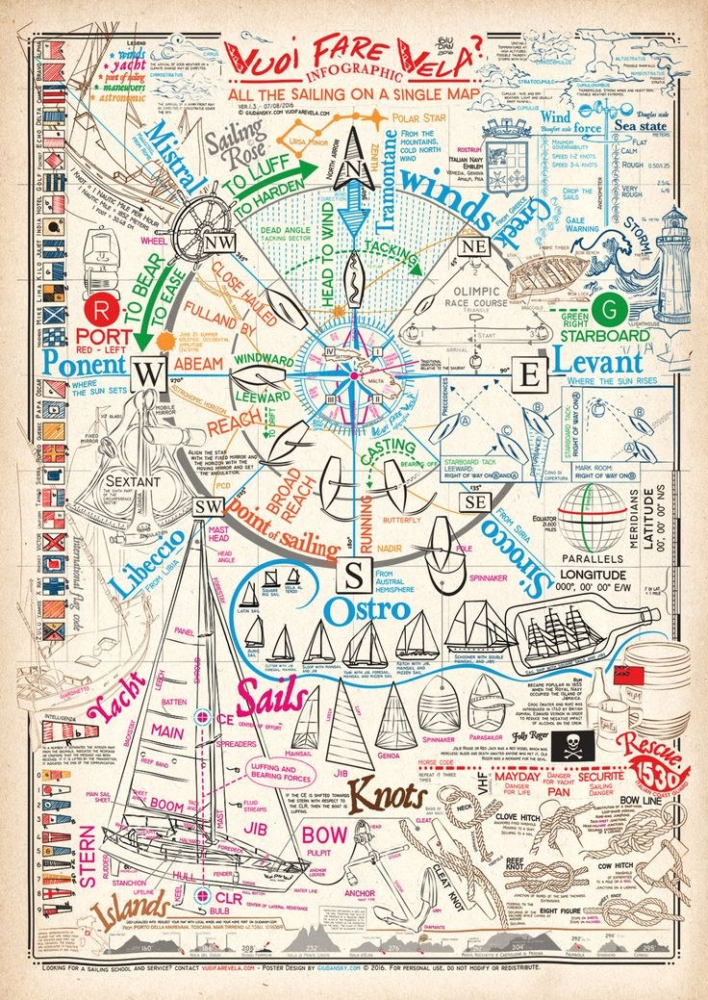

# SK-01 航海知识手绘图

课件第 35 页。图题或图中标识 *Vuoi fare vela?*。

## 数据与信息组织

把风向、航行方式、帆具、绳结和信号旗编目到同一张图，主图区用罗盘组织方向。

## 图形与视觉编码

中心罗盘和色彩把方向分开，手写字和线稿串联术语与图示，小边栏存放短符号条目。

## 阅读路径与复用

先定位方位与帆船示意，再沿具体术语看周边图。复用时可保持核心参照突出，外围条目采用一致的标签位置。

[返回本组案例](README.md)
