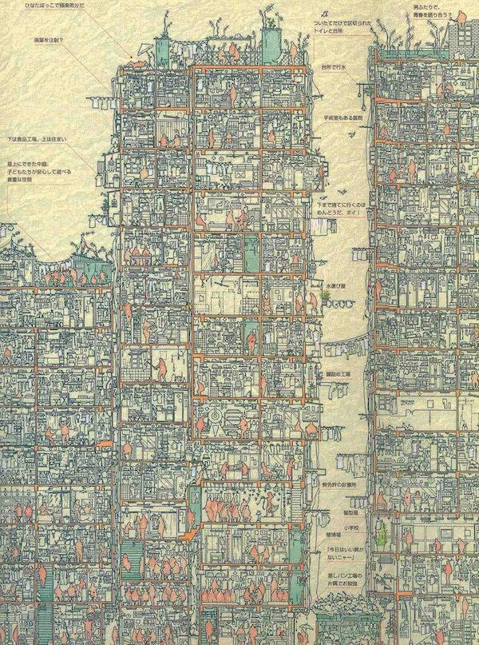

# SK-02 密集建筑群剖面手稿

课件第 35 页。图题或图中标识 *建筑剖面手稿*。

## 数据与信息组织

以建筑剖面为整体框架，用楼层、房间和通道容纳大量重复细节及引线注释。

## 图形与视觉编码

同一剖切视角表现内部空间。细线区分墙、楼层和设施，局部色彩标出视觉重点。

## 阅读路径与复用

可先以楼层和竖向结构定位，再查看房间。需要准确查找时可加楼层编号和局部索引。

[返回本组案例](README.md)
