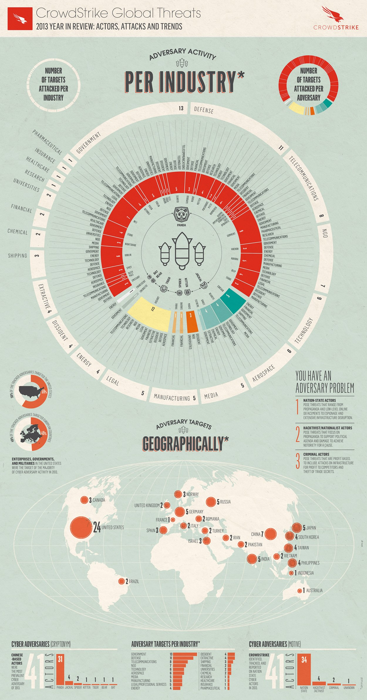

# CC-01 2013 年度回顾的环形版

课件第 36 页。图题或图中标识 *CrowdStrike Global Threats 2013 Year in Review*。

## 数据与信息组织

以上部双环分组展示行业、活动方和目标，地图按地点汇总，底部条形图提供计数对照。

## 图形与视觉编码

环形条带和颜色区分对象，地理圆点与数字定位地区，底部对齐条长和标签。

## 阅读路径与复用

先从年度和行业概览进入，再按地区或类别查阅。2013 是共同统计期，环内分段可按图例查类别。

[返回本组案例](README.md)
